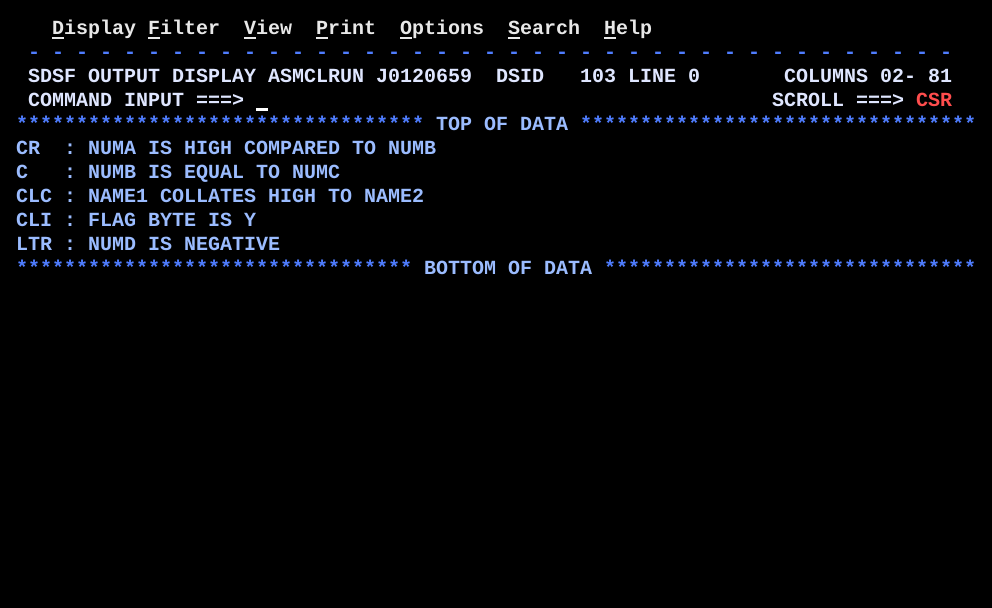

# BR01CMP.asm

## Program Overview

BR01CMP demonstrates how HLASM compare instructions set the condition code (CC) and how extended branch mnemonics test it. It runs five independent examples, one per compare instruction (`CR`, `C`, `CLC`, `CLI`, `LTR`). Each example picks a message with a conditional branch and writes one 50-character line to SYSOUT.

Program data:

| Field | Value | Used by |
|---|---|---|
| NUMA | 100 | Example 1 |
| NUMB | 50 | Examples 1 and 2 |
| NUMC | 50 | Example 2 |
| NUMD | -25 | Example 5 |
| NAME1 | `SMITH   ` (8 bytes) | Example 3 |
| NAME2 | `JONES   ` (8 bytes) | Example 3 |
| FLAG | `Y` (1 byte) | Example 4 |

Output:

```
CR  : NUMA IS HIGH COMPARED TO NUMB
C   : NUMB IS EQUAL TO NUMC
CLC : NAME1 COLLATES HIGH TO NAME2
CLI : FLAG BYTE IS Y
LTR : NUMD IS NEGATIVE
```



## How the Program Works

**Linkage and I/O.** The entry linkage, save area, `OPEN`, `CLOSE`, exit linkage and the SYSOUT DCB follow the same pattern as HELLO and REGCALC.

**Pattern for every example.**
1. `MVC OUTMSG(80),BLANKS` clears the output line.
2. A compare instruction sets the CC.
3. A conditional branch tests the CC and jumps to the code for the matching case.
4. `MVC OUTMSG(50),message` copies the selected 50-byte message into the buffer.
5. `PUT SYSOUT,OUTMSG` writes the line.
6. After every selected message except the last one in each block, an unconditional `B` skips the other messages and goes to the `PUT`.

**Execution trace with the test data.**

| Example | Instructions | CC | Branches | Message written |
|---|---|---|---|---|
| 1 | `L 3,NUMA` (100), `L 4,NUMB` (50), `CR 3,4` | 2 (high) | `BE` not taken, `BL` not taken, `B EX1HIGH` taken | `CR  : NUMA IS HIGH COMPARED TO NUMB` |
| 2 | `L 3,NUMB` (50), `C 3,NUMC` | 0 (equal) | `BNE` not taken, falls into the equal text, `B EX2PUT` | `C   : NUMB IS EQUAL TO NUMC` |
| 3 | `CLC NAME1(8),NAME2` | 2 (high) | `BNH` not taken, falls into the high text, `B EX3PUT` | `CLC : NAME1 COLLATES HIGH TO NAME2` |
| 4 | `CLI FLAG,C'Y'` | 0 (equal) | `BE EX4YES` taken | `CLI : FLAG BYTE IS Y` |
| 5 | `L 5,NUMD` (-25), `LTR 5,5` | 1 (negative) | `BZ` not taken, `BM EX5NEG` taken | `LTR : NUMD IS NEGATIVE` |

**Example 3 in detail.** `CLC` compares byte by byte from the left and stops at the first difference. The first byte of NAME1 is `S` (X'E2') and the first byte of NAME2 is `J` (X'D1'). X'E2' is greater than X'D1', so the first operand is high and CC is 2.

**Example 5 in detail.** `LTR 5,5` loads R5 into itself and sets the CC from its value. R5 is -25, so CC is 1 (negative) and `BM` is taken.

## Concepts Demonstrated

- The condition code and how compare instructions set it
- Signed (arithmetic) compare versus logical (unsigned) compare
- Comparing registers, a register with storage, storage with storage, and storage with an immediate byte
- Extended branch mnemonics and the branch mask behind them
- If/else and three-way decision structures built from branches
- Testing a register's sign with `LTR`
- Selecting a message by branch and writing it with `PUT`

## How the Concepts Are Implemented

| Concept | Implementation |
|---|---|
| Condition code | Compare instructions set CC 0 (equal), 1 (first operand low) or 2 (first operand high). `LTR` sets CC 0 (zero), 1 (negative) or 2 (positive). The program header lists CC 3 (overflow), but compare instructions never set it. |
| Signed register compare | `CR 3,4` compares two registers as signed binary numbers. `C 3,NUMC` compares a register with a fullword in storage the same way. |
| Logical storage compare | `CLC NAME1(8),NAME2` compares 8 bytes from left to right as unsigned values in EBCDIC order. The explicit length `(8)` sets how many bytes are compared. |
| Byte compare with immediate | `CLI FLAG,C'Y'` compares one storage byte with an immediate character. `FLAG DC C'Y'` is one byte. |
| Test a register | `LTR 5,5` sets the CC from a register's value. No constant or second operand is needed. |
| Branch mnemonics | `BE`, `BL`, `BNE`, `BNH`, `BZ`, `BM` and `B` are extended mnemonics for `BC mask,target`. The mask has one bit per CC value (8, 4, 2, 1). The branch is taken when the bit for the current CC is on. `BE`/`BZ` = 8, `BL`/`BM` = 4, `BH`/`BP` = 2, `BNE` = 7, `BNH` = 13, `B` = 15. |
| Three-way decision | Example 1: `BE EX1EQ`, `BL EX1LOW`, then `B EX1HIGH`. The unconditional branch handles the remaining case, high. |
| Two-way decision | Examples 2 to 4. A conditional branch jumps over one case, and an unconditional `B` skips the other case before the shared `PUT` label. |
| Join labels | `EX1PUT`, `EX2PUT`, `EX3PUT`, `EX4PUT` and `EX5PUT` mark where the paths meet. Each example has its own labels, prefixed by the example number. |
| Fixed-length messages | Each message constant is `CL50`, so every selection uses `MVC OUTMSG(50),msg` with the same length. The text is padded with blanks to 50. |
| Buffer clearing | `MVC OUTMSG(80),BLANKS` before each example removes text from the previous line. |

## Key Takeaways

- Compare first, branch second. The CC stays valid until another instruction changes it, so keep only instructions that do not change the CC (such as `MVC` and `L`) between the compare and the branch.
- `CR` and `C` are signed, while `CLC` and `CLI` are logical. A negative number is low in a signed compare, but the same bit pattern is high in a logical compare. Characters in EBCDIC compare by their hex values.
- `BNH` means "not high", so it also branches when the CC is 0 (equal). Choose between `BNH`, `BL` and `BE` to match the condition you intend.
- Each decision block needs an unconditional `B` to a join label. Without it, the "else" message is also copied and overwrites the first one.
- `CLC` compares only the length you code. `CLC NAME1(8),NAME2` compares 8 bytes, which matches the 8-byte name fields. A shorter length would compare only a prefix.
- `LTR r,r` is the standard way to test whether a register is zero, negative or positive without a comparison value.
- With this test data, seven of the twelve messages are never displayed (`MSG1EQ`, `MSG1LO`, `MSG2NE`, `MSG3NH`, `MSG4NO`, `MSG5POS`, `MSG5ZER`). Change `NUMA`, `NUMB`, `NUMC`, `NUMD`, `NAME1`, `NAME2` or `FLAG` and rerun to exercise the other branches.
- All messages are `CL50` and the buffer is `CL80`, so changing a message length requires changing the matching `MVC` lengths.
