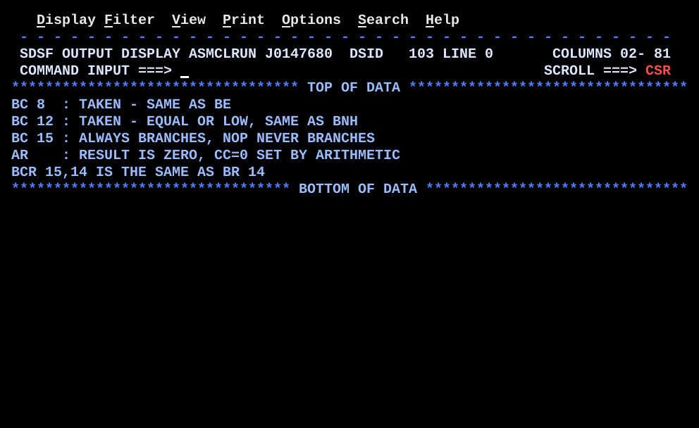

# BR02MASK.asm

## Program Overview

BR02MASK shows that every extended branch mnemonic (`BE`, `BH`, `BL`, `BZ`, `B`, `NOP`, `BR` and so on) is an alias for `BC mask,target` (or `BCR mask,reg`). It runs five examples that use the raw mask forms: `BC 8`, `BC 12`, `BC 15` with `NOP`, `BZ` after arithmetic, and `BCR 15,14`. Each example selects a message and writes one 50-character line to SYSOUT.

Program data:

| Field | Value | Used by |
|---|---|---|
| NUMA | 40 | Examples 1 and 2 |
| NUMB | 40 | Example 1 |
| NUMC | 90 | Example 2 |
| NUMD | 25 | Example 4 |
| NUME | -25 | Example 4 |

Output:

```
BC 8  : TAKEN - SAME AS BE
BC 12 : TAKEN - EQUAL OR LOW, SAME AS BNH
BC 15 : ALWAYS BRANCHES, NOP NEVER BRANCHES
AR    : RESULT IS ZERO, CC=0 SET BY ARITHMETIC
BCR 15,14 IS THE SAME AS BR 14
```



## How the Program Works

**Linkage and I/O.** The entry linkage, save area, `OPEN`, `CLOSE` and the SYSOUT DCB follow the same pattern as HELLO, REGCALC and BR01CMP. The exit linkage ends with `BCR 15,14` in place of `BR 14`. They assemble to the same instruction.

**Pattern for every example.**
1. `MVC OUTMSG(80),BLANKS` clears the output line.
2. An instruction sets the CC (a compare in Examples 1 and 2, `AR` in Example 4).
3. A `BC` written with an explicit mask tests the CC.
4. `MVC OUTMSG(50),message` copies the selected 50-byte message into the buffer.
5. `PUT SYSOUT,OUTMSG` writes the line.
6. An unconditional `B` skips the other path before the shared `PUT` label.

**Execution trace with the test data.**

| Example | Instructions | CC | Branches | Message written |
|---|---|---|---|---|
| 1 | `L 3,NUMA` (40), `C 3,NUMB` (40) | 0 (equal) | `BC 8,EX1EQ` taken | `BC 8  : TAKEN - SAME AS BE` |
| 2 | `L 3,NUMA` (40), `C 3,NUMC` (90) | 1 (low) | `BC 12,EX2NH` taken | `BC 12 : TAKEN - EQUAL OR LOW, SAME AS BNH` |
| 3 | `NOP EX3BAD`, `BC 15,EX3GOOD` | not tested | `NOP` (mask 0) never taken, `BC 15` always taken | `BC 15 : ALWAYS BRANCHES, NOP NEVER BRANCHES` |
| 4 | `L 4,NUMD` (25), `L 5,NUME` (-25), `AR 4,5` | 0 (zero) | `BZ EX4ZERO` taken | `AR    : RESULT IS ZERO, CC=0 SET BY ARITHMETIC` |
| 5 | none | not tested | none | `BCR 15,14 IS THE SAME AS BR 14` |

**Example 2 in detail.** Mask 12 is 8 (equal) plus 4 (low). `C 3,NUMC` compares 40 with 90, so the first operand is low and CC is 1. The mask has the CC 1 bit on, so the branch is taken and the "not high" path runs.

**Example 3 in detail.** `NOP EX3BAD` is `BC 0,EX3BAD`. No mask bit is on, so it never branches and execution continues with `BC 15,EX3GOOD`. Every mask bit is on, so that branch is always taken. The path at `EX3BAD` prints a logic-error message and is never reached.

**Example 4 in detail.** `AR 4,5` adds -25 to 25. The result is zero, so the CC is 0 with no separate compare. `BZ` assembles to `BC 8`, which tests CC 0.

**Example 5 in detail.** Example 5 only prints a message. The instruction it describes, `BCR 15,14`, is executed at the end of the program as the return to the caller.

## Concepts Demonstrated

- The branch mask as a 4-bit selector on the condition code
- Extended branch mnemonics as aliases for `BC` with fixed masks
- Combining mask bits to branch on more than one CC value
- Unconditional (mask 15) and never-taken (mask 0) branches
- Arithmetic instructions setting the CC without a compare
- `BCR` and branching to an address in a register
- Using `BCR 15,14` as the return instruction

## How the Concepts Are Implemented

| Concept | Implementation |
|---|---|
| Branch mask | `BC mask,target` has a 4-bit mask. Each bit selects one CC value: 8 for CC 0, 4 for CC 1, 2 for CC 2, 1 for CC 3. The branch is taken when the bit for the current CC is on. |
| Mnemonic equivalence | `BE`/`BZ` = `BC 8`, `BL`/`BM` = `BC 4`, `BH`/`BP` = `BC 2`, `BO` = `BC 1`, `BNE`/`BNZ` = `BC 7`, `BNL`/`BNM` = `BC 11`, `BNH`/`BNP` = `BC 13`, `BNO` = `BC 14`, `B` = `BC 15`, `NOP` = `BC 0`. Example 1 writes `BC 8,EX1EQ` where BR01CMP wrote `BE EX1EQ`. |
| Combined masks | Example 2 uses `BC 12`, which is 8 + 4 (CC 0 or CC 1). After a compare this is "equal or low", the same as `BNH` ("not high"). |
| Always and never | `BC 15,EX3GOOD` has every bit on, so it always branches. `NOP EX3BAD` has no bit on, so it never branches. The unreachable path (`MSG3BAD`) shows a mistake if the logic were wrong. |
| CC from arithmetic | `AR 4,5` sets CC 0 (zero), 1 (negative), 2 (positive) or 3 (overflow). `BZ EX4ZERO` tests the result with no compare. |
| BCR | `BCR 15,14` branches to the address in R14 when the mask matches the CC. With mask 15 it always branches, and it assembles to the same instruction as `BR 14`. |
| Fall-through layout | Examples 1, 2 and 4 put the "not taken" message right after the `BC`, then `B` to the `PUT`. The "taken" message sits at the branch target and falls into the `PUT`. |
| Fixed-length messages | Each message constant is `CL50`, so every selection uses `MVC OUTMSG(50),msg` with the same length. The text is padded with blanks to 50. |
| Buffer clearing | `MVC OUTMSG(80),BLANKS` before each example removes text from the previous line. |

## Key Takeaways

- An extended mnemonic is a readable name for a mask. If you know the four mask bits (8, 4, 2, 1), you can read or write any conditional branch as `BC mask,target`.
- Add mask bits to branch on several conditions. `BC 12` is equal or low (8 + 4), `BC 7` is not equal (4 + 2 + 1) and `BC 13` is not high (8 + 4 + 1).
- `BNH` assembles to `BC 13`, which includes CC 3. After a compare, CC 3 never occurs, so `BC 12` and `BNH` behave the same. After arithmetic, CC 3 means overflow and the two differ.
- The same mask has different names depending on what set the CC. `BL` after a compare and `BM` after arithmetic are both `BC 4`. `BH` and `BP` are both `BC 2`. `BE` and `BZ` are both `BC 8`. Pick the name that matches the instruction before it.
- Arithmetic instructions set the CC, so `AR 4,5` followed by `BZ` needs no compare. The branch must come before any instruction that changes the CC.
- Mask 15 is `B` and mask 0 is `NOP`. `NOP` is a four-byte instruction that does nothing, which makes it useful as a filler or placeholder.
- `BCR 15,14` and `BR 14` are the same instruction, so every program in this series has returned to its caller with a `BCR` all along. If the register field of `BCR` is 0, the instruction never branches.
- With this test data, four of the nine messages are never displayed (`MSG1NE`, `MSG2HI`, `MSG3BAD`, `MSG4NZ`). Change `NUMA`, `NUMB`, `NUMC`, `NUMD` or `NUME` and rerun to exercise the other paths.
- `MSG3BAD` is a self-check. If it ever prints, the branch logic is wrong.
- All messages are `CL50` and the buffer is `CL80`, so changing a message length requires changing the matching `MVC` lengths.
