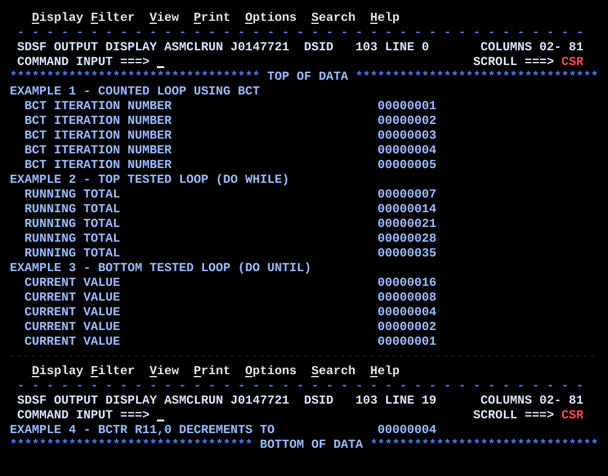

# BR03LOOP.asm

## Program Overview

BR03LOOP builds the three common loop shapes by hand in HLASM: a counted loop with `BCT`, a top-tested loop (DO WHILE) with `C` and a conditional branch, and a bottom-tested loop (DO UNTIL) with `LTR` and `BNZ`. A fourth example shows `BCTR r,0` as a one-instruction "subtract one". Each pass through a loop writes one line to SYSOUT with a label and an 8-digit number.

Program data:

| Field | Value | Used by |
|---|---|---|
| COUNT5 | 5 | Examples 1 and 4 (`BCT` count, `BCTR` input) |
| LIMIT | 30 | Example 2 (DO WHILE limit) |
| STEP7 | 7 | Example 2 (increment) |
| START16 | 16 | Example 3 (starting value) |

Registers used:

| Register | Role |
|---|---|
| R6 | Example 1 loop counter (`BCT`) |
| R7 | Example 1 iteration number |
| R8 | Example 2 running total |
| R9 | Example 2 increment |
| R10 | Example 3 value being halved |
| R11 | Example 4 value for `BCTR` |

Output (19 lines, shown on two SDSF screens):

```
EXAMPLE 1 - COUNTED LOOP USING BCT
  BCT ITERATION NUMBER                            00000001
  BCT ITERATION NUMBER                            00000002
  BCT ITERATION NUMBER                            00000003
  BCT ITERATION NUMBER                            00000004
  BCT ITERATION NUMBER                            00000005
EXAMPLE 2 - TOP TESTED LOOP (DO WHILE)
  RUNNING TOTAL                                   00000007
  RUNNING TOTAL                                   00000014
  RUNNING TOTAL                                   00000021
  RUNNING TOTAL                                   00000028
  RUNNING TOTAL                                   00000035
EXAMPLE 3 - BOTTOM TESTED LOOP (DO UNTIL)
  CURRENT VALUE                                   00000016
  CURRENT VALUE                                   00000008
  CURRENT VALUE                                   00000004
  CURRENT VALUE                                   00000002
  CURRENT VALUE                                   00000001
EXAMPLE 4 - BCTR R11,0 DECREMENTS TO              00000004
```



## How the Program Works

**Linkage and I/O.** The entry linkage, save area, `OPEN`, `CLOSE`, exit linkage (`BR 14`) and SYSOUT DCB follow the same pattern as the earlier programs.

**Output line format.** Each message constant is `CL50`. A pass through a loop clears the buffer, copies a 50-byte label with `MVC OUTMSG(50),msg`, converts the number with `CVD`, `UNPK` and `OI ZONE+7,X'F0'`, places the 8 digits at `OUTMSG+50(8)`, and writes the line with `PUT`. The number therefore starts in column 51 of each line. The first three examples also write a heading line before their loop.

**Example 1: counted loop with BCT.**
1. `L 6,COUNT5` sets R6 to 5, and `SR 7,7` sets R7 to 0.
2. At `LOOP1`, `LA 7,1(,7)` adds 1 to R7 and the line is written with R7.
3. `BCT 6,LOOP1` subtracts 1 from R6 and branches back while R6 is not zero.
4. The body runs 5 times and prints 1 to 5.

**Example 2: top-tested loop (DO WHILE).**
1. `SR 8,8` sets the total to 0 and `L 9,STEP7` loads the increment 7.
2. At `LOOP2`, `C 8,LIMIT` compares the total with 30 and `BH LOOP2END` leaves the loop when the total is high.
3. Otherwise `AR 8,9` adds 7, the line is written, and `B LOOP2` returns to the test.
4. The totals tested are 0, 7, 14, 21, 28 and 35. Each of the first five passes the test and prints the new total (7, 14, 21, 28, 35). At 35 the test fails and the loop ends at `LOOP2END`.

**Example 3: bottom-tested loop (DO UNTIL).**
1. `L 10,START16` loads 16.
2. At `LOOP3`, the current value is written first.
3. `SRL 10,1` shifts right one bit, which halves the value. `LTR 10,10` sets the CC from the new value and `BNZ LOOP3` repeats while it is not zero.
4. The values written are 16, 8, 4, 2 and 1. After 1 the shift gives 0, so the loop ends.

**Example 4: BCTR r,0.** `L 11,COUNT5` loads 5, `BCTR 11,0` subtracts 1 without branching (a second operand of 0 means no branch), and the result 4 is displayed.

## Concepts Demonstrated

- Counted loops with `BCT`
- Top-tested (DO WHILE) and bottom-tested (DO UNTIL) loop structures
- Loop exit by a conditional branch to a label after the loop
- Incrementing with `LA` and decrementing with `BCTR r,0`
- Halving a value with a logical right shift (`SRL`)
- Testing a register with `LTR` after an instruction that does not set the CC
- Zero-length labels with `DS 0H`
- Building a repeated output line from a label and a number

## How the Concepts Are Implemented

| Concept | Implementation |
|---|---|
| Counted loop | `L 6,COUNT5` sets the count. `BCT 6,LOOP1` subtracts 1 from R6 and branches to `LOOP1` while R6 is not zero. `BCT` does not change the condition code and needs no compare. |
| Iteration counter | `SR 7,7` clears R7 and `LA 7,1(,7)` adds 1 on each pass. `LA` adds the displacement 1 to the register without using a storage operand. |
| Top-tested loop | `LOOP2` starts with `C 8,LIMIT` and `BH LOOP2END`. The test comes before the body, so the body runs only while the total is not high, and could run zero times. |
| Loop exit label | `LOOP2END DS 0H` defines a label at the next instruction, with halfword alignment and no storage. `BH LOOP2END` branches to it. |
| Bottom-tested loop | `LOOP3` runs the body, then `SRL 10,1`, `LTR 10,10` and `BNZ LOOP3` at the bottom. The body runs at least once. |
| Divide by 2 | `SRL 10,1` shifts the register right by one bit. For a non-negative value this equals division by 2. `SRL` does not set the CC, so `LTR` follows it. |
| BCTR | `BCTR 11,0` subtracts 1 from R11. When the second register is 0 no branch is taken, so it works as a decrement. |
| Number display | `CVD`, `UNPK ZONE,DOUBLE`, `OI ZONE+7,X'F0'` and `MVC OUTMSG+50(8),ZONE` convert the binary register to 8 printable digits, as in REGCALC. |
| Repeated output | `MVC OUTMSG(80),BLANKS` at the start of each pass clears the line before the label and number are placed. |
| Loop control data | `COUNT5`, `LIMIT`, `STEP7` and `START16` are fullword constants, so the loop bounds are changed in storage and not in the instructions. |

## Key Takeaways

- `BCT` is the standard "do N times" loop. Load a positive count, put the body between a label and the `BCT`, and let `BCT` count down. If the count is 0 on entry, the first `BCT` makes it -1 (all ones), which is not zero, so the loop would run about 4 billion times. Guard a count that may be zero with `LTR` and `BZ` before the loop.
- A top-tested loop checks before the body, so it may run zero times. A bottom-tested loop checks after the body, so it always runs at least once. Pick the shape that matches what should happen when there is no work.
- In Example 2 the last printed total (35) is above `LIMIT` (30), because the test is on the total before the addition. The loop ends only when the next test sees 35.
- The exit branch for the top-tested loop is `BH` (leave when high), and the repeat branch for the bottom-tested loop is `BNZ` (repeat while not zero). Write the branch for the condition that ends or continues the loop, not its opposite.
- `SRL` and `BCT` do not set the CC. Add `LTR` (or a compare) before a conditional branch that depends on a new value.
- `BCTR r,0` is the shortest way to subtract 1 and is common for turning a length into the length-1 value that `EX` needs.
- Give each loop its own labels (`LOOP1`, `LOOP2`, `LOOP2END`, `LOOP3`) so branches go to the correct loop.
- The header comment mentions `BCTR 7,0`, but Example 4 uses R11. The comment on the `MVC OUTMSG(50),MSG4` line also says `'BCTR R11,0 GIVES'`, while the message text is `EXAMPLE 4 - BCTR R11,0 DECREMENTS TO`. The code is correct, so update those two comments if you want them to match.
- All messages are `CL50` and the number goes at `OUTMSG+50`, so changing a message length requires changing the offset and the `MVC` lengths.
- The 19 output lines do not fit one 24-row 3270 screen with the SDSF header rows. SDSF shows lines 1 to 18 on the first screen (`LINE 0`) and Example 4 on the second (`LINE 19`).
