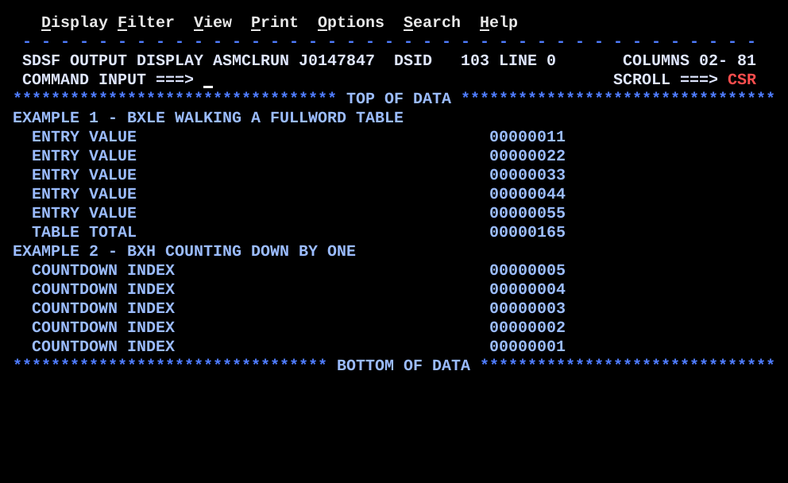

# BR04BXLE.asm

## Program Overview

BR04BXLE demonstrates the index-loop instructions `BXLE` (branch on index low or equal) and `BXH` (branch on index high). Example 1 uses `BXLE` to walk a table of five fullwords by address and add the entries. Example 2 uses `BXH` with a negative increment to count down from 5 to 1. Each pass writes one line to SYSOUT with a label and an 8-digit number.

Program data:

| Field | Value | Used by |
|---|---|---|
| TABLE | 11, 22, 33, 44, 55 (five fullwords) | Example 1 |
| START5 | 5 | Example 2 (starting index) |
| INCLIM | -1, then 0 (two adjacent fullwords) | Example 2 (increment and limit, loaded with `LM`) |

Registers used:

| Register | Role |
|---|---|
| R3 | Table element loaded in each pass of Example 1 |
| R5 | Example 1 running total |
| R6 | Index: table address (Example 1) or count (Example 2) |
| R8 | Increment: 4 (Example 1) or -1 (Example 2) |
| R9 | Limit: address of last entry (Example 1) or 0 (Example 2) |

Output (13 lines):

```
EXAMPLE 1 - BXLE WALKING A FULLWORD TABLE
  ENTRY VALUE                                     00000011
  ENTRY VALUE                                     00000022
  ENTRY VALUE                                     00000033
  ENTRY VALUE                                     00000044
  ENTRY VALUE                                     00000055
  TABLE TOTAL                                     00000165
EXAMPLE 2 - BXH COUNTING DOWN BY ONE
  COUNTDOWN INDEX                                 00000005
  COUNTDOWN INDEX                                 00000004
  COUNTDOWN INDEX                                 00000003
  COUNTDOWN INDEX                                 00000002
  COUNTDOWN INDEX                                 00000001
```



## How the Program Works

**Linkage and I/O.** The entry linkage, save area, `OPEN`, `CLOSE`, exit linkage (`BR 14`) and SYSOUT DCB follow the same pattern as the earlier programs.

**Output line format.** Each message constant is `CL50`. A pass clears the buffer, copies a 50-byte label with `MVC OUTMSG(50),msg`, converts the number with `CVD`, `UNPK` and `OI ZONE+7,X'F0'`, places the 8 digits at `OUTMSG+50(8)`, and writes the line with `PUT`. The number starts in column 51.

**Example 1: BXLE over a table.**
1. `SR 5,5` clears the total. `LA 6,TABLE` points R6 at the first entry.
2. `LA 8,4` sets the increment to the entry length. `LA 9,TABLE+16` points R9 at the last entry (4 x 4 bytes past the start).
3. At `LOOP1`, `L 3,0(,6)` loads the element R6 points at, `AR 5,3` adds it to the total, and a line is written.
4. `BXLE 6,8,LOOP1` adds R8 to R6, then compares R6 with R9. It branches back while R6 is less than or equal to R9.
5. R6 takes the values TABLE, +4, +8, +12, +16 (the body runs for each) and then TABLE+20, which is above R9, so the loop ends.
6. The total 165 (11 + 22 + 33 + 44 + 55) is written.

**Example 2: BXH countdown.**
1. `L 6,START5` sets R6 to 5. `LM 8,9,INCLIM` loads R8 = -1 and R9 = 0 from two adjacent fullwords in one instruction.
2. At `LOOP2`, the current index is written.
3. `BXH 6,8,LOOP2` adds -1 to R6, then compares R6 with R9. It branches back while R6 is greater than R9.
4. The values written are 5, 4, 3, 2 and 1. After 1, R6 becomes 0, which is not greater than 0, so the loop ends.

**Execution trace.**

| Pass | Instruction | R6 before | R6 after | Compare with R9 | Result |
|---|---|---|---|---|---|
| Ex 1, 1 | `BXLE 6,8,LOOP1` | TABLE | TABLE+4 | low | branch |
| Ex 1, 2 to 4 | `BXLE 6,8,LOOP1` | TABLE+4 to +12 | TABLE+8 to +16 | low or equal | branch |
| Ex 1, 5 | `BXLE 6,8,LOOP1` | TABLE+16 | TABLE+20 | high | fall through |
| Ex 2, 1 to 4 | `BXH 6,8,LOOP2` | 5 to 2 | 4 to 1 | high (above 0) | branch |
| Ex 2, 5 | `BXH 6,8,LOOP2` | 1 | 0 | equal | fall through |

## Concepts Demonstrated

- Index loops with `BXLE` and `BXH`
- The index, increment and limit register triple, with the even-odd register pair rule
- Walking a table by address instead of by a subscript
- Counting down with a negative increment
- Loading two adjacent fullwords into a register pair with `LM`
- One instruction that increments, compares and branches
- Building a repeated output line from a label and a number

## How the Concepts Are Implemented

| Concept | Implementation |
|---|---|
| Index loop | `BXLE r1,r3,target` adds the increment in r3 to the index in r1, then compares the new index with the limit in r3+1. It branches when the index is low or equal. `BXH` branches when the index is high. |
| Register triple | Both examples use `6,8`. R6 is the index, R8 the increment, and R9 (the odd register after R8) the limit. The limit register is not coded in the instruction. |
| Table walk by address | R6 holds an address. `L 3,0(,6)` loads the element at that address, and `LA 8,4` makes each step one fullword. The limit `LA 9,TABLE+16` is the address of the last entry, not one past it. |
| Running total | `SR 5,5` clears R5 and `AR 5,3` adds each element. The total 165 is written after the loop. |
| Negative increment | `INCLIM DC F'-1'` is loaded into R8, so each `BXH` subtracts 1. Counting down uses `BXH` because the loop continues while the index stays above the limit. |
| Paired load | `LM 8,9,INCLIM` loads R8 from `INCLIM` and R9 from the next fullword in one instruction. The two `DC` constants must be adjacent. |
| Increment first | The index is incremented before the compare, so in Example 2 the body sees 5 to 1 and the compare sees 4 to 0. |
| No CC use | `BXLE` and `BXH` branch from their own compare and leave the condition code unchanged. |
| Number display | `CVD`, `UNPK ZONE,DOUBLE`, `OI ZONE+7,X'F0'` and `MVC OUTMSG+50(8),ZONE` convert the binary register to 8 printable digits, as in REGCALC. |
| Repeated output | `MVC OUTMSG(80),BLANKS` at the start of each pass clears the line before the label and number are placed. |

## Key Takeaways

- `BXLE` replaces an add, a compare and a conditional branch with one instruction. It is the standard way to loop over a table whose entries have a fixed length.
- The increment register must be the even register of a pair, and the limit must be in the next odd register. `BXLE 6,8,LOOP1` is valid because R9 follows R8. `BXLE 6,7,LOOP1` would use R8 as the limit.
- The index is incremented before the compare. For a table walk, set the limit to the address of the last entry. Setting it to one past the last entry runs the loop one extra time.
- `BXLE` branches while the index is low or equal, and `BXH` branches while it is high. Use `BXLE` with a positive increment and `BXH` with a negative increment, so the branch repeats the loop.
- `BXLE` and `BXH` do not change the condition code, and the increment and limit registers are not changed.
- The test is at the bottom, so the body always runs at least once. If the table or count may be empty, test before entering the loop.
- The index register can hold an address (Example 1) or a plain number (Example 2). The instruction treats both as signed binary.
- `LM` loads the increment and limit from adjacent constants in one instruction, which keeps the loop control values in storage.
- All messages are `CL50` and the number goes at `OUTMSG+50`, so changing a message length requires changing the offset and the `MVC` lengths.
