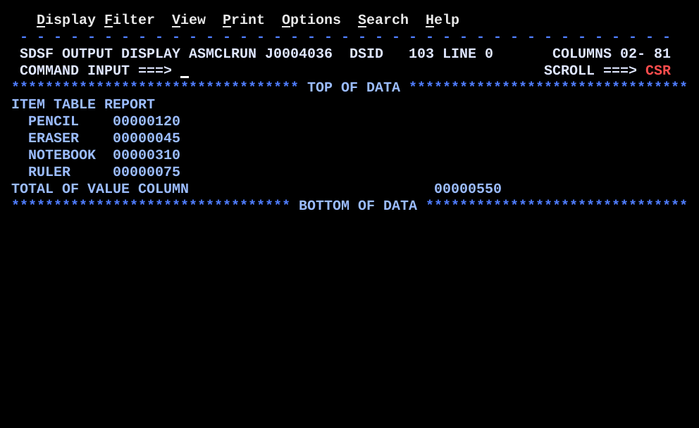

# BR05TABL.asm

## Program Overview

BR05TABL steps through a table of four fixed-length entries using an index register. Each entry is 12 bytes: an 8-byte name (`CL8`) followed by a fullword value (`F`). The loop is controlled by `BCT`. For each entry the program writes one detail line with the name and value, adds the value to a running total, and moves the index to the next entry. After the loop it writes the total.

Program data:

| Field | Value | Used by |
|---|---|---|
| TABLE | 4 entries: `PENCIL`/120, `ERASER`/45, `NOTEBOOK`/310, `RULER`/75 | Loop |
| ENTLEN | 12 (EQU, length of one entry) | Index step |
| ENTRIES | 4 | `BCT` loop count |

Registers used:

| Register | Role |
|---|---|
| R3 | Value part of the current entry |
| R4 | Address of the current entry |
| R5 | Index: byte offset of the current entry from `TABLE` |
| R6 | Entries remaining (`BCT` counter) |
| R7 | Running total of the values |

Output (6 lines):

```
ITEM TABLE REPORT
  PENCIL    00000120
  ERASER    00000045
  NOTEBOOK  00000310
  RULER     00000075
TOTAL OF VALUE COLUMN                             00000550
```



## How the Program Works

**Linkage and I/O.** The entry linkage, save area, `OPEN`, `CLOSE`, exit linkage (`BR 14`) and SYSOUT DCB follow the same pattern as the earlier programs. A heading line (`MSGHDR`) is written before the loop.

**Setup.** `SR 5,5` sets the index to offset 0, `L 6,ENTRIES` loads the count 4, and `SR 7,7` clears the total.

**Each pass through the loop.**
1. `LA 4,TABLE(5)` computes the address of `TABLE` plus the offset in R5 and puts it in R4.
2. `MVC OUTMSG(80),BLANKS` clears the output line.
3. `MVC OUTMSG+2(8),0(4)` copies the 8-byte name from the address in R4 to column 3 of the line.
4. `L 3,8(,4)` loads the fullword value, which is 8 bytes into the entry.
5. `AR 7,3` adds the value to the total.
6. `CVD`, `UNPK` and `OI ZONE+7,X'F0'` convert the value to 8 digits, and `MVC OUTMSG+12(8),ZONE` places them at column 13.
7. `PUT SYSOUT,OUTMSG` writes the detail line.
8. `LA 5,ENTLEN(,5)` adds 12 to the index.
9. `BCT 6,LOOP` subtracts 1 from R6 and branches back while R6 is not zero.

**After the loop.** The total in R7 is converted the same way, placed at `OUTMSG+50(8)` with the label `MSGTOT`, and written.

**Execution trace.**

| Pass | R5 before | R4 (entry address) | Name | Value (R3) | R7 after | R5 after | R6 after | `BCT` |
|---|---|---|---|---|---|---|---|---|
| 1 | 0 | TABLE | PENCIL | 120 | 120 | 12 | 3 | branch |
| 2 | 12 | TABLE+12 | ERASER | 45 | 165 | 24 | 2 | branch |
| 3 | 24 | TABLE+24 | NOTEBOOK | 310 | 475 | 36 | 1 | branch |
| 4 | 36 | TABLE+36 | RULER | 75 | 550 | 48 | 0 | fall through |

## Concepts Demonstrated

- Fixed-length table entries with a name field and a numeric field
- Indexed addressing in the form `label(index)`
- Stepping an index by the entry length
- Loop control with `BCT` and a count held in storage
- The difference between an index register and a base register
- Why storage-to-storage (SS) instructions need an address computed first
- Accumulating a total across the entries
- Placing fields from the same buffer at different output columns

## How the Concepts Are Implemented

| Concept | Implementation |
|---|---|
| Table layout | `TABLE DS 0F` forces fullword alignment, then four `DC CL8'name',F'value'` lines build 12-byte entries. The names are padded with blanks to 8 characters. |
| Entry length | `ENTLEN EQU 12` names the entry length, so the step is not a literal in the code. 8 bytes of name plus 4 bytes of value makes 12. |
| Entry count | `ENTRIES DC F'4'` holds the number of entries. `L 6,ENTRIES` loads it as the `BCT` counter. |
| Indexed address | `LA 4,TABLE(5)` is `D(X,B)` form: displacement of `TABLE`, index register R5, and the base register from `USING`. `LA` adds them and puts the address in R4 without reading storage. |
| Index step | `LA 5,ENTLEN(,5)` adds 12 to R5. `LA` is used as an add-constant instruction. |
| Pointer for SS instructions | `MVC` has no index field, so `MVC OUTMSG+2(8),0(4)` uses R4 as the base register. R4 was set by the indexed `LA`. |
| Field inside an entry | `L 3,8(,4)` reads the fullword at displacement 8 of the entry R4 points at. |
| Loop control | `BCT 6,LOOP` counts down from 4. The loop body runs 4 times. |
| Running total | `SR 7,7` clears R7 and `AR 7,3` adds each value. The result 550 (120 + 45 + 310 + 75) is written by the final `CVD` sequence. |
| Number display | `CVD`, `UNPK ZONE,DOUBLE`, `OI ZONE+7,X'F0'` and `MVC` convert the binary register to 8 printable digits, as in REGCALC. |
| Output columns | Names go at `OUTMSG+2`, values at `OUTMSG+12`, and the total at `OUTMSG+50` with a 50-byte label from `MSGTOT`. |

## Key Takeaways

- Keep two things in different registers: the offset (R5), which changes by `ENTLEN` each pass, and the address (R4), which is `TABLE` plus that offset. Instructions that take an index register use R5. Instructions that need a plain base register use R4.
- `LA` with an index, `LA 4,TABLE(5)`, builds an address and reads no storage. `MVC` and other SS instructions cannot take an index register, so this step is required before them.
- Name the entry length (`ENTLEN`) and keep the entry count (`ENTRIES`) beside the table. If a table entry is added, `ENTRIES` must change as well. The count can also be calculated at assembly time from the table's length, which avoids this.
- `BCT` tests at the bottom, so the body always runs at least once. If `ENTRIES` is 0, the first `BCT` makes R6 negative, which is not zero, and the loop runs about 4 billion times. Guard a count that may be zero with `LTR` and `BZ`.
- The name field is padded to 8 characters, and the `MVC` length 8 must match the field. A name longer than 8 characters would overlap the value.
- The `TABLE DS 0F` line forces fullword alignment, so the value part of each entry is on a fullword boundary when the entry length is a multiple of 4.
- The same `ZONE` and `DOUBLE` work areas are used for every conversion, so each pass clears the buffer first and then fills it.
- The index loop in BR04BXLE does the same stepping with one instruction (`BXLE`), where this program uses `LA` and `BCT`.
- All messages are `CL50`, and the total's offset `OUTMSG+50` depends on that, so changing a message length requires changing the offset and the `MVC` lengths.
