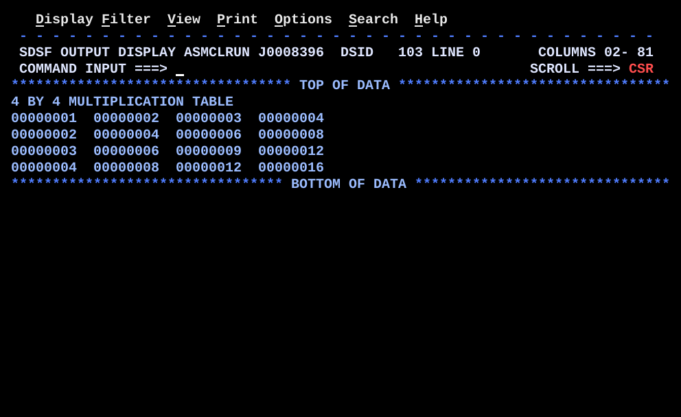

# BR06NEST.asm

## Program Overview

BR06NEST builds a 4 by 4 multiplication table with two nested `BCT` loops. The outer loop produces one row of output. The inner loop produces one column in that row by multiplying the row number by the column number with `MR` and placing the 8-digit result in the print line. After each row the line is written to SYSOUT.

Program data:

| Field | Value | Used by |
|---|---|---|
| ROWS | 4 | Outer loop count (R6) |
| COLS | 4 | Inner loop count (R7), reloaded on every row |

Registers used:

| Register | Role |
|---|---|
| R4 | Current row number |
| R5 | Current column number |
| R6 | Outer loop counter (rows remaining) |
| R7 | Inner loop counter (columns remaining) |
| R8:R9 | Even-odd pair for `MR`: product, high word in R8 and low word in R9 |
| R11 | Pointer to where the next field goes in the print line |

Output (5 lines):

```
4 BY 4 MULTIPLICATION TABLE
00000001  00000002  00000003  00000004
00000002  00000004  00000006  00000008
00000003  00000006  00000009  00000012
00000004  00000008  00000012  00000016
```



## How the Program Works

**Linkage and I/O.** The entry linkage, save area, `OPEN`, `CLOSE`, exit linkage (`BR 14`) and SYSOUT DCB follow the same pattern as the earlier programs. A heading line (`MSGHDR`) is written first.

**Setup.** `L 6,ROWS` loads the outer count 4 and `SR 4,4` sets the row number to 0.

**Outer loop (once per row), starting at `OUTER`.**
1. `LA 4,1(,4)` adds 1 to the row number.
2. `MVC OUTMSG(80),BLANKS` clears the whole print line.
3. `L 7,COLS` reloads the inner counter with 4.
4. `SR 5,5` resets the column number to 0.
5. `LA 11,OUTMSG` points R11 at the start of the print line.

**Inner loop (once per column), starting at `INNER`.**
1. `LA 5,1(,5)` adds 1 to the column number.
2. `LR 9,4` puts the row number in R9, the odd register of the pair 8/9. `SR 8,8` clears R8.
3. `MR 8,5` multiplies R9 by R5 and leaves the 64-bit product in R8:R9. The products here are small, so the result is in R9.
4. `CVD 9,DOUBLE`, `UNPK ZONE,DOUBLE` and `OI ZONE+7,X'F0'` convert R9 to 8 printable digits.
5. `MVC 0(8,11),ZONE` stores the 8 digits at the address in R11. The length 8 is coded in the instruction.
6. `LA 11,10(,11)` moves R11 forward 10 bytes, leaving 2 blanks between fields.
7. `BCT 7,INNER` subtracts 1 from R7 and repeats while R7 is not zero.

**End of a row.** `PUT SYSOUT,OUTMSG` writes the line, and `BCT 6,OUTER` subtracts 1 from R6 and repeats while R6 is not zero.

**Execution trace.**

| Row (R4) | R7 at start | Columns (R5) | Products written | R11 after each column | Line written |
|---|---|---|---|---|---|
| 1 | 4 | 1, 2, 3, 4 | 1, 2, 3, 4 | +10, +20, +30, +40 | `00000001  00000002  00000003  00000004` |
| 2 | 4 | 1, 2, 3, 4 | 2, 4, 6, 8 | +10, +20, +30, +40 | `00000002  00000004  00000006  00000008` |
| 3 | 4 | 1, 2, 3, 4 | 3, 6, 9, 12 | +10, +20, +30, +40 | `00000003  00000006  00000009  00000012` |
| 4 | 4 | 1, 2, 3, 4 | 4, 8, 12, 16 | +10, +20, +30, +40 | `00000004  00000008  00000012  00000016` |

The inner loop body runs 16 times in total, 4 times for each of the 4 rows.

## Concepts Demonstrated

- Nested loops with `BCT`, one counter register per loop level
- Resetting the inner counter and the column number on every pass of the outer loop
- Multiplication with `MR` and an even-odd register pair
- Building one print line from several fields with an advancing output pointer
- The explicit `D(L,B)` form of `MVC`, with the length coded in the operand
- Using `LA` as an add-constant instruction (`LA 4,1(,4)`)
- Writing one record per outer pass, not one per inner pass

## How the Concepts Are Implemented

| Concept | Implementation |
|---|---|
| Outer loop | R6 is loaded from `ROWS` once, before `OUTER`. `BCT 6,OUTER` at the bottom repeats the row logic 4 times. |
| Inner loop | R7 is loaded from `COLS` after the `OUTER` label, so it is reloaded on every row. `BCT 7,INNER` repeats the column logic 4 times per row. |
| Separate counters | The outer loop uses R6 and the inner loop uses R7. Each `BCT` changes only its own register, so the loops do not interfere. |
| Reset on every pass | `L 7,COLS`, `SR 5,5` and `LA 11,OUTMSG` are inside the outer loop. Without them the second row would start with R7 at 0, R5 at 4 and R11 at the end of the line. |
| Row and column numbers | `LA 4,1(,4)` and `LA 5,1(,5)` add 1 to the register without storage access. R4 starts at 0 and R5 is reset to 0, so the first values used are 1. |
| Multiplication | `LR 9,4` puts the multiplicand in the odd register R9. `MR 8,5` multiplies it by R5 and puts the product in the pair R8:R9. R8 must be the even register of the pair. |
| Number display | `CVD`, `UNPK ZONE,DOUBLE`, `OI ZONE+7,X'F0'` convert the product to 8 printable digits, as in REGCALC. |
| Explicit length form | `MVC 0(8,11),ZONE` is `D(L,B)`: displacement 0, length 8, base register R11. The length is in the instruction, so no separate length is needed. |
| Output pointer | `LA 11,10(,11)` advances R11 by 10 after each field, so the four fields start at offsets 0, 10, 20 and 30 of `OUTMSG`. |
| One record per row | `PUT SYSOUT,OUTMSG` is after the inner loop, so the line is written only when all four fields are in the buffer. |
| Buffer clearing | `MVC OUTMSG(80),BLANKS` at the start of each row removes the previous row's text. |

## Key Takeaways

- Each loop level needs its own counter register. Everything the inner loop uses and changes (its counter, its index and its output pointer) must be set again at the top of each outer pass.
- The `BCT 7,INNER` leaves R7 at 0. If `L 7,COLS` were before `OUTER`, row 2 would start with R7 at 0, the first `BCT` would make it -1, which is not zero, and the inner loop would run about 4 billion times.
- `MVC` has no index register field. To store at a position that changes, keep the position in a base register (R11) and use `D(L,B)`, as in `MVC 0(8,11),ZONE`. Advance the register with `LA`.
- `MR` needs an even-odd register pair. The multiplicand goes in the odd register (R9) and the result fills both. The `SR 8,8` is not required for `MR`, because the instruction replaces R8. Clearing it is harmless.
- The product is a 64-bit value in R8:R9. `CVD 9,DOUBLE` uses only R9, which is correct only while the product fits in 31 bits. Larger values would need the full pair.
- `LA r,n(,r)` is the shortest way to add a small constant to a register, and it is used for the row number, the column number and the pointer.
- The `PUT` belongs in the outer loop after the inner loop ends. Placing it inside the inner loop would write 16 lines with partly filled buffers.
- The row number R4 is changed by the outer loop only, and the column number R5 by the inner loop only. This keeps the multiplication inputs predictable.
- Changing `ROWS` or `COLS` changes the table size. A row wider than 8 fields of 10 bytes would overrun the 80-byte `OUTMSG`, because `COLS` is not checked against the buffer length.
- All messages are `CL50` and the buffer is `CL80`, so changing a message length requires changing the matching `MVC` lengths.
