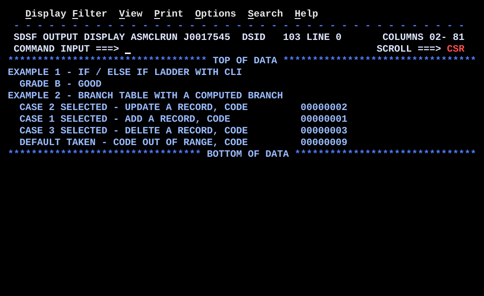

# BR07CASE.asm

## Program Overview

BR07CASE shows two ways to code a CASE / SELECT construct in HLASM. Example 1 uses a cascaded IF / ELSE IF ladder: `CLI` compares a grade letter with `A`, `B` and `C` in turn. Example 2 uses a branch table: a numeric code is range-checked, converted to a table offset, and used in a computed branch (`B BRTAB(3)`). Example 2 runs over a list of four codes, one of which is deliberately out of range.

Program data:

| Field | Value | Used by |
|---|---|---|
| GRADE | `B` (1 byte) | Example 1 |
| CODES | 2, 1, 3, 9 (four fullwords) | Example 2 |
| NCODES | 4 | Example 2 loop count |
| Literals | `=F'1'`, `=F'3'` | Range check limits, placed by `LTORG` |

Registers used:

| Register | Role |
|---|---|
| R3 | Code being dispatched (changed to the table offset) |
| R4 | Code reloaded for display |
| R5 | Offset into the code list (0, 4, 8, 12) |
| R6 | Codes remaining (`BCT` counter) |

Output (7 lines):

```
EXAMPLE 1 - IF / ELSE IF LADDER WITH CLI
  GRADE B - GOOD
EXAMPLE 2 - BRANCH TABLE WITH A COMPUTED BRANCH
  CASE 2 SELECTED - UPDATE A RECORD, CODE         00000002
  CASE 1 SELECTED - ADD A RECORD, CODE            00000001
  CASE 3 SELECTED - DELETE A RECORD, CODE         00000003
  DEFAULT TAKEN - CODE OUT OF RANGE, CODE         00000009
```



## How the Program Works

**Linkage and I/O.** The entry linkage, save area, `OPEN`, `CLOSE`, exit linkage (`BR 14`) and SYSOUT DCB follow the same pattern as the earlier programs. Each example writes its own heading line before its detail lines.

**Example 1: IF / ELSE IF ladder.**
1. `CLI GRADE,C'A'` and `BE GRADEA` test for an A. The next two compares test for B and C in the same way.
2. If none matches, the next instruction copies `MSGGX` (the ELSE path) and `B EX1PUT` jumps to the `PUT`.
3. Each matching label (`GRADEA`, `GRADEB`, `GRADEC`) copies its message. All but the last end with `B EX1PUT`. `GRADEC` falls into `EX1PUT`.
4. `GRADE` is `B`, so the A compare fails, the B compare succeeds, and `BE GRADEB` is taken. `GRADE B - GOOD` is written.

**Example 2: branch table.** The loop starts at `CASELOOP` with R5 = 0 and R6 = 4.
1. `L 3,CODES(5)` loads the code at offset R5 into R3.
2. `C 3,=F'1'` and `BL CASEDFLT` send any code below 1 to the default. `C 3,=F'3'` and `BH CASEDFLT` send any code above 3 to the default.
3. `BCTR 3,0` subtracts 1, making the code zero-based.
4. `SLL 3,2` multiplies by 4, the size of one table slot.
5. `B BRTAB(3)` branches to the table address plus R3. The slot there is a `B` to the matching case.
6. The case copies its message (`CASE1` to `CASE3`) and branches to `CASEEND`. The default case (`CASEDFLT`) falls into `CASEEND`.
7. `CASEEND` reloads the original code into R4 with `L 4,CODES(5)`, converts it with `CVD`, `UNPK` and `OI ZONE+7,X'F0'`, places it at `OUTMSG+50(8)`, and `PUT` writes the line.
8. `LA 5,4(,5)` steps to the next code, and `BCT 6,CASELOOP` repeats.

**Execution trace (Example 2).**

| Pass | Code | Range check | R3 after `BCTR` / `SLL` | Branch target | Message |
|---|---|---|---|---|---|
| 1 | 2 | in range | 1 / 4 | `BRTAB+4` (`B CASE2`) | `CASE 2 SELECTED - UPDATE A RECORD, CODE` |
| 2 | 1 | in range | 0 / 0 | `BRTAB+0` (`B CASE1`) | `CASE 1 SELECTED - ADD A RECORD, CODE` |
| 3 | 3 | in range | 2 / 8 | `BRTAB+8` (`B CASE3`) | `CASE 3 SELECTED - DELETE A RECORD, CODE` |
| 4 | 9 | `BH CASEDFLT` taken | not reached | `CASEDFLT` | `DEFAULT TAKEN - CODE OUT OF RANGE, CODE` |

## Concepts Demonstrated

- Multi-way decisions: a CASE / SELECT construct in assembler
- The IF / ELSE IF ladder built from `CLI` and `BE`
- A branch table with one 4-byte branch per slot
- A computed branch using an index register: `B label(reg)`
- Converting a one-based code to a zero-based byte offset with `BCTR` and `SLL`
- Range checking before a computed branch, with a default path
- Literals (`=F'1'`) and the literal pool (`LTORG`)
- Looping over a list of codes with an index and `BCT`

## How the Concepts Are Implemented

| Concept | Implementation |
|---|---|
| Ladder | Each `CLI GRADE,C'x'` sets the CC and `BE` jumps to the matching label. The tests run in order and stop at the first match. The instruction after the last `BE` is the ELSE path. |
| Join label | `EX1PUT` marks where the paths meet. Each case but the last ends with `B EX1PUT`, and `GRADEC` falls into it. |
| Branch table | `BRTAB` holds three `B` instructions, one per code. Each `B` is an RX instruction of 4 bytes, so slot n is at `BRTAB + 4 x (n-1)`. |
| Computed branch | `B BRTAB(3)` is `BC 15,BRTAB(3)`. R3 is the index register, so the target is `BRTAB` plus R3. The offset must be a multiple of 4 so the target is the start of a slot. |
| Offset calculation | `BCTR 3,0` gives the code minus 1 and `SLL 3,2` shifts left 2 bits, which multiplies by 4. Code 1 gives 0, code 2 gives 4, code 3 gives 8. |
| Range check | `C 3,=F'1'` with `BL`, and `C 3,=F'3'` with `BH`, send out-of-range codes to `CASEDFLT` before the offset is calculated. |
| Default path | `CASEDFLT` copies `MSGCD` and falls into `CASEEND`. It is placed immediately before `CASEEND`, so it needs no branch. |
| Literals | `=F'1'` and `=F'3'` create fullword constants in the literal pool. `LTORG` after the DCB places the pool in the program, within reach of the base register R12. |
| Code list | `CODES DC F'2'` followed by `DC F'1'`, `DC F'3'` and `DC F'9'` builds four adjacent fullwords. `CODES(5)` reads the one at offset R5. |
| Index step | `LA 5,4(,5)` adds 4 to R5 on each pass. `BCT 6,CASELOOP` counts the passes from `NCODES`. |
| Reload for display | R3 was changed into a table offset, so `L 4,CODES(5)` reloads the original code before it is converted with `CVD`. |
| Number display | `CVD`, `UNPK ZONE,DOUBLE`, `OI ZONE+7,X'F0'` and `MVC OUTMSG+50(8),ZONE` convert the binary register to 8 printable digits, as in REGCALC. |

## Key Takeaways

- A ladder tests the values one after another, so the number of compares grows with the number of cases. A branch table reaches any case with the same few instructions, which makes it better for many dense numeric codes. For a few cases or character values, the ladder is simpler.
- A computed branch with a bad index jumps to whatever is in storage at that address. Always check the range first. Here, code 0 would give offset -4 and code 9 would give offset 32, and both would branch outside the table.
- Every table entry must have the same fixed length. `B CASEn` is 4 bytes, so the shift is 2. A `BR` (2 bytes) or a different instruction length would change the multiplier.
- The table is made of `B` instructions, not addresses, so the code branches twice: once into the table, then to the case. This keeps the table position-independent and uses only the base register.
- Convert a code that starts at 1 to a zero-based offset before scaling it. `BCTR 3,0` does this in one instruction.
- Keep the original value if it is needed after the offset is calculated. R3 is overwritten, so the program reloads the code into R4 for display.
- `BL` and `BH` after `C` test the signed comparison, so a negative code is also caught by the low-limit test.
- Literals need a pool. `LTORG` places it at a known location. Without it, the assembler puts the pool at the end of the program, and it must still be within 4096 bytes of the base register.
- With this test data, three of the ten messages are never displayed (`MSGGA`, `MSGGC`, `MSGGX`). Change `GRADE` or the `CODES` list and rerun to exercise the other paths.
- All messages are `CL50` and the number goes at `OUTMSG+50`, so changing a message length requires changing the offset and the `MVC` lengths.
