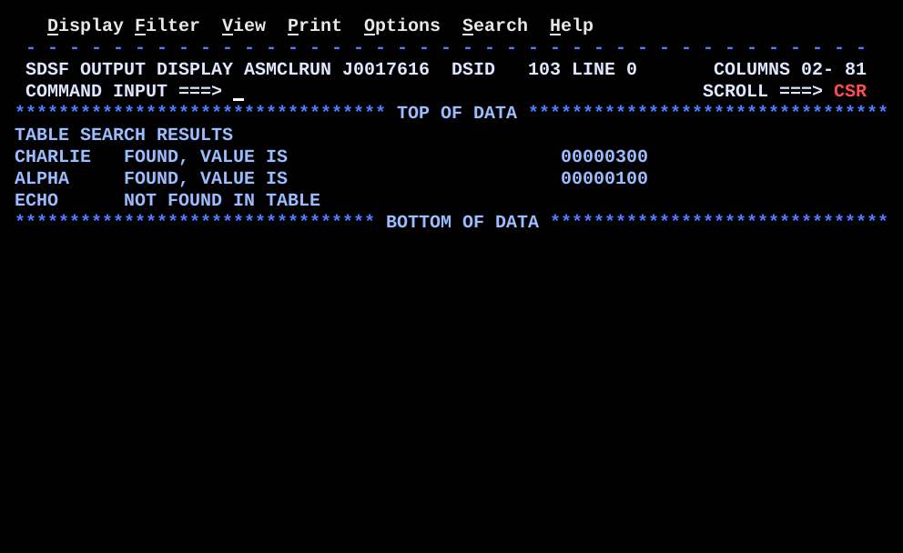

# BR08SRCH.asm

## Program Overview

BR08SRCH searches a keyed table serially and shows the found / not-found pattern with an early exit. The table has four 12-byte entries, each an 8-byte key (`CL8`) and a fullword value. An outer loop takes three search arguments in turn. For each argument an inner loop compares the key with each table entry using `CLC`. A match leaves the inner loop early and prints the value. If every entry is tested with no match, the loop ends and a "not found" line is printed.

Program data:

| Field | Value | Used by |
|---|---|---|
| TABLE | `ALPHA`/100, `BRAVO`/200, `CHARLIE`/300, `DELTA`/400 | Inner loop |
| ENTLEN | 12 (EQU, length of one entry) | Pointer step |
| ENTRIES | 4 | Inner loop count (R6) |
| SRCHLST | `CHARLIE`, `ALPHA`, `ECHO` (three `CL8` arguments) | Outer loop |
| NSRCH | 3 | Outer loop count (R9) |

Registers used:

| Register | Role |
|---|---|
| R3 | Value taken from the matching entry |
| R6 | Table entries left to test (inner `BCT` counter) |
| R7 | Pointer to the current table entry |
| R9 | Search arguments left (outer `BCT` counter) |
| R10 | Pointer to the current search argument |

Output (4 lines):

```
TABLE SEARCH RESULTS
CHARLIE   FOUND, VALUE IS                         00000300
ALPHA     FOUND, VALUE IS                         00000100
ECHO      NOT FOUND IN TABLE
```



## How the Program Works

**Linkage and I/O.** The entry linkage, save area, `OPEN`, `CLOSE`, exit linkage (`BR 14`) and SYSOUT DCB follow the same pattern as the earlier programs. A heading line (`MSGHDR`) is written first.

**Outer loop setup.** `LA 10,SRCHLST` points R10 at the first search argument and `L 9,NSRCH` loads the count 3.

**For each search argument, starting at `NEXTARG`.**
1. `MVC SRCHKEY(8),0(10)` copies the argument from the list into the work key `SRCHKEY`.
2. `LA 7,TABLE` points R7 at the first table entry and `L 6,ENTRIES` loads the count 4.
3. At `SEARCH`, `CLC SRCHKEY(8),0(7)` compares the key with the entry R7 points at.
4. `BE FOUND` leaves the loop on a match.
5. Otherwise `LA 7,ENTLEN(,7)` moves R7 on by 12 bytes and `BCT 6,SEARCH` repeats while R6 is not zero.

**Found path (`FOUND`).** R7 still points at the matching entry. `L 3,8(,7)` loads the value (8 bytes into the entry). The line is cleared, the key is copied to `OUTMSG(8)`, `MSGFND` to `OUTMSG+10(40)`, and the value is converted with `CVD`, `UNPK` and `OI ZONE+7,X'F0'` and placed at `OUTMSG+50(8)`.

**Not-found path (`NOTFOUND`).** The instruction after `BCT` runs only when R6 reaches zero with no match. The line is cleared, the key is copied to `OUTMSG(8)`, and `MSGNF` is copied to `OUTMSG+10(40)`. `B ARGPUT` skips the found path.

**End of each argument.** At `ARGPUT`, `PUT SYSOUT,OUTMSG` writes the line, `LA 10,8(,10)` moves to the next argument, and `BCT 9,NEXTARG` repeats while R9 is not zero.

**Execution trace.**

| Argument | Entries compared | Result of `CLC` | Exit | R7 at exit | Line written |
|---|---|---|---|---|---|
| `CHARLIE` | `ALPHA`, `BRAVO`, `CHARLIE` | not equal, not equal, equal | `BE FOUND` after 3rd compare | TABLE+24 | `CHARLIE   FOUND, VALUE IS ... 00000300` |
| `ALPHA` | `ALPHA` | equal | `BE FOUND` after 1st compare | TABLE+0 | `ALPHA     FOUND, VALUE IS ... 00000100` |
| `ECHO` | `ALPHA`, `BRAVO`, `CHARLIE`, `DELTA` | not equal x 4 | `BCT` falls through (R6 = 0) | TABLE+48 (past the table) | `ECHO      NOT FOUND IN TABLE` |

## Concepts Demonstrated

- Serial (linear) search of a keyed table
- Leaving a loop early with a conditional branch to a label outside the loop
- The found / not-found pattern, where falling out of the loop means not found
- Nested loops: an outer loop over arguments and an inner loop over entries
- A pointer register instead of an index for SS-format instructions (`CLC`, `MVC`)
- Stepping a pointer by the entry length with `LA`
- Reading a field at a fixed displacement from a pointer: `L 3,8(,7)`
- Building an output line from fields at different columns

## How the Concepts Are Implemented

| Concept | Implementation |
|---|---|
| Table layout | `TABLE DS 0F` forces fullword alignment, then four `DC CL8'key',F'value'` lines build 12-byte entries. `ENTLEN EQU 12` names the length, and `ENTRIES DC F'4'` holds the count. |
| Serial search | `SEARCH` compares the key with one entry, advances the pointer, and repeats with `BCT 6,SEARCH`. Entries are tested in table order. |
| Early exit | `BE FOUND` leaves the inner loop at the first matching entry, before the remaining entries are tested. |
| Not-found | `BCT` falls through when R6 reaches zero. The code after it (`NOTFOUND`) therefore runs only if no entry matched. |
| Pointer register | `CLC SRCHKEY(8),0(7)` and `MVC SRCHKEY(8),0(10)` take their second operand as displacement 0 from a base register. `CLC` and `MVC` have no index register field, so R7 and R10 hold addresses and are advanced by `LA`. |
| Pointer step | `LA 7,ENTLEN(,7)` adds 12 to R7. `LA 10,8(,10)` adds 8 to R10, the length of one `CL8` argument. |
| Field by displacement | `L 3,8(,7)` loads the value 8 bytes into the entry R7 points at. R7 is still valid at `FOUND` because the early exit leaves it unchanged. |
| Work key | `MVC SRCHKEY(8),0(10)` copies the current argument to `SRCHKEY`, so the inner loop compares against a fixed address and R10 is left alone. |
| Nested loops | The outer loop uses R9 and R10, and the inner loop uses R6 and R7. The inner registers are loaded again for every argument. |
| Output columns | The key goes at `OUTMSG(8)`, the message at `OUTMSG+10(40)`, and the value at `OUTMSG+50(8)`. `MSGFND` and `MSGNF` are `CL40`, and `MSGHDR` is `CL50`. |
| Number display | `CVD`, `UNPK ZONE,DOUBLE`, `OI ZONE+7,X'F0'` and `MVC OUTMSG+50(8),ZONE` convert the binary register to 8 printable digits, as in REGCALC. |
| Shared output | `ARGPUT` is the join point. Both the found and not-found paths reach the same `PUT`, `LA` and `BCT`. |

## Key Takeaways

- A search loop has two exits: a match (early exit) and the end of the table. Put the match exit on a labelled branch (`BE FOUND`) and let the loop fall through for not found.
- `CLC` and `MVC` are SS instructions with no index register field. Keep the address in a pointer register and move it with `LA`, as in BR05TABL, where the address was built from table and index.
- The pointer is still valid after an early exit. That is why `FOUND` can use `L 3,8(,7)` without recalculating the entry address.
- After a full unsuccessful pass, R7 points past the last entry (TABLE+48). It is not read, but a program that used it after the loop would read the data that follows the table.
- `CLC` compares exactly the length coded, 8 bytes here. The keys are padded with blanks to 8 characters, so `CL8'ECHO    '` and the work key compare correctly.
- The inner loop needs R6 and R7 reloaded for each argument, so those two instructions are after `NEXTARG`, inside the outer loop.
- `BCT` tests at the bottom. If `ENTRIES` were 0, the first `BCT` would make R6 negative, not zero, and the loop would run about 4 billion times. Guard a count that may be zero with `LTR` and `BZ`.
- A serial search tests up to `ENTRIES` keys per argument. For a large sorted table a binary search needs fewer compares, but this form works on an unsorted table.
- The last search argument (`ECHO`) is deliberately absent from the table, so the not-found path is exercised. Change `SRCHLST`, `TABLE` or `NSRCH` and rerun to exercise other cases.
- Changing a message length requires changing the matching `MVC` length and the output offsets.
