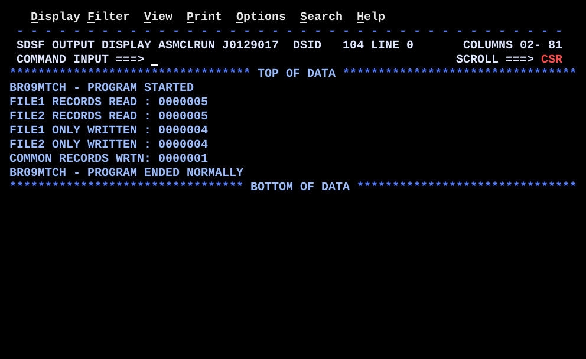

# BR09MTCH.asm

## Program Overview

BR09MTCH compares two sorted QSAM files of 10-byte customer numbers (match-merge, also called balanced line). It keeps one current record from each file and compares the two keys with `CLC`. A key that is only in file 1 goes to `OUT1ONLY`, a key that is only in file 2 goes to `OUT2ONLY`, and a key that is in both goes once to `OUTCOMM`. When one file ends, the rest of the other file is written to its own "only" file. At the end the program prints five record counts to `SYSPRINT`.

Program data:

| Field | Value | Used by |
|---|---|---|
| `INFILE1`, `INFILE2` | Input DCBs, `RECFM=FB`, `LRECL=10`, `MACRF=GM`, `EODAD=EOF1RTN` / `EOF2RTN` | `READ1`, `READ2` |
| `OUT1ONLY`, `OUT2ONLY`, `OUTCOMM` | Output DCBs, `RECFM=FB`, `LRECL=10`, `MACRF=PM` | `FLUSH1`, `FLUSH2`, `MATCHED` |
| `SYSPRINT` | Output DCB, `RECFM=FB`, `LRECL=80`, `MACRF=PM` | Messages and counts |
| `KEY1`, `KEY2` | `CL10`, current customer number of each file | `CLC`, `FLUSH1`, `FLUSH2`, `MATCHED` |
| `EOF1`, `EOF2` | `CL1`, `N` until the file ends, then `Y` | `MAINLOOP`, `CHECK2` |
| `OUT1REC`, `OUT2REC`, `OUTCREC` | `CL10` output record areas | `PUT` |
| `CNT1`, `CNT2`, `CNTONLY1`, `CNTONLY2`, `CNTCOMM` | `PL4` packed counters | `AP`, `PRTCNTS` |
| `ZONE` | `CL7` work area for `UNPK` | `PRTCNTS` |
| `HIVALUE` | `10X'FF'` | `EOF1RTN`, `EOF2RTN` |
| `MSGSTRT`, `MSGEND`, `MSGOPN1` to `MSGOPN5` | `CL50` messages | `SYSPRINT` |
| `LBL1` to `LBL5` | `CL20` count labels | `PRTCNTS` |

Registers used:

| Register | Role |
|---|---|
| R1 | Address of the `CL50` message to print |
| R2 | Address of the DCB tested by `OPENCHK` |
| R10 | Return address for the `BAL 10` routines (`READ1`, `READ2`, `OPENCHK`, `PRTCNTS`) |
| R12 | Base register |
| R13 | Address of the save area |
| R14, R15 | Return address and return code on exit |

Input files: the contents of `INFILE1` and `INFILE2` were not supplied, so there are no files in `data/`. The SYSOUT shows 5 records read from each file.

Output (7 lines):

```
BR09MTCH - PROGRAM STARTED
FILE1 RECORDS READ : 0000005
FILE2 RECORDS READ : 0000005
FILE1 ONLY WRITTEN : 0000004
FILE2 ONLY WRITTEN : 0000004
COMMON RECORDS WRTN: 0000001
BR09MTCH - PROGRAM ENDED NORMALLY
```



## How the Program Works

**Linkage and I/O.** Standard entry linkage with base register R12, then `SYSPRINT` is opened first and checked. The two input files and the three output files are opened next, each followed by `LA 2,dcb`, `BAL 10,OPENCHK` and its own `BNO OPNERRn`. Exit linkage is `L 13,SAVEAREA+4`, `LM 14,12,12(13)`, `SR 15,15`, `BR 14`.

**Setup.** `KEY1` and `KEY2` are set to blanks, `EOF1` and `EOF2` to `N`, and the five counters to zero with `ZAP`. `SYSPRINT` is opened first and `MSGSTRT` is written, so that every later failure has somewhere to report.

**Priming.** `BAL 10,READ1` and `BAL 10,READ2` load the first record of each file. An empty file sets its EOF switch at this point through `EOF1RTN` or `EOF2RTN`.

**Main loop (`MAINLOOP`).**
1. `CLI EOF1,C'Y'` and `BE CHECK2`: file 1 has ended, go and look at file 2.
2. `CLI EOF2,C'Y'` and `BE FLUSH1`: only file 2 has ended, drain file 1.
3. `CLC KEY1,KEY2` compares the two current keys.
4. Equal: `MATCHED` writes `KEY1` to `OUTCOMM`, counts it, and reads the next record from both files.
5. `KEY1 < KEY2`: `FLUSH1` writes `KEY1` to `OUT1ONLY`, counts it, and reads the next record from file 1 only.
6. `KEY1 > KEY2`: `FLUSH2` does the same for file 2.
7. Every path ends with `B MAINLOOP`, except `CHECK2`.

**`CHECK2`.** File 1 has ended. If file 2 has also ended, branch to `ALLDONE`. Otherwise `FLUSH2` runs once per remaining record of file 2.

**`ALLDONE`.** All five data files are closed, `PRTCNTS` prints the five counts, `MSGEND` is written, and `SYSPRINT` is closed last.

**`READ1` / `READ2`.** `MVC KEY1,BLANKS10`, `GET INFILE1,KEY1`, `AP CNT1,=P'1'`, `BR 10`. At end of file `GET` does not return; control goes to the `EODAD` label (`EOF1RTN`), which sets `EOF1` to `Y`, sets `KEY1` to `HIVALUE`, and returns with `BR 10`.

**Decision table.**

| EOF1 | EOF2 | Keys | Path | Written to | Next record read from |
|---|---|---|---|---|---|
| N | N | `KEY1 = KEY2` | `MATCHED` | `OUTCOMM` | Both files |
| N | N | `KEY1 < KEY2` | `FLUSH1` | `OUT1ONLY` | File 1 |
| N | N | `KEY1 > KEY2` | `FLUSH2` | `OUT2ONLY` | File 2 |
| N | Y | not compared | `FLUSH1` | `OUT1ONLY` | File 1 |
| Y | N | not compared | `CHECK2`, then `FLUSH2` | `OUT2ONLY` | File 2 |
| Y | Y | not compared | `CHECK2`, then `ALLDONE` | none | none |

**Counts from the SYSOUT.** The counts are consistent: each file gave 4 "only" records and 1 common record, so 4 + 1 = 5 records read from each file, and 4 + 4 + 1 = 9 records written.

## Concepts Demonstrated

- Match-merge (balanced line) processing of two files sorted on the same key
- One current record per file, with a priming read
- Three-way decision on `CLC` (equal, low, high) using the condition code
- Draining the remainder of one file after the other ends
- End-of-file detection through `EODAD` in QSAM
- `HIVALUE` (`X'FF'`) as a defensive key at end of file
- Internal subroutines with `BAL` and `BR`
- Checking that `OPEN` worked by testing `DCBOFOPN` in the DCB through a `DCBD` DSECT
- Opening `SYSPRINT` first so that open errors can be reported
- `ABEND` with a completion code and a dump
- Packed decimal counters printed with `UNPK` and `OI`

## How the Concepts Are Implemented

| Concept | Implementation |
|---|---|
| Current record per file | `READ1` and `READ2` load one 10-byte record into `KEY1` and `KEY2` with `GET` in move mode (`MACRF=GM`). |
| Priming read | `PRIME` calls `READ1` and `READ2` before `MAINLOOP`, so the first comparison has two keys. |
| Key comparison | `CLC KEY1,KEY2` sets the condition code. `BE MATCHED`, `BL FLUSH1`, and `B FLUSH2` take the three cases. |
| Output of one case | `MVC OUT1REC,KEY1`, `PUT OUT1ONLY,OUT1REC`, `AP CNTONLY1,=P'1'`, `BAL 10,READ1`, `B MAINLOOP` (mirrored for file 2). |
| Common keys written once | `MATCHED` does one `PUT OUTCOMM,OUTCREC`, then `BAL 10,READ1` and `BAL 10,READ2`. |
| Drain after end of file | `CLI EOF1,C'Y'` at the top of `MAINLOOP` skips the compare. `FLUSH1` or `FLUSH2` keeps running until `CHECK2` finds both switches on. |
| End of file | `EODAD=EOF1RTN` and `EODAD=EOF2RTN` in the input DCBs. The routines set the switch with `MVI`, move `HIVALUE` into the key, and `BR 10`. R2 to R13 are preserved by QSAM, so R10 and R12 are valid there. |
| Defensive key | `HIVALUE DC 10X'FF'` compares higher than any printable key. The main loop checks the EOF switches first, so `CLC` never sees it in this program. |
| Subroutines | `BAL 10,READ1`, `READ2`, `OPENCHK`, `PRTCNTS`. Each ends with `BR 10`. None calls another routine, so R10 is not overwritten. |
| Open check | `OPENCHK` does `USING IHADCB,2`, `TM DCBOFLGS,DCBOFOPN`, `DROP 2`, `BR 10`. The caller tests the condition code with `BNO OPNERRn`. |
| DCB map | `DCBD DSORG=PS,DEVD=DA` is the last statement before `END`, after `LTORG`. |
| Open errors | `OPNERR1` to `OPNERR5` load the address of `MSGOPN1` to `MSGOPN5`, join at `OPNERRX`, print the message, and `B ABENDRTN`. Each ends with its own branch, so a failure never prints the wrong name. |
| Abend | `ABEND 999,DUMP` in `ABENDRTN`. |
| Counters | `CNT1`, `CNT2`, `CNTONLY1`, `CNTONLY2`, `CNTCOMM` are `PL4`, set with `ZAP =P'0'` and incremented with `AP =P'1'`. |
| Count display | `MVC PRTLINE,BLANKS80`, `MVC PRTLINE(20),LBLn`, `UNPK ZONE,CNTn`, `OI ZONE+6,X'F0'`, `MVC PRTLINE+21(7),ZONE`, `PUT SYSPRINT,PRTLINE`. |
| Messages | `MSGSTRT`, `MSGEND`, `MSGOPN1` to `MSGOPN5` are `CL50`, moved with `MVC PRTLINE(50),0(1)`. R1 carries the message address. |

## Key Takeaways

- The method works only because both files are sorted on the same key. With unsorted input a match can be missed or reported as "only", and a search of the whole other file would be needed.
- Each pass of the loop deals with at least one current record and reads at least one new record, so the program ends after the sum of the two file sizes. Only one record per file is held in storage.
- Read the file the record came from, not both. After `FLUSH1` the record in `KEY2` has not been dealt with yet and must stay. Only `MATCHED` reads both.
- Check the EOF switches before the `CLC`. Once a file has ended, its key is not a real key. `HIVALUE` is a second safeguard, not the main one.
- `GET` has no return code to test; end of file arrives as a jump to the `EODAD` routine. The normal path after `GET` can assume a record was delivered. This is safe for `BR 10` because QSAM preserves R2 to R13.
- `OPEN` gives no direct return code in this program, so `OPENCHK` reads `DCBOFOPN`. `TM` sets the condition code from the tested bit and `BNO` branches when it is off.
- `SYSPRINT` is opened first and closed last. A failed open of any other file can then be reported, and the final counts can still be written.
- A key that appears more than once in one file is not handled as a pair. The first occurrence matches the other file's key, and the repeated key is then compared with the next key of the other file, so it ends in an "only" file. Unique keys per file are assumed.
- The five open-error paths and the `ABEND` path are not exercised by this run. The run shows one `OUTCOMM` record and four "only" records per file; the key values are not in the screenshots.
- `LBL5` holds `COMMON RECORDS WRTN:`, while the comment on the matching `MVC` in `PRTCNTS` shows `COMMON RECORDS WRITTEN:`. The printed label is the shorter form, as the SYSOUT shows. The source is unchanged.
- The count labels are `CL20` and the number is placed at `PRTLINE+21`, so the numerals line up. A longer label needs a new offset and a new `MVC` length.
- Each count is `PL4` and prints 7 digits (`ZONE` is `CL7`); a count above 9999999 would be cut at the left.
- All messages are `CL50`, and `MVC PRTLINE(50),0(1)` depends on that length.
