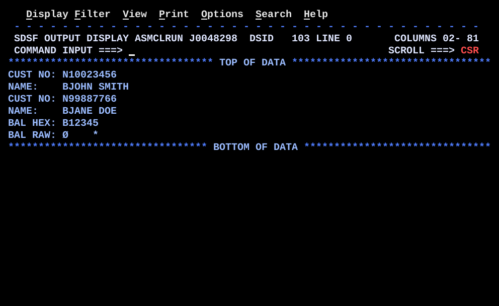

# DS01DSCT.asm

## Program Overview

DS01DSCT shows what a DSECT is: a storage map that reserves no storage of its own. The program defines a customer layout `CUSTD` (`CUSTNO`, `CUSTNAME`, `CUSTBAL`) as a DSECT at the end of the source and builds two sample records as plain `DC` constants. It points R3 at a record, issues `USING CUSTD,3`, and reads each field by name instead of by a hand counted offset. The same DSECT is then used over the second record by loading R3 with another address. Inside the DSECT, `ORG` gives the 5-byte balance a second name, `CUSTBALC`, so the same bytes can be read as packed decimal or as characters. This is the assembler's equivalent of COBOL's REDEFINES. The program writes six lines to SYSOUT.

Program data:

| Field | Value | Used by |
|---|---|---|
| CUSTREC | `CL8'10023456'`, `CL20'JOHN SMITH'`, `PL5'12345'` (33 bytes) | Parts 1 and 3 |
| CUSTREC2 | `CL8'99887766'`, `CL20'JANE DOE'`, `PL5'500'` (33 bytes, directly after `CUSTREC`) | Part 2 |
| CUSTD (DSECT) | `CUSTNO` CL8 at +0, `CUSTNAME` CL20 at +8, `CUSTBAL` PL5 at +28, `CUSTBALC` CL5 at +28 (after `ORG`) | All parts |
| OUTMSG | CL80 output line | Every `PUT` |
| BLANKS | CL80 blanks | Clearing `OUTMSG` |
| ZONE | CL5 work area | `UNPK` of the balance |

Registers used:

| Register | Role |
|---|---|
| R3 | Base register of the `CUSTD` mapping: address of the record being read |
| R12 | Program base register (`USING DS01DSCT,12`) |
| R13 | Save area address |

Output (6 lines):

```
CUST NO: N10023456
NAME:    BJOHN SMITH
CUST NO: N99887766
NAME:    BJANE DOE
BAL HEX: B12345
BAL RAW: Ø    *
```

The `N`, `B`, `B` and `Ø` in column 10 are not part of any label in the source. They come from the 10-byte `MVC` of 9-byte literals (see Key Takeaways).



## How the Program Works

**Linkage and I/O.** The entry linkage, save area, `OPEN`, `CLOSE`, exit linkage (`BR 14`) and SYSOUT DCB follow the same pattern as the earlier programs. There is no input file. `PRINT NOGEN` keeps macro expansions out of the listing. The source order is: code in three parts, data areas, the two records, the DCB, `LTORG`, the DSECT, `END`. The DSECT is last because a `DSECT` statement ends the control section.

**Part 1 - record 1 through the mapping.**
1. `LA 3,CUSTREC` puts the address of the first record in R3.
2. `USING CUSTD,3` tells the assembler to compute `CUSTD` field addresses from R3. It generates no instruction.
3. `MVC OUTMSG,BLANKS` clears the line, `MVC OUTMSG(10),=C'CUST NO: '` places the label, `MVC OUTMSG+10(8),CUSTNO` copies the customer number (displacement 0 from R3) and `PUT` writes line 1.
4. The same four steps with `CUSTNAME` (20 bytes at displacement 8 from R3) write line 2.
5. `DROP 3` ends the mapping.

**Part 2 - same DSECT, record 2.** `LA 3,CUSTREC2` and `USING CUSTD,3` map the same layout over the second record. The same field names now read the second record. Lines 3 and 4 are written.

**Part 3 - ORG, two views of the balance.** `LA 3,CUSTREC` returns to record 1. For `BAL HEX:`, `UNPK ZONE,CUSTBAL` reads the 5 bytes as packed decimal and unpacks them into the 5-byte `ZONE`, `OI ZONE+4,X'F0'` fixes the last sign nibble, and `MVC OUTMSG+10(5),ZONE` places the digits `12345`. For `BAL RAW:`, `MVC OUTMSG+10(5),CUSTBALC` copies the same 5 bytes, X'000012345C', as characters. Only X'5C' (`*`) is printable, so only the `*` shows, in column 15. `DROP 3` ends the mapping.

**Return.** `CLOSE (SYSOUT)`, restore registers, return code 0.

**Execution trace.**

| Step | R3 points at | DSECT field | Displacement | Bytes read | Output line |
|---|---|---|---|---|---|
| 1 | CUSTREC | CUSTNO | +0 | `10023456` | `CUST NO: N10023456` |
| 2 | CUSTREC | CUSTNAME | +8 | `JOHN SMITH` and 10 blanks | `NAME:    BJOHN SMITH` |
| 3 | CUSTREC2 (CUSTREC+33) | CUSTNO | +0 | `99887766` | `CUST NO: N99887766` |
| 4 | CUSTREC2 | CUSTNAME | +8 | `JANE DOE` and 12 blanks | `NAME:    BJANE DOE` |
| 5 | CUSTREC | CUSTBAL (packed) | +28 | X'000012345C', shown as digits `12345` | `BAL HEX: B12345` |
| 6 | CUSTREC | CUSTBALC (characters) | +28 | X'000012345C' | `BAL RAW: Ø    *` |

## Concepts Demonstrated

- A DSECT as a storage map: names and displacements, no storage, no object code
- Separating the layout from the storage, so one layout serves several records
- `USING` with a DSECT name and a register that is not the program base register
- `DROP` to end a mapping and a new `USING` to map the same layout elsewhere
- Fields addressed as register plus displacement, worked out by the assembler
- `ORG` inside a DSECT to give the same bytes two names (REDEFINES)
- Reading the same packed bytes as digits (`UNPK`) and as characters
- DSECT placement after `LTORG` and directly before `END`
- Literals (`=C'...'`) placed in the literal pool at `LTORG`

## How the Concepts Are Implemented

| Concept | Implementation |
|---|---|
| The map | `CUSTD DSECT` starts the map. `CUSTNO DS CL8`, `CUSTNAME DS CL20` and `CUSTBAL DS PL5` give displacements 0, 8 and 28. Assembling it adds no bytes. |
| Real storage | `CUSTREC DC CL8'10023456',CL20'JOHN SMITH',PL5'12345'` and `CUSTREC2` are ordinary constants in the CSECT. Nothing in them says `CUSTD`. |
| Pointing at a record | `LA 3,CUSTREC` loads the address. `USING CUSTD,3` tells the assembler that the layout starts at the address in R3. |
| Using a field by name | `MVC OUTMSG+10(8),CUSTNO` and `MVC OUTMSG+10(20),CUSTNAME` assemble with base R3 and displacements 0 and 8. |
| Same layout, other record | `DROP 3`, `LA 3,CUSTREC2`, `USING CUSTD,3`. The field names are unchanged and now address `CUSTREC2`. |
| Ending a mapping | `DROP 3` after each part. |
| ORG overlay | `ORG CUSTBAL` moves the location counter back to displacement 28. `CUSTBALC DS CL5` is then defined at the same displacement, so `CUSTBAL` and `CUSTBALC` name the same 5 bytes. |
| Packed view | `UNPK ZONE,CUSTBAL` takes the operand length (5) from `PL5`. `OI ZONE+4,X'F0'` makes the last digit printable. |
| Character view | `MVC OUTMSG+10(5),CUSTBALC` copies the packed bytes unchanged; the output shows how they look as characters. |
| DSECT placement | `LTORG` places the literals, then `CUSTD DSECT` follows, then `END DS01DSCT`. |
| Output columns | Label at `OUTMSG(10)`, value at `OUTMSG+10`. |

## Key Takeaways

- A DSECT only gives names to displacements. The program works because R3 holds a real address when the names are used. If `USING CUSTD,3` is in effect while R3 holds a wrong address, the names read other storage with no error.
- `USING` and `DROP` are assembler directives. They run at assembly time and generate no instructions. `LA 3,...` must execute before the first use of a `CUSTD` name.
- Nothing checks that the real record is as long as the layout. `CUSTD` is 33 bytes (8 + 20 + 5), and each `DC` record is 33 bytes.
- The source comments say the records are 30 bytes (in the Part 1, Part 2 and records banners). The real length is 33 bytes. The comments are wrong and the code is correct. The source is not changed.
- The labels `CUST NO: `, `NAME:    `, `BAL HEX: ` and `BAL RAW: ` are 9-byte literals, but each `MVC OUTMSG(10),literal` copies 10 bytes. The tenth byte is the first byte of the next literal in the pool (`N`, `B`, `B`), and for the last literal it is the byte after the pool (`Ø` on this run, outside the program's control). The pool follows the order of first use, and the repeated `=C'CUST NO: '` and `=C'NAME:    '` in Part 2 reuse the same entries. The value fields start at column 11 and are not affected. A 10-byte literal (`=CL10'CUST NO:'`) or a length of 9 would remove the stray character.
- The label `BAL HEX:` is misleading. The line shows the unpacked decimal digits `12345`, not hex. The bytes are X'000012345C'.
- `UNPK ZONE,CUSTBAL` into a 5-byte field takes only the low 3 bytes of the packed field, so it shows 5 digits. A balance of 123456 would show `23456`.
- The `BAL RAW:` line shows `*` because X'5C' is `*` in EBCDIC. X'00', X'00', X'12' and X'34' are not displayed as characters (blank on the screen). Packed bytes are not meant to be read as characters; the line only shows that both names reach the same bytes.
- `ORG` copies no data. The name used decides how the bytes are read. In a real record, another field (for example a type code) would decide which view is valid.
- The DSECT is last because a `DSECT` statement ends the CSECT, so no real storage can be defined after it. `LTORG` goes before it so the literals stay in the CSECT.
- QSAMPROC and BR09MTCH use the same mechanism with an IBM-supplied map: `DCBD` generates the `IHADCB` DSECT, and `USING IHADCB,2` maps it over a DCB. QSAMPROC lays out its input record with `DS 0CL559` and a field list, which is the approach this program compares against.
