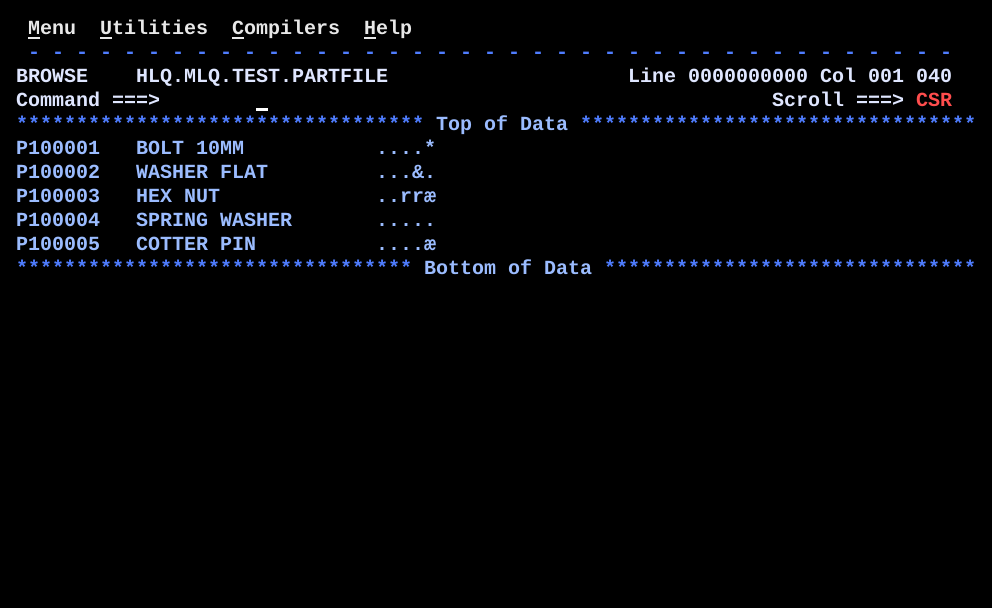

# DS02BILD.asm

## Program Overview

DS02BILD builds a test file. It writes five 40-byte records to the `PARTFILE` DD, each laid out like the `PARTD` DSECT of the companion program DS02DSCT: part number in columns 1-8, description in columns 11-30 and a packed decimal amount in columns 31-35. The amount cannot be typed in an ordinary editor, so the program loads it with `ZAP` from a packed literal, which gives valid packed bytes with a correct sign. The record area `OUTREC` is laid out with `ORG` so that the amount field `OUTAMT` sits at displacement 30. The program writes no SYSOUT; its result is the dataset, which is checked in ISPF Browse.

Program data:

| Field | Value | Used by |
|---|---|---|
| Part numbers | `P100001` to `P100005` (`CL8`) | `MVC OUTREC(8)` |
| Descriptions | `BOLT 10MM`, `WASHER FLAT`, `HEX NUT`, `SPRING WASHER`, `COTTER PIN` (`CL20`, padded with blanks) | `MVC OUTREC+10(20)` |
| Amounts | `P'12345'`, `P'500'`, `P'99999'`, `P'0'`, `P'15099'` | `ZAP OUTAMT` |
| OUTREC | 40-byte record area (`DS 0CL40`) | Every `PUT` |
| OUTAMT | `PL5` at displacement 30 of `OUTREC` | `ZAP` |
| BLANKS40 | `CL40' '` | Clearing `OUTREC` |

Registers used:

| Register | Role |
|---|---|
| R12 | Program base register (`USING DS02BILD,12`) |
| R13 | Save area address |

Files:

| DD | Direction | Format | Dataset in the JCL |
|---|---|---|---|
| PARTFILE | Output | `RECFM=FB`, `LRECL=40`, `BLKSIZE=0` | `HLQ.MLQ.TEST.PARTFILE` (created `NEW,CATLG,DELETE`) |

Run JCL: `jcl/DS02BILD.jcl` (assemble, link, run). The dataset name is masked: replace `HLQ.MLQ` with your own qualifiers.

Output (5 records, ISPF Browse, `Col 001 040`, character view):

```
P100001   BOLT 10MM           ....*
P100002   WASHER FLAT         ...&.
P100003   HEX NUT             ..rræ
P100004   SPRING WASHER       .....
P100005   COTTER PIN          ....æ
```

Columns 31-35 hold packed bytes, which Browse shows as characters. Bytes that have no printable character show as `.`. The real contents are in the execution trace below.



## How the Program Works

**Linkage and I/O.** The entry linkage, save area and exit linkage (`BR 14`) follow the same pattern as the earlier programs. `PRINT NOGEN` keeps macro expansions out of the listing. `OPEN (PARTFILE,(OUTPUT))` opens the file, `PUT PARTFILE,OUTREC` writes one record (move mode, `MACRF=PM`) and `CLOSE (PARTFILE)` closes it. There is no loop. The same five statements are written five times, once per record.

**Each record.**
1. `MVC OUTREC,BLANKS40` clears all 40 bytes. The length of the first operand comes from `OUTREC` (`DS 0CL40`).
2. `MVC OUTREC(8),=CL8'P10000n'` places the part number in columns 1-8.
3. `MVC OUTREC+10(20),=CL20'...'` places the description in columns 11-30.
4. `ZAP OUTAMT,=P'n'` places the packed amount in columns 31-35. The source is a 5-byte value from the literal pool.
5. `PUT PARTFILE,OUTREC` writes the 40 bytes.

Columns 9-10 and 36-40 stay blank from step 1.

**Return.** `CLOSE (PARTFILE)`, restore registers, return code 0.

**Execution trace.**

| Record | Part number | Description | `ZAP` literal | Bytes in columns 31-35 | Browse characters |
|---|---|---|---|---|---|
| 1 | `P100001` | `BOLT 10MM` | `P'12345'` | X'000012345C' | `....*` |
| 2 | `P100002` | `WASHER FLAT` | `P'500'` | X'000000500C' | `...&.` |
| 3 | `P100003` | `HEX NUT` | `P'99999'` | X'000099999C' | `..rræ` |
| 4 | `P100004` | `SPRING WASHER` | `P'0'` | X'000000000C' | `.....` |
| 5 | `P100005` | `COTTER PIN` | `P'15099'` | X'000015099C' | `....æ` |

## Concepts Demonstrated

- Building a test file with a program when the data contains packed decimal
- `ZAP` from a packed literal gives valid digits and a valid sign nibble
- A record area laid out with `DS 0CL40` and `ORG`, matching a DSECT in another program
- The `ORG` forward and the `ORG` to the record end that keeps the next definitions out of the record
- Output with QSAM: `OPEN` for output, `PUT`, `CLOSE`, `DCB` with `MACRF=PM`
- Clearing a record with `MVC` from a blank constant before building it
- Literals (`=CL8'...'`, `=CL20'...'`, `=P'...'`) placed at `LTORG`
- Reading a packed field in Browse: printable characters only, and why it looks like garbage

## How the Concepts Are Implemented

| Concept | Implementation |
|---|---|
| Record layout | `OUTREC DS 0CL40` defines the label with length attribute 40 and reserves no bytes. `MVC OUTREC,BLANKS40` therefore moves 40 bytes. |
| Positioning the amount | `ORG OUTREC+30` moves the location counter to displacement 30. `OUTAMT DS PL5` is then defined there, which is column 31. |
| Keeping the record whole | `ORG OUTREC+40` moves the location counter to the end of the record, so the 40 bytes belong to `OUTREC`. Without it the counter would stop at `OUTREC+35`, and the next definition would start inside the record. |
| Packed value | `ZAP OUTAMT,=P'12345'` copies the literal into a 5-byte field. A packed literal carries the sign nibble `C`, so the stored value is X'000012345C'. |
| Part number and description | `MVC OUTREC(8),=CL8'P100001'` and `MVC OUTREC+10(20),=CL20'BOLT 10MM'`. The literal length equals the move length, so nothing outside the literal is copied. |
| Blank fields | Columns 9-10 and 36-40 are never written after `MVC OUTREC,BLANKS40`, so they stay blank. |
| Output file | `PARTFILE DCB DSORG=PS,MACRF=PM,DDNAME=PARTFILE,` with the continuation line `RECFM=FB,LRECL=40,BLKSIZE=0`. The continuation character `X` is in column 72. |
| Open, write, close | `OPEN (PARTFILE,(OUTPUT))`, five times `PUT PARTFILE,OUTREC`, `CLOSE (PARTFILE)`. |
| JCL | `//PARTFILE DD DSN=HLQ.MLQ.TEST.PARTFILE,DISP=(NEW,CATLG,DELETE),SPACE=(TRK,(1,2),RLSE),DCB=(RECFM=FB,LRECL=40,BLKSIZE=0)` in step `STEP03`. |

## Key Takeaways

- The position of `OUTAMT` is the point of the program. `OUTAMT` here and `PARTAMT` in the `PARTD` DSECT of DS02DSCT must be at the same displacement (30). Nothing checks this at assembly or run time. If they differ, DS02DSCT reads the wrong five bytes.
- `ORG OUTREC+40` moves forward (30 to 40), but the source comment says "Step back". The comment is wrong and the code is correct. The source is not changed. The comment is shortened in the source to "Step back to end of record,".
- The final `ORG` matters. Without it the location counter ends at `OUTREC+35`. The `DCB` that follows would then be assembled over the end of the record area (a `DCB` is aligned, so from byte 36), and `PUT` would write bytes of the `DCB` into columns 36-40.
- `ORG` forward from `OUTREC` leaves bytes 0-29 as skipped storage. They get their values from `MVC OUTREC,BLANKS40` at the start of each record, not from the `DS`.
- Browse in character view cannot show packed data. `X'5C'` shows as `*`, `X'50'` as `&`, `X'99'` as `r` and `X'9C'` as `æ`. All bytes without a printable character show as `.`. Use `HEX ON` in Browse to see the real bytes, for example X'000012345C' for record 1.
- A packed field has no decimal point. The comment `$123.45, if 2 decimal places assumed` means the reader decides the scale. The stored digits are `12345`.
- `ZAP` with `=P'0'` gives X'000000000C', a valid positive zero. A field of X'0000000000' would have no valid sign and would fail in packed arithmetic.
- The file cannot be built in `data/` as a text file. Packed bytes such as X'1C' and X'5C' would be damaged by an ASCII-to-EBCDIC text upload. The program creates the file on the mainframe instead.
- `PARTFILE` is coded `NEW,CATLG,DELETE`. If the dataset already exists, the run fails at allocation, so delete it before a rerun.
- The same five statements are written five times and there is no loop. The comment block in the source says this is on purpose, so each record is readable in the source.
- The banner comment refers to `dt02arth.asm` in lower case. It is the source of DT02ARTH in this repo. The name is not changed.
- The JCL has `PRORGAM` in a comment (`SET PRORGAM NAME, SOURCE & LOAD LIBRARY`). It is kept as shown in the screenshot.
