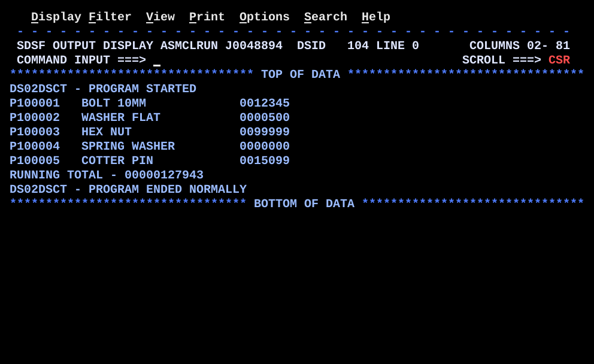

# DS02DSCT.asm

## Program Overview

DS02DSCT reads the file `PARTFILE` that DS02BILD creates and uses two DSECTs. `PARTD` maps the 40-byte record in the buffer `INAREA`, so the part number, description and packed amount are read by name. `PARMD` maps a small parameter block `PARMAREA` that `BUILDTOT` fills and hands to the routine `ADDAMT` in R1. For each of the five records the program prints one line (part number, description, amount) to `SYSPRINT`, adds the amount to a packed running total through the parameter block, and after end of file prints the total. It writes eight lines.

Program data:

| Field | Value | Used by |
|---|---|---|
| PARTFILE | Input, `RECFM=FB`, `LRECL=40`, 5 records built by DS02BILD | `GET` |
| INAREA | `CL40` record buffer | `GET`, `PARTD` mapping |
| PARTD (DSECT) | `PARTNO` CL8 at +0, filler CL2 at +8, `PARTDESC` CL20 at +10, `PARTAMT` PL5 at +30, filler CL5 at +35 | `SHOWREC`, `BUILDTOT` |
| PARMAREA | `CL11` parameter block | `BUILDTOT`, `ADDAMT` |
| PARMD (DSECT) | `PARMAMT` PL5 at +0, `PARMTOT` PL6 at +5 (never used) | `BUILDTOT`, `ADDAMT` |
| GRANDTOT | `PL6`, running total, set to zero at the start | `ADDAMT`, `ALLDONE` |
| RECCNT | `PL4`, records read, set to zero at the start, never printed | `READREC` |
| EOFSW | `CL1`, `N` until end of file, then `Y` | `MAINLOOP`, `EOFRTN` |
| PRTLINE | `CL80` output line | Every `PUT` |
| ZONE7, ZONE11 | `CL7` and `CL11` work areas for `UNPK` | `SHOWREC`, `ALLDONE` |
| MSGSTRT, MSGEND | `CL50` messages | `PRTMSG` |
| BLANKS, BLANKS40 | `CL80` and `CL40` blanks | Clearing `PRTLINE` and `INAREA` |

Registers used:

| Register | Role |
|---|---|
| R1 | Address of the message (`PRTMSG`) or of the parameter block (`BUILDTOT`, `ADDAMT`) |
| R3 | Base register of `PARTD`: address of `INAREA` |
| R9 | Return address of the level 2 call `BAL 9,ADDAMT` |
| R10 | Return address of the level 1 calls (`BAL 10` from the mainline) |
| R12 | Program base register (`USING DS02DSCT,12`) |
| R13 | Save area address |

Files:

| DD | Direction | Format | Source of the data |
|---|---|---|---|
| PARTFILE | Input | `RECFM=FB`, `LRECL=40`, `EODAD=EOFRTN` | `HLQ.MLQ.TEST.PARTFILE`, created by DS02BILD |
| SYSPRINT | Output | `RECFM=FB`, `LRECL=80` | Spool |

Run JCL: `jcl/DS02DSCT.jcl` (assemble, link, run). `PARTFILE` is `DISP=SHR` on `HLQ.MLQ.TEST.PARTFILE`, so run DS02BILD first. Replace `HLQ.MLQ` with your own qualifiers.

Output (8 lines):

```
DS02DSCT - PROGRAM STARTED
P100001   BOLT 10MM             0012345
P100002   WASHER FLAT           0000500
P100003   HEX NUT               0099999
P100004   SPRING WASHER         0000000
P100005   COTTER PIN            0015099
RUNNING TOTAL - 00000127943
DS02DSCT - PROGRAM ENDED NORMALLY
```

The amounts are the 7 low digits of each packed amount. The total is 11 digits.



## How the Program Works

**Linkage and I/O.** The entry linkage, save area, exit linkage (`BR 14`) and `PRINT NOGEN` follow the same pattern as the earlier programs. `SYSPRINT` is opened for output and `PARTFILE` for input. All routines are internal and are called with `BAL`.

**Start.**
1. `MVI EOFSW,C'N'` and `ZAP RECCNT,=P'0'` set the switch and the record count.
2. `ZAP GRANDTOT,=P'0'` sets the running total to a valid packed zero. This line is what fixed the S0C7 of the first version (see Key Takeaways).
3. `LA 1,MSGSTRT` and `BAL 10,PRTMSG` print the start message.
4. `BAL 10,READREC` reads the first record (priming read).

**Main loop (`MAINLOOP`).** `CLI EOFSW,C'Y'` and `BE ALLDONE` end the loop. Otherwise, for each record:
1. `BAL 10,SHOWREC` prints the record.
2. `BAL 10,BUILDTOT` adds the amount to the total through a parameter block.
3. `BAL 10,READREC` reads the next record, then `B MAINLOOP`.

**READREC.** `MVC INAREA,BLANKS40` clears the buffer, `GET PARTFILE,INAREA` copies the next record into it (move mode) and `AP RECCNT,=P'1'` counts it. At end of file the `GET` branches to `EOFRTN`, which sets `EOFSW` to `Y` and returns with `BR 10`, skipping the count.

**SHOWREC.** `LA 3,INAREA` and `USING PARTD,3` map `PARTD` over the buffer. `MVC PRTLINE(8),PARTNO` and `MVC PRTLINE+10(20),PARTDESC` place the part number and description. `UNPK ZONE7,PARTAMT` makes 7 digits from the packed amount, `OI ZONE7+6,X'F0'` makes the last digit printable, and `MVC PRTLINE+32(7),ZONE7` places it at column 33. `PUT` writes the line, `DROP 3` ends the mapping.

**BUILDTOT.** `LA 3,INAREA` and `USING PARTD,3` map the record. `LA 1,PARMAREA` and `USING PARMD,1` map the parameter block. `MVC PARMAMT,PARTAMT` copies the 5-byte amount from the record (through R3) into the block (through R1), with two DSECTs active at once. Both are dropped, then `BAL 9,ADDAMT` calls the routine. R1 still holds the address of the block. `BR 10` returns to `MAINLOOP`.

**ADDAMT.** `USING PARMD,1` maps the block. `AP GRANDTOT,PARMAMT` adds the amount to the total. `DROP 1`, `BR 9` returns to `BUILDTOT`. The routine reads the amount only from the block, and updates `GRANDTOT` by name.

**ALLDONE.** `UNPK ZONE11,GRANDTOT` makes 11 digits from the 6-byte total, `OI ZONE11+10,X'F0'` fixes the last digit, and the line `RUNNING TOTAL - ` plus the digits is written. The end message is printed with `PRTMSG`. Then `CLOSE (PARTFILE)`, `CLOSE (SYSPRINT)`, restore registers, return code 0.

**Execution trace.**

| Record | Part number | `PARTAMT` (hex) | Shown by `SHOWREC` | `PARMAMT` after `BUILDTOT` | `GRANDTOT` after `ADDAMT` |
|---|---|---|---|---|---|
| 1 | `P100001` | X'000012345C' | `0012345` | 12345 | 12345 |
| 2 | `P100002` | X'000000500C' | `0000500` | 500 | 12845 |
| 3 | `P100003` | X'000099999C' | `0099999` | 99999 | 112844 |
| 4 | `P100004` | X'000000000C' | `0000000` | 0 | 112844 |
| 5 | `P100005` | X'000015099C' | `0015099` | 15099 | 127943 |
| End of file | | | | | `00000127943` printed |

## Concepts Demonstrated

- A DSECT over a real record: the buffer filled by `GET` is described by a DSECT, so fields are used by name
- Two DSECTs active at once, each with its own base register (`PARTD` with R3, `PARMD` with R1)
- A parameter list: a block of fields built by the caller and passed by its address in R1
- A called routine that only knows the parameter layout (`ADDAMT` uses `PARMD`)
- Two levels of internal calls with separate return registers (R10 and R9)
- QSAM input with `GET` in move mode and an `EODAD` exit
- Priming read and a loop that ends on an end-of-file switch
- Packed decimal accumulation: initialize with `ZAP`, add with `AP`
- Showing packed data as digits with `UNPK` and `OI`
- Reading a file whose layout was built by another program (DS02BILD)
- DSECTs placed after `LTORG` and directly before `END`

## How the Concepts Are Implemented

| Concept | Implementation |
|---|---|
| Record map | `PARTD DSECT`: `PARTNO DS CL8`, `DS CL2`, `PARTDESC DS CL20`, `PARTAMT DS PL5`, `DS CL5`. Displacements 0, 10, 30 and 35, 40 bytes in all, the same layout as `OUTREC` in DS02BILD. |
| Real buffer | `INAREA DS CL40` is the storage. It has no field names; `LA 3,INAREA` and `USING PARTD,3` give it names while the mapping is active. |
| Read | `GET PARTFILE,INAREA` in move mode. The `PARTFILE` DCB is `MACRF=GM,EODAD=EOFRTN,RECFM=FB,LRECL=40,BLKSIZE=0`. |
| End of file | `EOFRTN` sets `EOFSW` to `Y` and does `BR 10`. R10 still holds the address after the `BAL 10,READREC`, so control goes back to the caller of `READREC`. |
| Priming read | `BAL 10,READREC` before `MAINLOOP`, and again at the bottom of each pass. |
| Parameter block | `PARMAREA DS CL11` is the storage; `PARMD DSECT` (`PARMAMT DS PL5`, `PARMTOT DS PL6`) is the map. `LA 1,PARMAREA` puts its address in R1. |
| Two maps at once | `USING PARTD,3` and `USING PARMD,1` are both in effect for `MVC PARMAMT,PARTAMT`. The assembler uses base R1 for the target and base R3 for the source. |
| Called routine | `BAL 9,ADDAMT`. `ADDAMT` issues `USING PARMD,1` and uses `PARMAMT`; it knows nothing of `INAREA` or `PARTD`. |
| Two call levels | Level 1 calls (`SHOWREC`, `BUILDTOT`, `READREC`, `PRTMSG`) use `BAL 10` and `BR 10`. The level 2 call from inside `BUILDTOT` uses `BAL 9` and `BR 9`, so R10 is not overwritten. |
| Total | `ZAP GRANDTOT,=P'0'` first, then `AP GRANDTOT,PARMAMT` per record. `GRANDTOT` is `PL6`. |
| Digit display | `UNPK ZONE7,PARTAMT` and `OI ZONE7+6,X'F0'` for the amount; `UNPK ZONE11,GRANDTOT` and `OI ZONE11+10,X'F0'` for the total. |
| Message routine | `PRTMSG` copies 50 bytes from the address in R1 (`MVC PRTLINE(50),0(1)`) and writes the line. |
| DSECT placement | `LTORG`, then `PARTD DSECT`, then `PARMD DSECT`, then `END DS02DSCT`. |

## Key Takeaways

- The first version abended with S0C7. `GRANDTOT DS PL6` reserves 6 bytes and gives them no value. `AP` checks that both operands are valid packed data, and a field with no valid sign nibble fails. Even storage that happens to be all zeros fails, because the last nibble 0 is not a sign. `ZAP GRANDTOT,=P'0'` at the start is required.
- Before that failure, `MVC`, `UNPK` and `OI` do not check packed data. `SHOWREC` therefore prints record 1 correctly before `AP` abends in `ADDAMT`.
- The first version also had a second fault, found by reading the code: `BUILDTOT` called `ADDAMT` with `BAL 10`, which overwrites R10, the return address to `MAINLOOP`. `ADDAMT` would return to the `BR 10` in `BUILDTOT`, which would branch to itself without end. The S0C7 hid it. The final version uses `BAL 9` and `BR 9` for the call from `BUILDTOT`. Each calling level needs its own return register.
- The final version relies on R9 and R10 surviving `GET` and `PUT`, which QSAM preserves (R2 to R13).
- Macros such as `GET`, `PUT` and `OPEN` change R0, R1, R14 and R15. R1 is loaded just before it is used (`LA 1,MSGSTRT` before `BAL 10,PRTMSG`; `LA 1,PARMAREA` before `BAL 9,ADDAMT`) and no macro runs in between.
- `ADDAMT` is called with a parameter block but updates `GRANDTOT` by name, outside the block. `PARMTOT` is defined and never used, and the last 6 bytes of `PARMAREA` are never set. The source says this is a shortcut. A stricter routine would receive the address of the total in the block.
- `DROP 3` and `DROP 1` come before `BAL 9,ADDAMT`. The mappings are assembler-time and do not affect R1, which still carries the block address. `ADDAMT` sets up its own `USING PARMD,1`.
- `PARTAMT` must be at displacement 30 and be packed, as built by `OUTAMT` in DS02BILD. A file edited and saved as text loses the packed bytes. `SHOWREC` would still print digits and `AP` would then abend.
- `UNPK ZONE7,PARTAMT` uses only the 7 low digits of the 9 in `PL5`; an amount over 9999999 would lose its leftmost digits on the line but would be added to the total in full.
- `GRANDTOT` is `PL6`, 11 digits, shown in `ZONE11` without loss. `RECCNT` counts records read and is never printed.
- The line layout depends on fixed offsets: part number at `PRTLINE`, description at `PRTLINE+10`, amount at `PRTLINE+32`. The messages are `CL50` and `PRTMSG` moves 50 bytes.
- The comments name the record DSECT `PARTREC` (in the header block and the `READREC` and `SHOWREC` headings), but the DSECT is `PARTD`. The comments are wrong and the code is correct.
- `EOFRTN` is reached from the `GET` inside `READREC`, so it must end with `BR 10` to return to the caller of `READREC`.
- In DS01DSCT the DSECT was laid over `DC` data. Here it is laid over a buffer that `GET` fills, which is the normal use.
