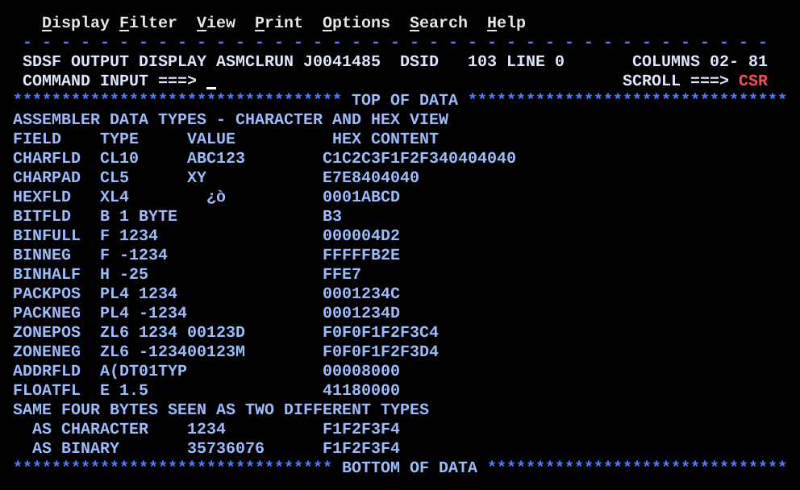

# DT01TYPE.asm

## Program Overview

DT01TYPE defines one field of each common HLASM data type and prints, for each field, its type, its character appearance and its true hexadecimal content. The hex digits are built by an internal routine, `HEXDISP`, called with `BAL`. The program then maps the same four bytes as characters (`OVLCHAR`) and as a fullword (`OVLFULL`) to show that a type is only the way the bytes are interpreted.

Program data:

| Field | Definition | Stored bytes (hex) | Used by |
|---|---|---|---|
| CHARFLD | `CL10'ABC123'` | C1C2C3F1F2F3 40404040 | C, blank padded on the right |
| CHARPAD | `CL5'XY'` | E7E8404040 | C, short value |
| HEXFLD | `XL4'0001ABCD'` | 0001ABCD | X, raw bytes |
| BITFLD | `B'10110011'` | B3 | B, one byte |
| BINFULL | `F'1234'` | 000004D2 | F, fullword |
| BINNEG | `F'-1234'` | FFFFFB2E | F, twos complement |
| BINHALF | `H'-25'` | FFE7 | H, halfword |
| PACKPOS | `PL4'1234'` | 0001234C | P, sign C |
| PACKNEG | `PL4'-1234'` | 0001234D | P, sign D |
| ZONEPOS | `ZL6'1234'` | F0F0F1F2F3C4 | Z, sign C in the last zone |
| ZONENEG | `ZL6'-1234'` | F0F0F1F2F3D4 | Z, sign D in the last zone |
| ADDRFLD | `A(DT01TYPE)` | 00008000 (load address in this run) | A, address constant |
| FLOATFL | `E'1.5'` | 41180000 | E, short floating point |
| OVLFULL / OVLCHAR | `DS 0F` then `C'1234'` | F1F2F3F4 | One area, two labels |
| HEXDIGIT | `C'0123456789ABCDEF'` | | `HEXDISP` nibble table |

Registers used:

| Register | Role |
|---|---|
| R2 | Address of the field to dump; `HEXDISP` advances it one byte per pass |
| R3 | Number of bytes to dump; `BCT` counter in `HEXDISP` |
| R4 | Fullword loaded from `OVLFULL` for the decimal display |
| R5 | Work register: the byte, then its low nibble |
| R6 | High nibble of the byte |
| R7 | Translated hex character (low byte stored with `STC`) |
| R10 | Address in `OUTMSG` where the next hex digit goes; advanced 2 per byte |
| R11 | Return address set by `BAL 11,HEXDISP` |
| R12 | Base register |
| R13 | Save area address |

Output (18 lines):

```
ASSEMBLER DATA TYPES - CHARACTER AND HEX VIEW
FIELD    TYPE     VALUE          HEX CONTENT
CHARFLD  CL10     ABC123        C1C2C3F1F2F340404040
CHARPAD  CL5      XY            E7E8404040
HEXFLD   XL4        ¿ò          0001ABCD
BITFLD   B 1 BYTE               B3
BINFULL  F 1234                 000004D2
BINNEG   F -1234                FFFFFB2E
BINHALF  H -25                  FFE7
PACKPOS  PL4 1234               0001234C
PACKNEG  PL4 -1234              0001234D
ZONEPOS  ZL6 1234 00123D        F0F0F1F2F3C4
ZONENEG  ZL6 -123400123M        F0F0F1F2F3D4
ADDRFLD  A(DT01TYP              00008000
FLOATFL  E 1.5                  41180000
SAME FOUR BYTES SEEN AS TWO DIFFERENT TYPES
  AS CHARACTER    1234          F1F2F3F4
  AS BINARY       35736076      F1F2F3F4
```



## How the Program Works

**Linkage and I/O.** The entry linkage, save area, `OPEN`, `CLOSE`, exit linkage (`BR 14`) and SYSOUT DCB follow the same pattern as the earlier programs. A heading line (`MSGHDR`) and a column heading line (`MSGCOL`) are written first.

**One dump block per type.** Every field uses the same block of eight statements:
1. `MVC OUTMSG(80),BLANKS` clears the line.
2. `MVC OUTMSG(18),=CL18'name  type value'` places the field name at column 1 and the type text at column 10. The literal is 18 bytes, so the text after column 18 is cut off.
3. For fields of type C, X and Z, `MVC OUTMSG+18(n),field` copies the field bytes to column 19, so they print as characters.
4. `LA 2,field`, `LA 3,length` and `LA 10,OUTMSG+32` set the three parameters of `HEXDISP`.
5. `BAL 11,HEXDISP` builds the hex digits at column 33.
6. `PUT SYSOUT,OUTMSG` writes the line.

For BITFLD, BINFULL, BINNEG, BINHALF, PACKPOS, PACKNEG, ADDRFLD and FLOATFL the value column is empty. The value shown in the TYPE column is text typed into the literal, not taken from the field.

**Overlay section.** `MSGOVL` is written, then two lines for the same four bytes at `OVLFULL`/`OVLCHAR` (`X'F1F2F3F4'`):
1. `AS CHARACTER`: `MVC OUTMSG+18(4),OVLCHAR` prints `1234`, then `HEXDISP` prints `F1F2F3F4`.
2. `AS BINARY`: `L 4,OVLFULL` loads the bytes as a signed fullword (-235736076). `CVD`, `UNPK ZONE,DOUBLE` and `OI ZONE+7,X'F0'` turn it into `ZONE`, an 8 byte field, so the leftmost digit and the sign are lost and `35736076` is shown. `HEXDISP` prints `F1F2F3F4` again.

**HEXDISP.** For each byte at the address in R2:
1. `SR 5,5` clears R5 and `IC 5,0(,2)` inserts the byte (0 to 255) into its low 8 bits.
2. `LR 6,5` and `SRL 6,4` give the high nibble in R6.
3. `N 5,=F'15'` keeps only the low nibble in R5.
4. `IC 7,HEXDIGIT(6)` and `STC 7,0(,10)` store the character for the high nibble.
5. `IC 7,HEXDIGIT(5)` and `STC 7,1(,10)` store the character for the low nibble.
6. `LA 10,2(,10)` and `LA 2,1(,2)` advance the output and input pointers.
7. `BCT 3,HEXLOOP` repeats until R3 is 0, then `BR 11` returns.

**Execution trace.** `HEXDISP` for `BINNEG` (`X'FFFFFB2E'`): R2 -> `BINNEG`, R3 = 4, R10 -> `OUTMSG+32`.

| Pass | Byte | R5 after `IC` | R6 (high) | R5 (low) | Stored | Written at | R3 after | `BCT` |
|---|---|---|---|---|---|---|---|---|
| 1 | FF | 255 | 15 | 15 | `FF` | `OUTMSG+32` | 3 | branch |
| 2 | FF | 255 | 15 | 15 | `FF` | `OUTMSG+34` | 2 | branch |
| 3 | FB | 251 | 15 | 11 | `FB` | `OUTMSG+36` | 1 | branch |
| 4 | 2E | 46 | 2 | 14 | `2E` | `OUTMSG+38` | 0 | fall through |

## Concepts Demonstrated

- The common DC types: C, X, B, F, H, P, Z, A and E
- Length modifiers (`CL10`, `XL4`, `PL4`, `ZL6`) and padding rules: C pads on the right with blanks, X pads on the left with zeros
- Twos complement for negative binary values
- Sign nibbles in packed decimal (C, D) and zoned decimal (zone of the last byte)
- Alignment: fullword and halfword fields on their boundaries
- Why the same bytes print differently as characters and as hex
- Mapping one storage area with two labels (`DS 0F` followed by `DC C'1234'`)
- An internal subroutine called with `BAL` and left with `BR`
- Converting a byte to two hex characters with a shift, a mask and a lookup table
- Loop control with `BCT` and a count in a register
- A literal pool (`LTORG`) for `=F'15'` and the `=CL18'...'` literals

## How the Concepts Are Implemented

| Concept | Implementation |
|---|---|
| Data types | The `DC` lines under "The data types themselves", one per type, each with a comment on the format. |
| Padding | `CL10'ABC123'` is padded on the right with X'40'. `XL4'0001ABCD'` is exact; a shorter hex constant would be padded on the left with zeros. |
| Twos complement | `F'-1234'` is stored as `FFFFFB2E`; `H'-25'` as `FFE7`. |
| Packed decimal | `PL4'1234'` is `0001234C` and `PL4'-1234'` is `0001234D`. The sign is the low nibble of the last byte. |
| Zoned decimal | `ZL6'1234'` is `F0F0F1F2F3C4`. The last byte has the sign in its zone nibble, so it prints as `D` (X'C4'). `ZL6'-1234'` ends in X'D4', which prints as `M`. |
| Alignment | The `F`, `H` and `A` constants are aligned by the assembler. `OVLFULL DS 0F` forces a fullword boundary for the overlay area. |
| Overlay | `OVLFULL` and `OVLCHAR` are the same address. `L 4,OVLFULL` reads it as binary, `MVC OUTMSG+18(4),OVLCHAR` reads it as characters. |
| Hex display | `HEXDISP` splits each byte with `SRL 6,4` and `N 5,=F'15'` and uses `IC 7,HEXDIGIT(n)` with the nibble as an index into the 16 byte table. |
| Calling the routine | `BAL 11,HEXDISP` puts the return address in R11. The routine ends with `BR 11`. The parameters are in R2, R3 and R10. |
| Loop | `BCT 3,HEXLOOP` counts the bytes down from the length in R3. |
| Output columns | Name and type at `OUTMSG(18)`, characters at `OUTMSG+18`, hex at `OUTMSG+32`. The column heading `MSGCOL` puts `HEX CONTENT` at column 34, one column right of the hex digits. |
| Decimal display | `CVD 4,DOUBLE`, `UNPK ZONE,DOUBLE`, `OI ZONE+7,X'F0'` and `MVC OUTMSG+18(8),ZONE`, as in the earlier programs. |
| Literals | `LTORG` after the DCB places the literals (`=F'15'` and the `=CL18` constants) in the pool. |

## Key Takeaways

- The type does not change the bytes in storage. It changes how an instruction reads them. `X'F1F2F3F4'` is `1234` as characters, a negative fullword as binary, and four bytes of hex in the dump.
- Positive zoned decimal prints as the digits only when the sign nibble is F. `ZL6'1234'` is stored with sign C in the last byte (`F0F0F1F2F3C4`), so it prints as `00123D`. The comment `Prints as 001234` in the source and the banner line "Positive zoned decimal is identical to printable characters" do not match the output.
- The negative zoned value ends in X'D4', which is `M` in EBCDIC, so `ZL6'-1234'` prints as `00123M`.
- `OVLFULL DS 0F` reserves no storage; it only aligns the area that `OVLCHAR` (`DC C'1234'`) defines. The banners say "three different labels" and "three different types" and mention hex, but the code has two labels and `MSGOVL` says "TWO DIFFERENT TYPES". The source is not changed.
- `AS BINARY` shows `35736076`, but the fullword `X'F1F2F3F4'` is -235736076. `ZONE` is 8 bytes, so `UNPK` keeps only 8 digits and `OI ZONE+7,X'F0'` replaces the sign.
- The `=CL18'ADDRFLD  A(DT01TYPE)'` literal is 20 characters long and is cut to 18, so the line shows `A(DT01TYP`.
- For BITFLD, BINFULL, BINNEG, BINHALF, PACKPOS, PACKNEG, ADDRFLD and FLOATFL, the value in the TYPE column is typed text. If the `DC` value is changed, the literal must be changed too.
- `HEXFLD` prints `¿ò` in the value column because the bytes X'00' and X'01' do not display and X'AB' and X'CD' are `¿` and `ò` in code page 037.
- The hex digits of `ADDRFLD` (`00008000`) are the load address of `DT01TYPE` in this run and can differ in another run.
- `HEXDISP` expects R3 to be at least 1. With R3 = 0, `BCT` makes R3 negative and the loop runs about 4 billion times.
- `HEXDISP` changes R2, R3 and R10 as well as its work registers, so the caller reloads all three before each call.
- The hex output starts at `OUTMSG+32`, so the character area at `OUTMSG+18` must stay under 14 bytes. The longest field shown, `CHARFLD`, uses 10.
- The literal `=F'15'` in `N 5,=F'15'` needs the literal pool, which is why `LTORG` is present.
