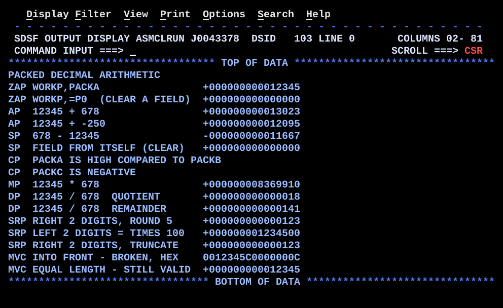

# DT02ARTH.asm

## Program Overview

DT02ARTH demonstrates the packed decimal instruction set in 15 numbered examples: `ZAP`, `AP`, `SP`, `CP`, `MP`, `DP`, `SRP`, and `MVC` used on packed data. Every example works on three test values (`PACKA` 12345, `PACKB` 678, `PACKC` -250) and prints one line. Decimal instructions are SS format and work in storage, so the arithmetic uses no general registers. Registers are used only for the output pointer, the return address of two internal routines, and a hex dump.

Examples 7 and 8 print a text line chosen by the condition code. Example 14 deliberately shows a wrong result (`MVC` into the front of an 8-byte field) as a hex dump, and example 15 shows the safe use of `MVC`.

Program data:

| Field | Value | Used by |
|---|---|---|
| PACKA | `PL4'12345'`, X'0012345C' | Examples 1, 3, 4, 5, 7, 9, 10, 11, 12, 13, 14, 15 |
| PACKB | `PL4'678'`, X'0000678C' | Examples 3, 5, 7, 9, 10 |
| PACKC | `PL3'-250'`, X'00250D' | Examples 4, 8 |
| WORKP | `PL8` work field, 15 digits and sign | Every example; input of `PKDISP` |
| MULT | `PL8`, multiply work area | Example 9 |
| DIVD | `PL8`, divide work area (quotient `DIVD(4)`, remainder `DIVD+4(4)`) | Example 10 |
| SAMELEN | `PL4`, same length as `PACKA` | Example 15 |
| ZONE15 | `CL15`, zoned decimal work area | `PKDISP` |
| HEXDIGIT | `C'0123456789ABCDEF'` | `HEXDISP` |
| Messages | `MSGHDR` `CL50`; `MSG01` to `MSG06`, `MSG09` to `MSG15` `CL32`; `MSG07EQ/LO/HI`, `MSG08NG/PS` `CL50` | Output lines |

Registers used:

| Register | Role |
|---|---|
| R2 | Address of the field to dump (`HEXDISP` input) |
| R3 | Length to dump (`HEXDISP` input and `BCT` counter) |
| R5 | Work register in `HEXDISP`: byte, then low nibble |
| R6 | High nibble in `HEXDISP` |
| R7 | Hex character being stored in `HEXDISP` |
| R10 | Address in `OUTMSG` where the number or hex string goes (`OUTMSG+32`) |
| R11 | Return address set by `BAL` for `PKDISP` and `HEXDISP` |
| R12 | Base register |
| R13 | Save area address |

Output (17 lines):

```
PACKED DECIMAL ARITHMETIC
ZAP WORKP,PACKA                 +000000000012345
ZAP WORKP,=P0  (CLEAR A FIELD)  +000000000000000
AP  12345 + 678                 +000000000013023
AP  12345 + -250                +000000000012095
SP  678 - 12345                 -000000000011667
SP  FIELD FROM ITSELF (CLEAR)   +000000000000000
CP  PACKA IS HIGH COMPARED TO PACKB
CP  PACKC IS NEGATIVE
MP  12345 * 678                 +000000008369910
DP  12345 / 678  QUOTIENT       +000000000000018
DP  12345 / 678  REMAINDER      +000000000000141
SRP RIGHT 2 DIGITS, ROUND 5     +000000000000123
SRP LEFT 2 DIGITS = TIMES 100   +000000001234500
SRP RIGHT 2 DIGITS, TRUNCATE    +000000000000123
MVC INTO FRONT - BROKEN, HEX    0012345C0000000C
MVC EQUAL LENGTH - STILL VALID  +000000000012345
```



## How the Program Works

**Linkage and I/O.** The entry linkage, save area, `OPEN`, `CLOSE`, exit linkage (`BR 14`) and SYSOUT DCB follow the same pattern as the earlier programs. A heading line (`MSGHDR`) is written first. A `LTORG` before `END` places the literals `=P'0'` and `=F'15'`.

**Display pattern.** Most examples end with the same five instructions: `MVC OUTMSG(80),BLANKS` clears the line, `MVC OUTMSG(32),MSGnn` puts the 32-byte label at column 1, `LA 10,OUTMSG+32` points R10 at column 33, `BAL 11,PKDISP` formats `WORKP` there, and `PUT SYSOUT,OUTMSG` writes the line.

**PKDISP.** `CP WORKP(8),=P'0'` tests the sign. `BNL PKPOS` skips the minus case. `MVI 0(10),C'-'` or `MVI 0(10),C'+'` writes the sign character. `UNPK ZONE15(15),WORKP(8)` unpacks 15 digits, `OI ZONE15+14,X'F0'` forces the last zone to F, and `MVC 1(15,10),ZONE15` places the digits after the sign. `BR 11` returns. The output is 16 characters: sign plus 15 digits.

**HEXDISP.** For each of R3 bytes starting at the address in R2: `SR 5,5`, `IC 5,0(,2)` insert the byte; `LR 6,5` and `SRL 6,4` give the high nibble; `N 5,=F'15'` gives the low nibble; each nibble indexes `HEXDIGIT` through `IC 7,HEXDIGIT(n)` and is stored with `STC` at `0(,10)` and `1(,10)`. `LA 10,2(,10)` and `LA 2,1(,2)` advance both pointers, and `BCT 3,HEXLOOP` repeats. `BR 11` returns.

**Execution trace.**

| Example | Instructions | WORKP or result | Output |
|---|---|---|---|
| 1 | `ZAP WORKP(8),PACKA(4)` | 12345 | `+...12345` |
| 2 | `ZAP WORKP(8),=P'0'` | 0 | `+...0` |
| 3 | `ZAP` PACKA, `AP` PACKB | 12345 + 678 = 13023 | `+...13023` |
| 4 | `ZAP` PACKA, `AP` PACKC | 12345 + (-250) = 12095 | `+...12095` |
| 5 | `ZAP` PACKB, `SP` PACKA | 678 - 12345 = -11667 | `-...11667` |
| 6 | `SP WORKP(8),WORKP(8)` | 0 | `+...0` |
| 7 | `CP PACKA(4),PACKB(4)` | 12345 > 678, CC=2, `BE` and `BL` not taken | `MSG07HI` text |
| 8 | `CP PACKC(3),=P'0'` | -250 < 0, CC=1, `BNL` not taken | `MSG08NG` text |
| 9 | `ZAP MULT(8),PACKA(4)`, `MP MULT(8),PACKB(4)`, `ZAP WORKP(8),MULT(8)` | 12345 * 678 = 8369910 | `+...8369910` |
| 10 | `ZAP DIVD(8),PACKA(4)`, `DP DIVD(8),PACKB(4)` | quotient 18 in `DIVD(4)`, remainder 141 in `DIVD+4(4)` | two lines |
| 11 | `SRP WORKP(8),64-2,5` | 12345 shifted right 2 = 123 | `+...123` |
| 12 | `SRP WORKP(8),2,0` | 12345 shifted left 2 = 1234500 | `+...1234500` |
| 13 | `SRP WORKP(8),64-2,0` | 123 | `+...123` |
| 14 | `ZAP` zero, `MVC WORKP(4),PACKA` | X'00 12 34 5C 00 00 00 0C' | `0012345C0000000C` |
| 15 | `MVC SAMELEN(4),PACKA`, `ZAP WORKP(8),SAMELEN(4)` | 12345 | `+...12345` |

## Concepts Demonstrated

- Packed decimal fields declared with `PL` lengths and signs in the last nibble
- `ZAP` as the safe copy, clear and length-adjusting move
- `AP` and `SP` with operands of different lengths and signs
- `CP` setting the condition code, used with `BE`, `BL`, `BNL`
- Testing the sign of a packed field with `CP` against `=P'0'`
- `MP` rules: operand 2 at most 8 bytes, L1 greater than L2, high-order bytes of operand 1 zero
- `DP` result layout: quotient and remainder side by side in operand 1
- `SRP` shifting right with rounding, left, and right with truncation
- Why `MVC` is a byte copy and breaks a packed field when the lengths differ
- Internal routines called with `BAL` and left with `BR`
- Parameter passing in registers (R10 output address, R2 and R3 for `HEXDISP`)
- Hex dump of storage with `IC`, `SRL`, `N`, `STC` and a translate table
- Literals (`=P'0'`, `=F'15'`) and `LTORG`

## How the Concepts Are Implemented

| Concept | Implementation |
|---|---|
| Packed constants | `PACKA DC PL4'12345'` is X'0012345C', `PACKB DC PL4'678'` is X'0000678C', `PACKC DC PL3'-250'` is X'00250D'. The final nibble is the sign (C positive, D negative). |
| Safe move | `ZAP WORKP(8),PACKA(4)` clears the 8-byte target and adds the 4-byte source, so the result is right-aligned with a valid sign. |
| Clear a field | `ZAP WORKP(8),=P'0'` (example 2) and `SP WORKP(8),WORKP(8)` (example 6) both leave zero. |
| Add and subtract | `AP WORKP(8),PACKB(4)`, `AP WORKP(8),PACKC(3)` and `SP WORKP(8),PACKA(4)` work on signed values, so a negative operand needs no special handling. Operand 1 is 8 bytes, so overflow does not occur. |
| Compare | `CP PACKA(4),PACKB(4)` followed by `BE CP0EQ` and `BL CP0LOW`; the high case falls through to `MVC OUTMSG(50),MSG07HI`. `B CP0PUT` joins the paths at the `PUT`. |
| Sign test | `CP PACKC(3),=P'0'` then `BNL CP1NN`; the fall-through path moves `MSG08NG`. |
| Multiply | `ZAP MULT(8),PACKA(4)` first guarantees leading zero bytes, then `MP MULT(8),PACKB(4)` with a 4-byte multiplier. `ZAP WORKP(8),MULT(8)` copies the product for display. |
| Divide | `DP DIVD(8),PACKB(4)` leaves the quotient in `DIVD(4)` (L1-L2 = 4 bytes) and the remainder in `DIVD+4(4)` (L2 = 4 bytes). Two `ZAP`s pick them up. |
| Shift right | `SRP WORKP(8),64-2,5` codes a right shift of 2 as 64-2 with rounding digit 5. |
| Shift left | `SRP WORKP(8),2,0` shifts left 2 digits (times 100); the rounding digit is 0. |
| Truncate | `SRP WORKP(8),64-2,0` shifts right 2 with no rounding. |
| Broken byte copy | `MVC WORKP(4),PACKA` copies X'0012345C' into the front of a zeroed 8-byte field, leaving the sign nibble in byte 4. Result X'0012345C0000000C'. |
| Safe byte copy | `MVC SAMELEN(4),PACKA` copies a whole field of equal length, so the result is still valid and `ZAP` reads it. |
| Signed display | `PKDISP`: `CP`/`BNL`/`MVI` for the sign, then `UNPK ZONE15(15),WORKP(8)`, `OI ZONE15+14,X'F0'` and `MVC 1(15,10),ZONE15`. |
| Hex display | `HEXDISP`: `IC`, `LR`, `SRL 6,4`, `N 5,=F'15'`, two `IC 7,HEXDIGIT(n)` and `STC 7,0(,10)` / `STC 7,1(,10)`, loop with `BCT 3,HEXLOOP`. |
| Routine linkage | `BAL 11,PKDISP` and `BAL 11,HEXDISP` store the return address in R11; both routines end with `BR 11`. `PKDISP` and `HEXDISP` start with `DS 0H`. |
| Output columns | Labels at `OUTMSG(32)`, numbers and hex at `OUTMSG+32` through R10. The `CL50` messages of examples 7 and 8 use `OUTMSG(50)`. |

## Key Takeaways

- Use `ZAP` to copy or move a packed field. `MVC` copies bytes only. When the target is longer than the source, `MVC` into the front leaves the sign nibble in the middle (example 14), and the field is no longer valid packed data.
- `MVC` is safe only when source and target have the same length (example 15).
- `MP` needs the high-order L2 bytes of operand 1 to be zero. `ZAP` into an 8-byte field first guarantees this.
- `DP` leaves two fields in operand 1: quotient first (L1-L2 bytes), remainder last (L2 bytes), with the remainder carrying the sign of the dividend. If the quotient does not fit in L1-L2 bytes, a decimal divide exception occurs. Here 18 fits in 4 bytes.
- `SRP` codes a right shift of N as 64-N. In examples 11 and 13 the digit shifted out last is 4, so rounding with 5 gives 4+5=9 with no carry. Both lines show 123 and the output does not show a difference between rounding and truncating.
- Examples 7 and 8 take one branch each with this data. `MSG07EQ`, `MSG07LO` and `MSG08PS` are defined but never printed.
- The comment on the `MVC OUTMSG(32),MSG14` instruction reads `'MVC INTO FRONT - BAD SIGN'`, but `MSG14` contains `MVC INTO FRONT - BROKEN, HEX`. The comment on example 6 reads `'SP  FIELD FROM ITSELF'`, while `MSG06` is `SP  FIELD FROM ITSELF (CLEAR)`. The source is unchanged.
- `HEXDISP` changes R2, R3 and R10 (R2 and R10 advance, R3 ends at 0). Set them again before each call.
- `PKDISP` and `HEXDISP` do not save registers. They use `BAL` with R11 and cannot call each other, because R11 would be overwritten.
- `PKDISP` writes the sign separately because `UNPK` does not produce a printable sign. The output is always 16 characters at `OUTMSG+32`, so the label length of 32 bytes and the offset depend on each other.
- The messages are `CL32` for the arithmetic lines and `CL50` for the compare lines. The number is placed at `OUTMSG+32` only for the `CL32` lines.
- The decimal instructions set the condition code for `AP`, `SP`, `ZAP` and `SRP`, but the program only tests the condition code after `CP`.
