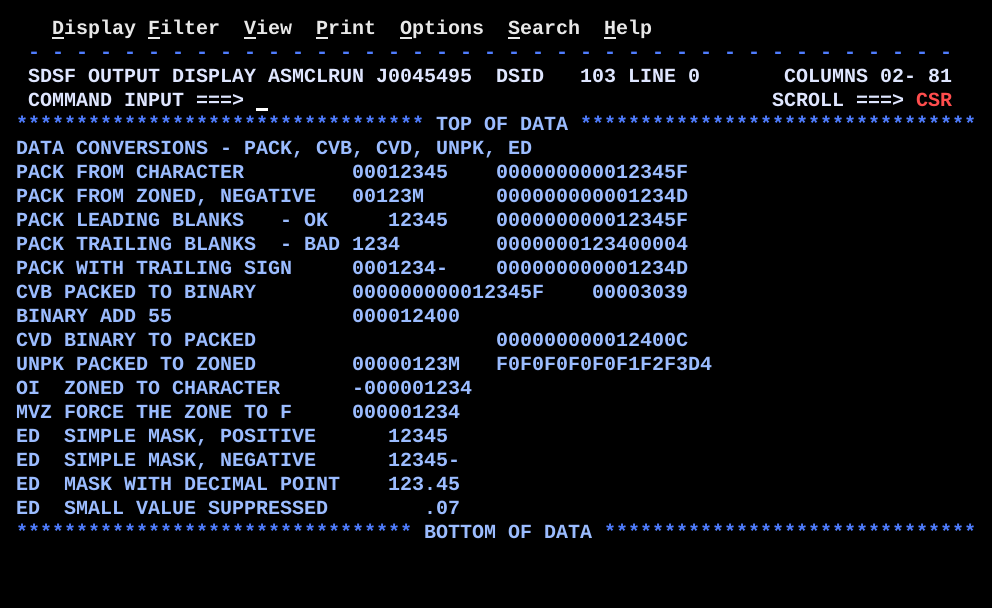

# DT03CONV.asm

## Program Overview

DT03CONV walks the data conversion chain in both directions: character or zoned decimal to packed decimal (`PACK`), packed decimal to binary (`CVB`), binary back to packed decimal (`CVD`), packed decimal to zoned decimal (`UNPK`), zoned decimal to a printable character (`OI`, `MVZ`), and packed decimal to a formatted character field (`ED`). It also shows the two classic `PACK` input traps: leading blanks (harmless) and trailing blanks (a bug), plus a trailing minus sign that `PACK` does not understand. Each step writes one line to SYSOUT; most lines show the result in hex through the internal routine `HEXDISP`.

Program data:

| Field | Value | Used by |
|---|---|---|
| CHARNUM | `CL8'00012345'` | Steps 1 and 6 |
| CHARLEAD | `CL8'   12345'` (3 leading blanks) | Step 3 |
| CHARTRL | `CL8'1234    '` (4 trailing blanks) | Step 4 |
| CHARSGN | `CL8'0001234-'` (trailing minus) | Step 5 |
| ZONEIN | `ZL6'-1234'`, X'F0F0F1F2F3D4' | Step 2 |
| EDMASK1 | X'402020202020202060' (fill, 7 digit selectors, trailing minus) | Steps 12 and 13 |
| EDMASK2 | X'4020202020214B202060' (fill, 4 digit selectors, significance starter, period, 2 digit selectors, trailing minus) | Steps 14 and 15 |
| HEXDIGIT | `C'0123456789ABCDEF'` | `HEXDISP` |

Work areas:

| Field | Definition | Purpose |
|---|---|---|
| DOUBLE | `DS D` | Packed result of `PACK` and `CVD`, source of `CVB` (doubleword aligned) |
| DBLDISP | `DS D` | Second doubleword used by `BINDISP` |
| BINWK | `DS F` | Binary result saved from R4 |
| PACKWK | `DS PL5` | Packed work value (9 digits) |
| ZONE9 | `DS CL9` | Zoned decimal work area |
| EDWORK | `DS CL16` | Target of `ED`, loaded with a pattern first |
| SIGNCHR | `DS CL1` | Sign saved before `OI` destroys it |

Registers used:

| Register | Role |
|---|---|
| R2 | `HEXDISP`: address of the field to dump |
| R3 | `HEXDISP`: length to dump (`BCT` counter); `BINDISP`: value to print |
| R4 | Binary result of `CVB`, then input of the binary add |
| R5, R6, R7 | `HEXDISP` work registers (byte, high nibble, character) |
| R10 | Output address inside `OUTMSG` for the hex or digits |
| R11 | Return address for `BAL` to `HEXDISP` and `BINDISP` |
| R12 | Base register |
| R13 | Save area address |

Output (16 lines):

```
DATA CONVERSIONS - PACK, CVB, CVD, UNPK, ED
PACK FROM CHARACTER         00012345    000000000012345F
PACK FROM ZONED, NEGATIVE   00123M      000000000001234D
PACK LEADING BLANKS   - OK     12345    000000000012345F
PACK TRAILING BLANKS  - BAD 1234        0000000123400004
PACK WITH TRAILING SIGN     0001234-    000000000001234D
CVB PACKED TO BINARY        000000000012345F    00003039
BINARY ADD 55               000012400
CVD BINARY TO PACKED                    000000000012400C
UNPK PACKED TO ZONED        00000123M   F0F0F0F0F0F1F2F3D4
OI  ZONED TO CHARACTER      -000001234
MVZ FORCE THE ZONE TO F     000001234
ED  SIMPLE MASK, POSITIVE      12345
ED  SIMPLE MASK, NEGATIVE      12345-
ED  MASK WITH DECIMAL POINT    123.45
ED  SMALL VALUE SUPPRESSED        .07
```



## How the Program Works

**Linkage and I/O.** The entry linkage, save area, `OPEN`, `CLOSE`, exit linkage (`BR 14`) and SYSOUT DCB follow the same pattern as the earlier programs. A heading line (`MSGHDR`, `CL50`) is written first. All other messages are `CL28`; the converted data goes to `OUTMSG+28` and the hex dump to `OUTMSG+40`.

**Line building.** Each step clears `OUTMSG`, moves a 28 byte message, adds the data at column 29 (`OUTMSG+28`), points R2, R3 and R10 at the field to dump and calls `HEXDISP` with `BAL 11`, then writes the line with `PUT`.

**Steps.**

1. `PACK DOUBLE(8),CHARNUM(8)`: eight digit characters become X'000000000012345F'. The last byte's zone F becomes the sign.
2. `PACK DOUBLE(8),ZONEIN(6)`: the zone D of the last byte becomes the sign. `ZONEIN` prints as `00123M` because X'D4' is the letter M.
3. `PACK` from `CHARLEAD`: the blanks (X'40') pack as zero digits. The result equals step 1.
4. `PACK` from `CHARTRL`: the four trailing blanks pack as zeros and the last blank's zone 4 becomes the sign, giving X'0000000123400004'. The value is 1234 times 10,000 with an invalid sign. The program only dumps it.
5. `PACK DOUBLE(8),CHARSGN(7)` packs only the seven digits (sign nibble F). `CLI` tests the eighth character for `-`. If it is a minus, `NI DOUBLE+7,X'F0'` clears the sign nibble and `OI DOUBLE+7,X'0D'` sets it to D. If not, `BNE SGNDONE` leaves it.
6. `PACK` rebuilds X'000000000012345F', `CVB 4,DOUBLE` makes R4 = 12345, and the line shows the packed input at `OUTMSG+28` and R4 stored in `BINWK` at `OUTMSG+48` (X'00003039').
7. `L 4,BINWK`, `A 4,=F'55'` gives 12400 in binary. `BINDISP` prints it as `000012400`.
8. `CVD 4,DOUBLE` converts R4 back to X'000000000012400C'.
9. `ZAP PACKWK(5),=P'-1234'` and `UNPK ZONE9(9),PACKWK(5)` give nine zoned digits with the sign in the last zone (X'F0F0F0F0F0F1F2F3D4', printed as `00000123M`).
10. `UNPK` again, `CP PACKWK(5),=P'0'` tests the sign, `SIGNCHR` records `-` or `+`, and `OI ZONE9+8,X'F0'` makes the last digit printable. The sign is printed separately from `SIGNCHR`.
11. `MVZ ZONE9+8(1),=X'F0'` copies the zone of the literal onto the last byte. The result is the same as the `OI` but `MVZ` can move zones between any bytes.
12. `ED` with `EDMASK1` and 12345 gives `   12345 `.
13. `ED` with `EDMASK1` and -12345 gives `   12345-`.
14. `ED` with `EDMASK2` and 12345 gives `   123.45 `.
15. `ED` with `EDMASK2` and 7 gives `      .07 `.

**Internal routines.**
- `HEXDISP` (entry R2 address, R3 length, R10 output address): for each byte, `IC` the byte, split it into nibbles with `SRL 6,4` and `N 5,=F'15'`, translate each nibble through `HEXDIGIT`, store two characters with `STC`, advance R10 by 2 and R2 by 1, and repeat with `BCT 3,HEXLOOP`.
- `BINDISP` (entry R3 value, R10 output address): `CVD 3,DBLDISP`, `UNPK ZONE9(9),DBLDISP+3(5)` (the low 5 bytes hold 9 digits), `OI ZONE9+8,X'F0'`, and `MVC 0(9,10),ZONE9`.

**Execution trace (packed results).**

| Step | Input | Instruction | Result | Shown |
|---|---|---|---|---|
| 1 | X'F0F0F0F1F2F3F4F5' | `PACK` | X'000000000012345F' | `000000000012345F` |
| 2 | X'F0F0F1F2F3D4' | `PACK` | X'000000000001234D' | `000000000001234D` |
| 3 | X'404040F1F2F3F4F5' | `PACK` | X'000000000012345F' | `000000000012345F` |
| 4 | X'F1F2F3F440404040' | `PACK` | X'0000000123400004' | `0000000123400004` |
| 5 | X'F0F0F0F1F2F3F4' + `-` | `PACK`, `NI`, `OI` | X'000000000001234D' | `000000000001234D` |
| 6 | X'000000000012345F' | `CVB` | R4 = X'00003039' (12345) | `00003039` |
| 7 | R4 = 12345 | `A 4,=F'55'` | R4 = 12400 | `000012400` |
| 8 | R4 = 12400 | `CVD` | X'000000000012400C' | `000000000012400C` |
| 9 | X'000001234D' | `UNPK` | X'F0F0F0F0F0F1F2F3D4' | `00000123M` |

**ED results.**

| Step | Mask | Value | EDWORK |
|---|---|---|---|
| 12 | EDMASK1 | +12345 | `   12345 ` |
| 13 | EDMASK1 | -12345 | `   12345-` |
| 14 | EDMASK2 | +12345 | `   123.45 ` |
| 15 | EDMASK2 | +7 | `      .07 ` |

## Concepts Demonstrated

- `PACK`: digit nibbles kept, last byte's zone becomes the sign
- Why leading blanks are safe and trailing blanks are not
- Handling a trailing minus sign by hand with `CLI`, `NI` and `OI`
- `CVB` and `CVD` between packed decimal and a register, with their doubleword requirement
- Binary arithmetic on a converted value (`A`) and printing it back
- `UNPK` and why a negative zoned value prints a letter in the last position
- `OI` and `MVZ` to force an F zone for printing, and the lost sign
- `ED` with a pattern: fill character, digit selector, trailing minus, period, significance starter
- Loading the pattern into a work area first, because `ED` overwrites it
- Internal routines called with `BAL` and returned with `BR`, parameters in registers
- Hex dump of storage as a debugging aid

## How the Concepts Are Implemented

| Concept | Implementation |
|---|---|
| Character to packed | `PACK DOUBLE(8),CHARNUM(8)`. Source and target lengths are coded explicitly. The target is filled with zero digits on the left. |
| Zoned to packed | `PACK DOUBLE(8),ZONEIN(6)`. `ZONEIN DC ZL6'-1234'` carries the sign in the zone of the last byte (D). |
| Leading blanks | `CHARLEAD DC CL8'   12345'` packs to the same value as `CHARNUM`, because X'40' has digit nibble 0. |
| Trailing blanks | `CHARTRL DC CL8'1234    '` packs to X'0000000123400004'. The last zone 4 is an invalid sign and the value is scaled by 10,000. The result is dumped only. |
| Trailing minus | `PACK DOUBLE(8),CHARSGN(7)` leaves the minus out. `CLI CHARSGN+7,C'-'`, `BNE SGNDONE`, `NI DOUBLE+7,X'F0'` and `OI DOUBLE+7,X'0D'` build sign D. |
| Packed to binary | `CVB 4,DOUBLE`. `DOUBLE DS D` is doubleword aligned, as `CVB` requires. The value must fit in 31 bits. |
| Binary to packed | `CVD 4,DOUBLE` and `CVD 3,DBLDISP`. The target is a doubleword. |
| Binary arithmetic | `L 4,BINWK`, `A 4,=F'55'`. The literal `=F'55'` is placed in the pool by `LTORG`. |
| Binary display | `BINDISP`: `CVD`, `UNPK ZONE9(9),DBLDISP+3(5)` (low 5 bytes = 9 digits), `OI`, `MVC 0(9,10),ZONE9`. |
| Packed to zoned | `UNPK ZONE9(9),PACKWK(5)` writes 9 digits with zone F, except the last byte, whose zone is the sign. |
| Sign test before `OI` | `CP PACKWK(5),=P'0'`, `BNL OIPOS`, `MVI SIGNCHR,C'-'` or `C'+'`. The sign is printed from `SIGNCHR`. |
| `OI` to printable | `OI ZONE9+8,X'F0'` sets the high nibble of the last byte to F. The low nibble (the digit) is unchanged. |
| `MVZ` | `MVZ ZONE9+8(1),=X'F0'` copies only the high nibble of the literal's byte to the target byte. |
| `ED` pattern | `MVC EDWORK(9),EDMASK1` loads the pattern, then `ED EDWORK(9),PACKWK`. X'40' is the fill, X'20' a digit selector, X'60' the trailing minus, X'21' a significance starter, X'4B' the period. |
| Fresh pattern each time | `ED` overwrites the pattern, so every `ED` is preceded by `MVC EDWORK(n),EDMASKn`. |
| Hex dump | `HEXDISP`: `IC`, `LR`, `SRL 6,4`, `N 5,=F'15'`, `IC 7,HEXDIGIT(6)`, `STC 7,0(,10)`, `BCT 3,HEXLOOP`, `BR 11`. |
| Internal routine call | `LA 2,field`, `LA 3,len`, `LA 10,OUTMSG+40`, `BAL 11,HEXDISP`. |
| Output columns | Message at `OUTMSG(28)`, data at `OUTMSG+28`, hex at `OUTMSG+40`, a second hex field at `OUTMSG+48` in step 6. |

## Key Takeaways

- `PACK` does not check its input. Blank, trailing blank and sign characters are all processed as bytes: the low nibble of each byte becomes a digit and the zone of the last byte becomes the sign. Valid input is the programmer's job.
- Leading blanks are harmless. Trailing blanks multiply the value by a power of ten and leave an invalid sign (4). Right justify the digits (or `PACK` only the digit part) before packing.
- A trailing minus sign is not understood by `PACK`. Pack the digits, then set the sign nibble yourself (`NI` to clear, `OI` to set D).
- `CVB` needs a doubleword-aligned 8 byte packed field with valid digits and sign, and the value must fit in 31 bits; otherwise a data exception or fixed point divide exception occurs. `CVD` also needs a doubleword target.
- `UNPK` puts the sign in the last zone. A negative value prints a letter (D4 is M, so `-1234` shows as `00123M`). A positive value with sign F prints normally.
- `OI X'F0'` and `MVZ` both lose the sign. Save it first (`CP`, `SIGNCHR`) if it matters. `OI` is quick, while `MVZ` is the general instruction for moving zones.
- `ED` is the normal way to print a number. The pattern is destroyed by `ED`, so reload it before each use. A positive value leaves the fill character in the trailing sign position.
- X'21' (significance starter) turns zero suppression off for the digits that follow it. It does not force the digit selected by X'21' itself to print when that digit is zero and suppression is still on. For 7, step 15 prints `.07` with a blank before the period.
- Inconsistency in the source: the comment on the step 15 `ZAP` says `7 becomes 0.07` and the comment on the output `MVC` says `Prints as 0.07`, but the output is `.07`. To print `0.07` the significance starter must be one digit position earlier in `EDMASK2`.
- Inconsistency in the source: the comment in step 1 ends `packs to X'0000012345F'`, which is shorter than the 8 byte result X'000000000012345F' shown in the output.
- The step 15 message comment is `'ED  SMALL VALUE, SUPPRESSED'` with a comma, but the `MSG15` constant has no comma.
- `HEXDISP` changes R2, R3 and R10 (they are advanced and counted down), so each call reloads them. It does not use R4, so a binary value in R4 survives a call.
- `BINDISP` prints exactly 9 digits and drops the sign. A value with more than 9 digits loses its high-order digits.
- `BINDISP` converts into `DBLDISP`, not `DOUBLE`, so it does not change the packed result in `DOUBLE`.
- All messages are `CL28` and the data columns `OUTMSG+28` and `OUTMSG+40` depend on it. Changing a message length means changing the offsets and the `MVC` lengths.
