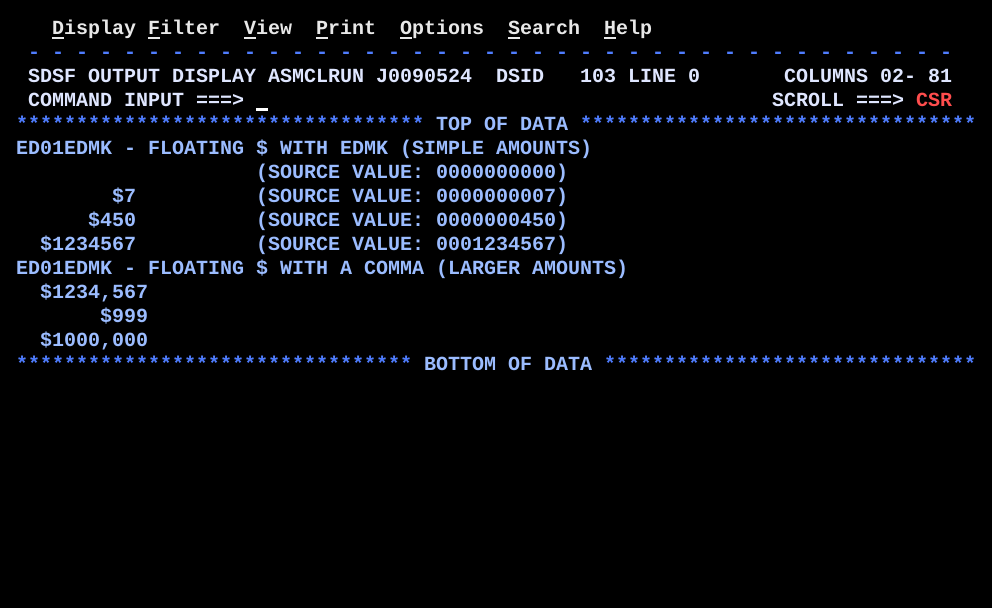

# ED01EDMK.asm

## Program Overview

ED01EDMK edits packed decimal amounts with `EDMK` and floats a `$` directly in front of the first significant digit. `EDMK` works like `ED` and also stores the address of the first significant digit's pattern byte in R1. The program backs R1 up one byte with `BCTR 1,0` and stores `$` there with `MVI 0(1),C'$'`, so the sign sits against the first digit whatever the amount. Loop 1 edits a table of four amounts with a plain pattern; loop 2 edits three larger amounts with a pattern that has a comma. Each pass copies the master pattern to a work area first, because `EDMK` overwrites the pattern.

Program data:

| Field | Value | Used by |
|---|---|---|
| PATMAST | `X'402020202020202020202021'` (12 bytes as read from the editor): fill, ten `X'20'`, `X'21'` | Master pattern, loop 1 |
| PATTERN | `CL11` work copy | Loop 1 `EDMK` |
| AMTTAB | 4 x `PL5`: 0, 7, 450, 1234567 | Loop 1 |
| AMTLEN, AMTCNT | 5 (EQU), 4 | Index step, `BCT` count |
| PATMAST2 | `X'40202020202020',C',',X'202021'` (11 bytes): fill, six `X'20'`, comma, `X'20'`, `X'20'`, `X'21'` | Master pattern, loop 2 |
| PATTERN2 | `CL11` work copy | Loop 2 `EDMK` |
| AMTTAB2 | 3 x `PL5`: 1234567, 999, 1000000 | Loop 2 |
| AMTLEN2, AMTCNT2 | 5 (EQU), 3 | Index step, `BCT` count |
| ZONESHOW | `CL10` zoned copy of the packed amount | Loop 1 display |
| MSGHDR, MSGCOMMA | `CL60` headings | Before loop 1, before loop 2 |

Registers used:

| Register | Role |
|---|---|
| R1 | Set by `EDMK` to the address of the first significant digit's slot in the pattern; backed up one byte by `BCTR 1,0` |
| R6 | Entries remaining (`BCT` counter) |
| R7 | Address of the current packed amount; stepped by `AMTLEN` or `AMTLEN2` |
| R12 | Base register |
| R13 | Save area |

Output (9 lines):

```
ED01EDMK - FLOATING $ WITH EDMK (SIMPLE AMOUNTS)
                    (SOURCE VALUE: 0000000000)
        $7          (SOURCE VALUE: 0000000007)
      $450          (SOURCE VALUE: 0000000450)
  $1234567          (SOURCE VALUE: 0001234567)
ED01EDMK - FLOATING $ WITH A COMMA (LARGER AMOUNTS)
  $1234,567
       $999
  $1000,000
```



No data files; the program runs with the generic `jcl/ASMCLRUN.jcl`. The first output line for the amount 0 has no `$` and no digit (see Key Takeaways).

## How the Program Works

**Linkage and I/O.** The entry linkage, save area, `OPEN`, `CLOSE`, exit linkage (`BR 14`) and SYSOUT DCB follow the same pattern as the earlier programs. `PRINT NOGEN` comes first. A heading line (`MSGHDR`) is written before loop 1.

**Setup of loop 1.** `LA 7,AMTTAB` points R7 at the first amount and `L 6,AMTCNT` loads the count 4.

**Each pass through loop 1 (`EDLOOP`).**
1. `MVC OUTMSG,BLANKS` clears the output line.
2. `MVC PATTERN,PATMAST` copies a fresh pattern. The length is 11, taken from `PATTERN`.
3. `EDMK PATTERN,0(7)` overlays the pattern with the digits of the packed amount at R7. The length is 11, taken from `PATTERN`.
4. `BCTR 1,0` backs R1 up one byte.
5. `MVI 0(1),C'$'` stores the currency sign there.
6. `MVC OUTMSG(12),PATTERN` copies the edited result to column 1 of the line.
7. `MVC OUTMSG+20(14),=C'(SOURCE VALUE:'` adds the label at column 21.
8. `UNPK ZONESHOW,0(5,7)` and `OI ZONESHOW+9,X'F0'` turn the 5-byte packed amount into 10 digits, and `MVC OUTMSG+35(10),ZONESHOW` places them at column 36.
9. `MVI OUTMSG+45,C')'` closes the label.
10. `PUT SYSOUT,OUTMSG` writes the line.
11. `LA 7,AMTLEN(,7)` steps R7 to the next amount and `BCT 6,EDLOOP` repeats.

**Loop 2 (`EDLOOP2`).** `MVC OUTMSG(60),MSGCOMMA` and `PUT` write the second heading, `LA 7,AMTTAB2` and `L 6,AMTCNT2` set the count to 3, and each pass does the same copy, `EDMK`, `BCTR`, `MVI` sequence with `PATMAST2` and `PATTERN2`. It writes only the edited amount (`MVC OUTMSG(11),PATTERN2`), with no source value.

**Execution trace, loop 1** (byte numbers are positions in the 11-byte `PATTERN`, byte 1 first; digits d1 to d9 land in bytes 2 to 10):

| Amount | Packed bytes | First significant digit | R1 after `EDMK` | R1 after `BCTR` | `PATTERN` result |
|---|---|---|---|---|---|
| 0 | 00 00 00 00 0C | none | not set | not meaningful | all blanks (the `$` goes to R1-1, outside the output line) |
| 7 | 00 00 00 00 7C | d9 in byte 10 | PATTERN+9 | PATTERN+8 | `        $7 ` |
| 450 | 00 00 00 45 0C | d7 in byte 8 | PATTERN+7 | PATTERN+6 | `      $450 ` |
| 1234567 | 00 12 34 56 7C | d3 in byte 4 | PATTERN+3 | PATTERN+2 | `  $1234567 ` |

**Execution trace, loop 2:**

| Amount | Packed bytes | First significant digit | R1 after `BCTR` | `PATTERN2` result |
|---|---|---|---|---|
| 1234567 | 00 12 34 56 7C | d3 in byte 4 | PATTERN2+2 | `  $1234,567` |
| 999 | 00 00 00 99 9C | d7 in byte 9 | PATTERN2+7 (the comma slot) | `       $999` |
| 1000000 | 00 10 00 00 0C | d3 in byte 4 | PATTERN2+2 | `  $1000,000` |

## Concepts Demonstrated

- `EDMK` compared with `ED`: R1 receives the address of the first significant digit's pattern byte
- Floating currency sign: `BCTR 1,0` and `MVI 0(1),C'$'`
- Pattern bytes: fill byte, digit selector `X'20'`, significance starter `X'21'`, message insertion bytes
- Zero suppression and the way a comma is suppressed with the leading zeros
- Re-copying the master pattern before every edit, because `ED` and `EDMK` destroy it
- Table of packed amounts stepped with `LA` and `BCT`
- `UNPK` and `OI` to show the same packed amount as digits
- Output columns built in one buffer (`OUTMSG`, `OUTMSG+20`, `OUTMSG+35`, `OUTMSG+45`)

## How the Concepts Are Implemented

| Concept | Implementation |
|---|---|
| Pattern and source | `EDMK PATTERN,0(7)` has one length, 11, from `PATTERN`. The source amount is the packed field at `0(7)`; its 9 digits go to digit selectors in pattern bytes 2 to 10 in loop 1. |
| R1 result | `EDMK` stores the address of the pattern byte where the first digit is printed. R1 is left alone until a digit selector becomes significant. |
| Floating `$` | `BCTR 1,0` moves R1 back one byte, the position directly before the first digit. `MVI 0(1),C'$'` stores the sign there. The position changes with the amount (PATTERN+8, +6, +2 in loop 1). |
| Pattern master and work copy | `PATMAST` and `PATTERN`, `PATMAST2` and `PATTERN2`. `MVC PATTERN,PATMAST` runs at the top of every pass. |
| Significance starter | `X'21'` on the last digit selector of `PATMAST2` forces that digit to print even when the whole amount is zero. In `PATMAST` the `X'21'` is the 12th byte, outside the 11 bytes that are copied and edited. |
| Comma suppression | In `PATMAST2` the comma is a message insertion byte after six digit selectors. For 999 the six digits before it are zero, so it is replaced by the fill and then overwritten by the `$`. |
| Table walk | `LA 7,AMTTAB`, `LA 7,AMTLEN(,7)`, `L 6,AMTCNT`, `BCT 6,EDLOOP`. `AMTLEN` and `AMTLEN2` are `EQU 5`. |
| Raw value display | `UNPK ZONESHOW,0(5,7)` gives 10 characters, `OI ZONESHOW+9,X'F0'` makes the last one a digit, `MVC OUTMSG+35(10),ZONESHOW` places them. |
| Output columns | Result at column 1, `(SOURCE VALUE:` at column 21 (14 bytes), digits at column 36, `)` at column 46. |

## Key Takeaways

- The amount 0 prints a blank result and no `$`. The comment on `AMTTAB` says the zero proves R1 still gets set through the forced `X'21'`. In this run it does not: the `X'21'` is byte 12 of `PATMAST`, `PATTERN` is 11 bytes, and `MVC PATTERN,PATMAST` copies only 11. No digit selector becomes significant, so `EDMK` leaves R1 alone. `BCTR 1,0` and `MVI 0(1),C'$'` then store a `$` one byte before whatever R1 held, which is outside the output line. The byte it overwrote was not identified.
- The length of the work area decides how many pattern bytes are copied and edited. A master longer than its work area loses its last bytes. Make the work area as long as the master.
- `EDMK` never sets R1 for an amount with no significant digit unless the pattern forces it. Do not run `BCTR` and `MVI` on a stale R1; set R1 to a safe address before the `EDMK`, or test for zero first.
- Source and comments disagree on the size of `PATMAST`: the banner says 12 bytes, the line comment says 11 bytes (`fill,8*sel,sel21`, which adds to 10), and `PATTERN` is `CL11`. The hex string as read from the editor is 12 bytes.
- `PATMAST2` is consistent: fill, six selectors, comma, two selectors and `X'21'` is 11 bytes, and `PATTERN2` is `CL11`.
- Loop 1 copies 12 bytes of `PATTERN` with `MVC OUTMSG(12),PATTERN`. `PATTERN` is 11 bytes, so byte 12 is the first byte of `AMTTAB`, `X'00'`, which shows as a blank. Loop 2 copies 11.
- The comma in `PATMAST2` is placed after the sixth digit, three digits in from the right. 1,234,567 shows as `$1234,567`, not `$1,234,567`; the pattern has only one comma. The banner says it covers amounts up to 9,999,999.
- `ED` and `EDMK` replace the pattern in place, so each pass starts with a fresh copy from the master.
- `BCTR 1,0` has register 0 as its second operand, so it never branches. The comment on the idiom says `BCTR` also branches on the result; it does not branch here or anywhere with register 0.
- The count of a `BCT` loop is held in storage (`AMTCNT`, `AMTCNT2`). A count of 0 would run the loop about 4 billion times.
- The comment before `EDLOOP2` says the comma is suppressed with the leading zeros "when the amount is small". Only 999 shows that case, and its `$` takes the slot of the suppressed comma.
- All amounts are positive (`PL5` literals, sign `C`). Neither pattern shows a minus sign, so a negative amount would print without it.
