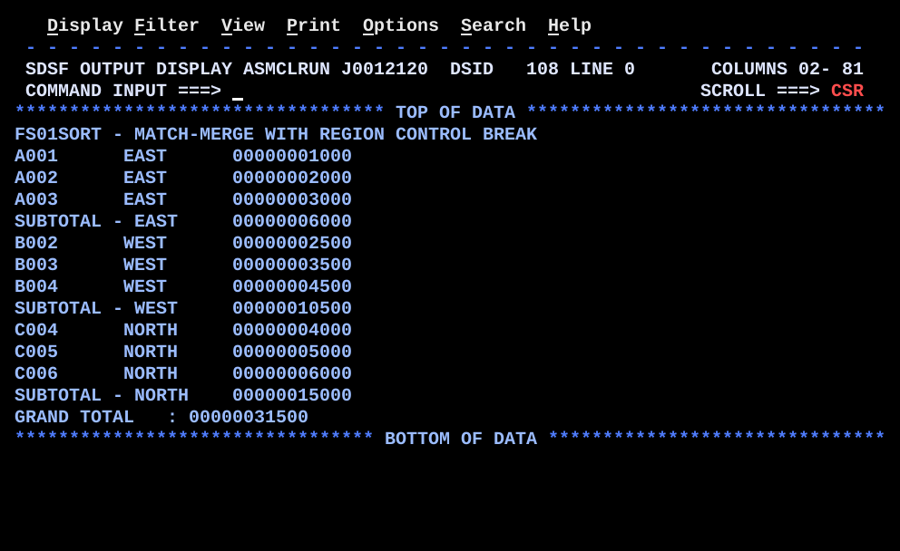

# FS01SORT.asm

## Program Overview

FS01SORT merges two input files that are already in key order, `FILEA` and `FILEB`, into one stream and prints that stream to `SYSPRINT`. While it does this it runs a control break on the region field: when the region of the record just processed differs from the region of the previous one, it prints a subtotal for the previous region and starts a new one. A grand total is printed after the last record. Subtotals and the grand total are packed decimal (`PL6`).

Both files have 20-byte fixed records: `CL8` key (columns 1-8), `CL6` region (columns 9-14) and the amount as 6 zoned digits (columns 15-20).

Program data:

| Field | Value | Used by |
|---|---|---|
| `FILEA` | 5 records: A001, A003, B002, B004, C005 (`data/FS01SORT_FILEA.txt`) | `READA` |
| `FILEB` | 4 records: A002, B003, C004, C006 (`data/FS01SORT_FILEB.txt`) | `READB` |
| `LOWVALS` | `X'000000000000'` | First-record test against `LASTRGN` |
| `MSGHDR` | `CL50` heading | Heading line |
| Run JCL | `jcl/FS01SORT.jcl`, 5 steps, both files built in the job by `IEBGENER` | Run |

Registers used:

| Register | Role |
|---|---|
| R9 | Return address of `PUTSUBT` (level 2 calls) |
| R10 | Return address of `READA`, `READB`, `PROCA`, `PROCB` (level 1 calls from `MERGE`) |
| R12 | Base register |
| R13 | Save area |

Output (14 lines):

```
FS01SORT - MATCH-MERGE WITH REGION CONTROL BREAK
A001      EAST      00000001000
A002      EAST      00000002000
A003      EAST      00000003000
SUBTOTAL - EAST     00000006000
B002      WEST      00000002500
B003      WEST      00000003500
B004      WEST      00000004500
SUBTOTAL - WEST     00000010500
C004      NORTH     00000004000
C005      NORTH     00000005000
C006      NORTH     00000006000
SUBTOTAL - NORTH    00000015000
GRAND TOTAL   : 00000031500
```



## How the Program Works

**Linkage and I/O.** Standard entry and exit linkage with one base register (R12). `SYSPRINT` is opened first, then `FILEA` and `FILEB` as input; all three are closed after the grand total. The `FILEA` and `FILEB` DCBs name end-of-file routines (`EODAD=AEOF`, `EODAD=BEOF`). The heading line is written before any record is read.

**Setup.** `EOFASW` and `EOFBSW` are set to `N`. `LASTRGN` is set to `LOWVALS` so that the first record always looks like a region change. `SUBTOT` and `GRANDTOT` are set with `ZAP`. `READA` and `READB` each read one record (priming reads) with `BAL 10`.

**Merge loop (`MERGE`).**
1. If `EOFASW` is `Y`, go to `MRGONLYB`; if `EOFBSW` is `Y`, go to `MRGONLYA`.
2. Otherwise `CLC AKEY,BKEY`: equal goes to `MRGMATCH`, low to `MRGTAKEA`, high to `MRGTAKEB`.
3. Each of those paths does `BAL 10,PROCA` or `BAL 10,PROCB` and then reads the next record from only the file that was processed (`MRGMATCH` reads both) and branches back to `MERGE`.
4. `MRGONLYB` and `MRGONLYA` first test whether the other file is also at end of file. If so, they go to `MRGDONE`; if not, they process and read the remaining file.

**Processing a record (`PROCA`, `PROCB`, `COMMON`).** `PROCA` and `PROCB` copy the region (offset 8), the key and the amount (`PACK` from the 6 zoned digits at offset 14) into `CURRGN`, `CURKEY` and `CURAMT`, then branch to `COMMON`. `COMMON` compares `CURRGN` with `LASTRGN`:
- Same region: skip to `COMMNOBK`.
- Different region: `BAL 9,PUTSUBT` prints the previous region's subtotal and zeroes `SUBTOT`, then `LASTRGN` is set to the new region.
- `COMMNOBK` adds `CURAMT` to `SUBTOT` and `GRANDTOT`, builds the detail line (key at column 1, region at column 11, amount at column 21) and writes it. `BR 10` returns to `MERGE`.

**Reading (`READA`, `READB`).** `GET` into `AREC` or `BREC`, copy the key to `AKEY` or `BKEY`, `BR 10`. At end of file the `AEOF` or `BEOF` routine sets the end switch to `Y` and returns with `BR 10`. The key field keeps its last value.

**Ending (`MRGDONE`).** `BAL 9,PUTSUBT` prints the last pending subtotal, then the grand total line is built and written, the three files are closed and the program returns with return code 0.

**`PUTSUBT`.** If `LASTRGN` is still `LOWVALS` the print is skipped. Otherwise it writes `SUBTOTAL -`, the region at column 12 and the subtotal at column 21. `ZAP SUBTOT,=P'0'` and `BR 9` follow.

**Execution trace** (merge passes with the test data):

| Pass | AKEY | BKEY | Decision | Record processed | Break line printed | SUBTOT after | GRANDTOT after |
|---|---|---|---|---|---|---|---|
| 1 | A001 | A002 | low | A001 EAST | none (first record, `PUTSUBT` skips) | 1000 | 1000 |
| 2 | A003 | A002 | high | A002 EAST | none | 3000 | 3000 |
| 3 | A003 | B003 | low | A003 EAST | none | 6000 | 6000 |
| 4 | B002 | B003 | low | B002 WEST | SUBTOTAL - EAST 6000 | 2500 | 8500 |
| 5 | B004 | B003 | high | B003 WEST | none | 6000 | 12000 |
| 6 | B004 | C004 | low | B004 WEST | none | 10500 | 16500 |
| 7 | C005 | C004 | high | C004 NORTH | SUBTOTAL - WEST 10500 | 4000 | 20500 |
| 8 | C005 | C006 | low | C005 NORTH | none | 9000 | 25500 |
| 9 | EOF | C006 | `MRGONLYB` | C006 NORTH | none | 15000 | 31500 |
| 10 | EOF | EOF | `MRGDONE` | none | SUBTOTAL - NORTH 15000, GRAND TOTAL 31500 | | |

No pass takes the equal-key path (`MRGMATCH`).

## Concepts Demonstrated

- Match-merge of two sorted files with one current record per file
- Three-way `CLC` decision (equal, low, high) and a branch for each
- End-of-file switches per file and draining the surviving file
- Control break on a grouping field with a subtotal on change
- Priming the break field with low-values so the first record needs no special case
- Final pending subtotal printed after the loop
- Packed decimal accumulation: `PACK`, `AP`, `ZAP`, `UNPK`
- One return register per calling level (R10 for level 1, R9 for `PUTSUBT`)
- Writing the break logic once and sharing it between two paths (`COMMON`)
- Building the test files in the job with `IEBGENER`

## How the Concepts Are Implemented

| Concept | Implementation |
|---|---|
| Current record per file | `AREC` / `AKEY` and `BREC` / `BKEY`; `READA` and `READB` fill them with `GET` and `MVC` |
| Merge decision | `CLC AKEY,BKEY` then `BE MRGMATCH`, `BL MRGTAKEA`, `B MRGTAKEB` |
| End of file | `EODAD=AEOF` / `BEOF` set `EOFASW` / `EOFBSW` to `Y`; `MERGE` tests them with `CLI` before the `CLC` |
| Draining one file | `MRGONLYB` and `MRGONLYA` process and read the remaining file; each ends at `MRGDONE` only when the other switch is also `Y` |
| Break detection | `CLC CURRGN,LASTRGN` in `COMMON`; `BE COMMNOBK` skips the break |
| First record | `MVC LASTRGN,LOWVALS` at the start; `PUTSUBT` does `CLC LASTRGN,LOWVALS` and `BE PUTSUBTX` to skip the print |
| Subtotal reset | `PUTSUBTX ZAP SUBTOT,=P'0'` after the print |
| Final subtotal | `MRGDONE` calls `PUTSUBT` once more before the grand total |
| Zoned to packed | `PACK CURAMT,AREC+14(6)` (or `BREC+14(6)`) turns the 6 digit characters into `PL6` |
| Accumulation | `AP SUBTOT,CURAMT` and `AP GRANDTOT,CURAMT` |
| Display of totals | `UNPK ZONE11,SUBTOT`, `OI ZONE11+10,X'F0'`, `MVC PRTLINE+20(11),ZONE11` (grand total at `PRTLINE+16`) |
| Calling levels | `BAL 10,...` from `MERGE`; `BAL 9,PUTSUBT` from `COMMON` and `MRGDONE`; `BR 10` and `BR 9` return |
| Shared break logic | `PROCA` and `PROCB` end with `B COMMON`; `COMMON` returns with `BR 10` to the instruction after the `BAL 10,PROCx` in `MERGE` |
| Test files | `STEP03` and `STEP04` of `jcl/FS01SORT.jcl`: `IEBGENER` copies inline data to `&&FILEA` and `&&FILEB` (`FB`, `LRECL=20`) |

## Key Takeaways

- The merge compares `AKEY` and `BKEY` (columns 1-8), not the region. The banner comments say REGION is the match-merge key; the code does not compare it. The control break only works because the keys A, B and C go up with the regions EAST, WEST and NORTH in the test data.
- A control break needs the data grouped by region, not sorted by region. EAST, WEST, NORTH is not alphabetical and still gives three subtotals. If a region appeared again later in the merged stream, it would get a second subtotal.
- The equal-key path (`MRGMATCH`) is not exercised: no key is in both files. On equal keys the program processes the `FILEA` record and reads both files, so the `FILEB` record with the same key is read and dropped without being printed or added to the totals.
- `LASTRGN` starts as six binary zeros so the first record always differs from it. `PUTSUBT` tests for that value and skips the print. A region code of six `X'00'` bytes would be treated as the start of the run.
- A control break prints a subtotal only when a new region starts, so the last region's subtotal is still in `SUBTOT` when the loop ends. `MRGDONE` calls `PUTSUBT` for it. Leaving that call out loses the last subtotal.
- R10 holds the return address to `MERGE` while `COMMON` runs, because `COMMON` was reached by `BAL 10,PROCx` followed by `B COMMON`. A call to `PUTSUBT` with `BAL 10` would overwrite it, and `BR 10` at the end of `COMMNOBK` would branch into `COMMON` instead of `MERGE`. The source comment records that this loop happened with R10.
- `AKEY` and `BKEY` keep their last value after end of file, and `HIVALUE` is not used. This works only because `MERGE` tests the end switches before the `CLC`.
- An empty `FILEA` or `FILEB` is handled by the same switches. If both are empty, the merge goes straight to `MRGDONE`, `PUTSUBT` skips the print and the grand total is 0. This case is not in the test data.
- The record comment says the amount is `PL6`, but the file holds 6 zoned digits. `PACK` converts them. `PACK` does not check its input, so a non-digit in columns 15-20 gives a wrong value, and with a bad sign nibble `AP` would abend with S0C7.
- `PL6` holds 11 digits and `ZONE11` shows 11, so a total over 11 digits would lose its leftmost digits. `UNPK` plus `OI ZONE11+10,X'F0'` also removes the sign, so a negative total prints as positive.
- The source comment on `COMMON` refers to `LEARNING.md section 13.3`. The repo's `LEARNING.md` has no section 13.3; the same R9 / R10 rule is in the DS02DSCT notes under 08 DSECTs.
- Line 174 of the source reads `regardles` followed by the closing `*` of the banner (the last letter of `regardless` is not there).
- `OPEN` is not checked (no `DCBD` open test as in BR09MTCH), so a missing DD name would fail at the first `GET` or `PUT`.
- The run step also has a `SYSOUT` DD that the program does not use. All output goes to `SYSPRINT`.
- `FILEA` and `FILEB` are temporary datasets (`&&FILEA`, `&&FILEB`) created and deleted inside the job, so the job can be resubmitted as it is.
- The program was not assembled or run by Claude; the output is from the owner's run (job J0012120).
