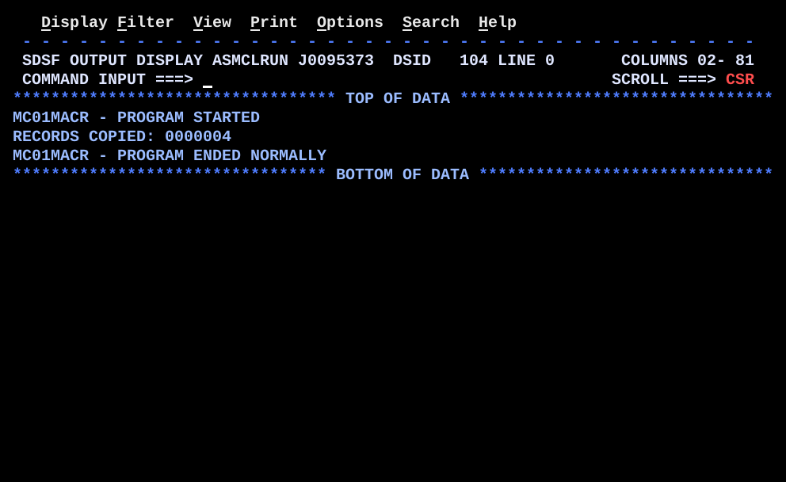

# MC01MACR.asm

## Program Overview

MC01MACR defines two source macros in the program itself and uses them several times each. `CHKOPEN` tests whether a DCB opened and, when a failure message is supplied, prints it and abends. `PRTMSG` clears the print line, moves a `CL50` message into it and writes it. Both replace routines that earlier programs (DS02DSCT, QSAMPROC, VB01LOC, BR09MTCH) coded by hand as `BAL` / `BR` subroutines. `&SYSNDX` gives each expansion its own labels, and `AIF` leaves the failure block out when no message is passed. The mainline opens three files, prints a start message, copies the records of `INFILE` to `OUTFILE`, prints the record count and an end message.

Program data:

| Field | Value | Used by |
|---|---|---|
| MSGOPN0, MSGOPN1, MSGOPN2 | `CL50` open error messages for SYSPRINT, INFILE, OUTFILE | `CHKOPEN` calls 1 to 3 |
| MSGSTRT, MSGEND | `CL50` start and end messages | `PRTMSG` calls |
| RECCNT | `PL4`, record count | Copy loop, `UNPK` |
| EOFSW | `CL1`, set to `N` before the loop and `Y` at `EOFRTN`; never tested | Copy loop |
| PRTLINE | `CL80` print line | `PRTMSG`, count line |
| INAREA, OUTAREA | `CL80` record areas | Copy loop |

Macros:

| Macro | Prototype | Parameters | Generated labels |
|---|---|---|---|
| CHKOPEN | `&LAB CHKOPEN &DCB,&FAILMSG` | Two positional | `OK&SYSNDX` |
| PRTMSG | `&LAB PRTMSG &MSG,&DEST=SYSOUT` | One positional, one keyword with a default | none |

Registers used:

| Register | Role |
|---|---|
| R2 | DCB address inside each `CHKOPEN` expansion, mapped by `USING IHADCB,2` and dropped |
| R12 | Base register |
| R13 | Save area |
| R14, R15 | Return address and return code (0) |

Files:

| DD | Data set | Content | Records |
|---|---|---|---|
| INFILE | `HLQ.MLQ.BR08SRCH.OUTFILE` (output of BR08SRCH) | Table search result lines | 4 x 80, `data/MC01MACR_INFILE.txt` |
| OUTFILE | `HLQ.MLQ.MC01MACR.OUTFILE` | Copy of INFILE | 4 x 80, `data/MC01MACR_OUTFILE.txt` |
| SYSPRINT | SYSOUT | Messages and count | 3 lines |

Run JCL: `jcl/MC01MACR.jcl`.

Output (3 lines):

```
MC01MACR - PROGRAM STARTED
RECORDS COPIED: 0000004
MC01MACR - PROGRAM ENDED NORMALLY
```



Content of `OUTFILE` (ISPF Browse, identical to `INFILE`):

```
TABLE SEARCH RESULTS
CHARLIE   FOUND, VALUE IS                         00000300
ALPHA     FOUND, VALUE IS                         00000100
ECHO      NOT FOUND IN TABLE
```

## How the Program Works

**Linkage and I/O.** Standard entry linkage, one save area, three DCBs (`INFILE` `MACRF=GM` with `EODAD=EOFRTN`, `OUTFILE` and `SYSPRINT` `MACRF=PM`), exit linkage with `BR 14`. `PRINT NOGEN` keeps the macro expansions out of the listing. `DCBD` follows `LTORG` before `END`, because `CHKOPEN` uses the `IHADCB` fields.

**Macro definitions.** Both definitions come before the `CSECT`, each between `MACRO` and `MEND`. A definition generates nothing until it is invoked.

**Mainline.**
1. `OPEN (SYSPRINT,(OUTPUT))`, then `CHKOPEN SYSPRINT,MSGOPN0` (expansion 1).
2. `OPEN (INFILE,(INPUT))`, then `CHKOPEN INFILE,MSGOPN1` (expansion 2).
3. `OPEN (OUTFILE,(OUTPUT))`, then `CHKOPEN OUTFILE,MSGOPN2` (expansion 3).
4. `PRTMSG MSGSTRT,DEST=SYSPRINT` prints the start message.
5. `ZAP RECCNT,=P'0'` and `MVI EOFSW,C'N'`.
6. `COPYLOOP`: `GET INFILE,INAREA`, `MVC OUTAREA,INAREA`, `PUT OUTFILE,OUTAREA`, `AP RECCNT,=P'1'`, `B COPYLOOP`.
7. The fifth `GET` branches to `EOFRTN` through `EODAD`. `EOFRTN` sets `EOFSW` to `Y` and the program continues in line.
8. The count is built as `RECORDS COPIED: ` plus 7 digits (`UNPK ZONE7,RECCNT`, `OI ZONE7+6,X'F0'`) and written to `SYSPRINT`.
9. `PRTMSG MSGEND,DEST=SYSPRINT`, three `CLOSE` macros, exit linkage.

**What `CHKOPEN` expands to** (message supplied):

```
&LAB   DS   0H
       LA   2,&DCB
       USING IHADCB,2
       TM   DCBOFLGS,DCBOFOPN
       DROP 2
       BO   OK&SYSNDX
       PRTMSG &FAILMSG,DEST=SYSPRINT
       ABEND 999,DUMP
OK&SYSNDX DS 0H
```

With an empty `&FAILMSG` the `AIF` jumps to `.NOMSG` and only the `TM` part is generated.

**Execution trace.**

| Step | Action | Result |
|---|---|---|
| 1 | `OPEN SYSPRINT`, `CHKOPEN` 1 | Open bit on, `BO` taken, no message |
| 2 | `OPEN INFILE`, `CHKOPEN` 2 | Open bit on, `BO` taken |
| 3 | `OPEN OUTFILE`, `CHKOPEN` 3 | Open bit on, `BO` taken |
| 4 | `PRTMSG MSGSTRT` | Line 1 written |
| 5 | `GET` 1 to 4, `PUT` 1 to 4 | `TABLE SEARCH RESULTS`, `CHARLIE`, `ALPHA`, `ECHO` copied; `RECCNT` 1, 2, 3, 4 |
| 6 | `GET` 5 | End of file, branch to `EOFRTN`, `EOFSW` = `Y` |
| 7 | Count line | `RECORDS COPIED: 0000004` |
| 8 | `PRTMSG MSGEND`, `CLOSE` x3 | Line 3 written, return code 0 |

## Concepts Demonstrated

- Source macro definition with `MACRO` and `MEND` in the same source member
- The `&LAB` label parameter on the macro instruction
- Positional and keyword parameters, and a keyword default (`&DEST=SYSOUT`)
- `&SYSNDX` to make a unique label for every expansion
- `AIF` and a sequence symbol (`.NOMSG`, `ANOP`) for conditional assembly
- A macro calling another macro (`PRTMSG` inside `CHKOPEN`)
- Macro expansion happens at assembly time and leaves inline code, with no call at run time
- `PRINT NOGEN` to hide expansions in the listing
- DCB open check through `DCBD`, as in QSAMPROC and BR09MTCH

## How the Concepts Are Implemented

| Concept | Implementation |
|---|---|
| Definition | `MACRO`, the prototype statement (`&LAB CHKOPEN &DCB,&FAILMSG`), the body, `MEND`. Lines starting `.*` are macro comments and are not copied into the expansion. |
| Label parameter | `&LAB` is the first prototype operand field. The label coded on the macro instruction is passed in; both macros start with `&LAB DS 0H`. |
| Positional parameters | `CHKOPEN SYSPRINT,MSGOPN0` and `PRTMSG MSGSTRT,...` supply values in prototype order. `&DCB` is not in parentheses. |
| Keyword parameter | `&DEST=SYSOUT` in the `PRTMSG` prototype is the default. Every call codes `DEST=SYSPRINT` because the program's DCB is named `SYSPRINT`. |
| Unique labels | `OK&SYSNDX` assembles as `OK` plus a 4-digit number that the assembler changes for each macro instruction, so three `CHKOPEN` expansions define three different labels. |
| Conditional assembly | `AIF ('&FAILMSG' EQ '').NOMSG` compares the text passed. When true, assembly skips to `.NOMSG ANOP`, so `BO`, `PRTMSG`, `ABEND` and the `OK&SYSNDX` label are not generated. |
| Nested macro | The failure path invokes `PRTMSG &FAILMSG,DEST=SYSPRINT` inside `CHKOPEN`; the outer parameter is substituted before the inner macro is expanded. |
| Open check | `LA 2,&DCB`, `USING IHADCB,2`, `TM DCBOFLGS,DCBOFOPN`, `DROP 2`; `BO` branches on the tested bit being on. `DROP` and `AIF` do not change the condition code. |
| Print line | `MVC PRTLINE,BLANKS`, `MVC PRTLINE(50),&MSG`, `PUT &DEST,PRTLINE`. |
| Copy loop | `GET`, `MVC`, `PUT`, `AP`, `B COPYLOOP`; the loop ends only through `EODAD=EOFRTN`. |
| Count display | `UNPK ZONE7,RECCNT`, `OI ZONE7+6,X'F0'`, `MVC PRTLINE+16(7),ZONE7` after the 16-byte label `RECORDS COPIED: `. |

## Key Takeaways

- A macro is not a subroutine. Each invocation is replaced by its own copy of the generated instructions, so the program grows with every call and no `BAL`, `BR` or return register is involved. The earlier `OPENCHK` routine exists once and is called; `CHKOPEN` is generated three times.
- A fixed label inside a macro causes a duplicate-label error from the second expansion on. Build internal labels with `&SYSNDX`.
- `AIF` works on the text of the operands at assembly time. Its result is fixed in the object code; nothing is tested at run time.
- Only the macro with a message is exercised: all three `CHKOPEN` calls pass a message, so the `.NOMSG` path, the failure path (`PRTMSG` and `ABEND 999,DUMP`) and the `PRTMSG` default `DEST=SYSOUT` are not run. The program has no `SYSOUT` DCB, so the default could not be used as it stands.
- If `SYSPRINT` itself fails to open, `CHKOPEN` calls `PRTMSG` to `SYSPRINT`, so the message `MSGOPN0` cannot be printed.
- `EOFSW` is set to `N` and `Y` but never tested. The loop ends because `EODAD` branches to `EOFRTN`, which falls into the code that follows.
- The `INFILE` of this run is the output file of BR08SRCH. The copy has the same four lines, so the count 4 and the content are the check.
- The program needed six rounds of fixes to assemble (see `LEARNING.md`, section 10): a misspelt `&SYSSNDX`, a variable symbol appended to a sequence symbol (`.SKIPMSG&SYSNDX`, then `.SKP&SYSNDX`), a keyword call `PRTMSG MSG=&FAILMSG` of a positional parameter that also left `DEST` at the default `SYSOUT` (9 errors from one call), and `AGO .SKIP` used for a run-time decision, which dropped the label `BNO NOGOOD&SYSNDX` branched to.
- `AGO` is always taken at assembly time and cannot test the condition code. The run-time decision is the machine instruction `BO OK&SYSNDX`; `AIF` only decides whether the failure block is generated at all.
- A sequence symbol (`.NOMSG`) is never emitted into the object code and takes no `&SYSNDX`; `OK&SYSNDX` is emitted and needs it.
- The macro comments do not match the code in places (left over from the earlier attempts): they describe the label as `&LABEL.A&SYSNDX` and give `OPNA0007` and `OPNA0008` as examples, but the code defines `OK&SYSNDX`. They mention `BNO NOGOOD&SYSNDX`, which is not in the macro (it uses `BO OK&SYSNDX`). The prototype in the comments says `&LABEL`, the code says `&LAB`. Real `&SYSNDX` values count every macro instruction, including `OPEN`, `PUT`, `GET` and `PRTMSG`, so they do not run 0007, 0008. The code is unchanged.
- Macro comments and the `MSG=MSGSTRT,DEST=SYSOUT` example describe keyword coding; the real calls code the message positionally.
- `CL50` messages and the `PRTLINE(50)` length depend on each other; a longer message is cut.
- The `DD SYSOUT` in the run JCL is not used by the program; output goes to `SYSPRINT`. `OUTFILE` is `NEW,CATLG,DELETE`, so delete it before a rerun.
