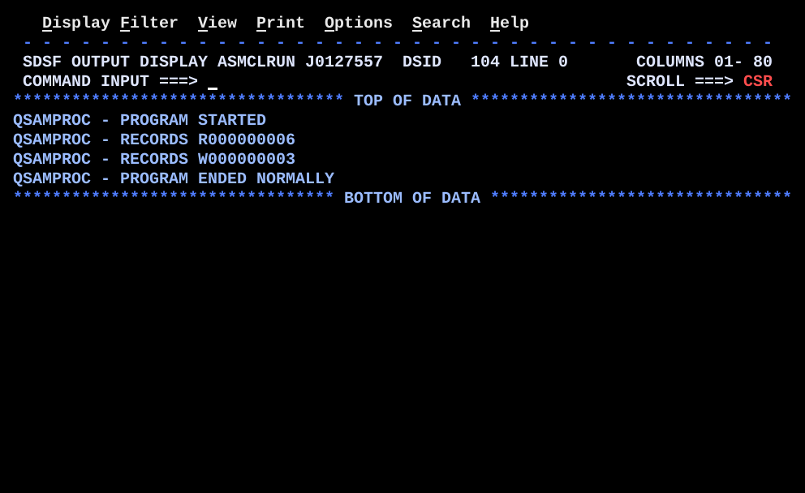

# QSAMPROC.asm

## Program Overview

QSAMPROC reads a sorted sequential file of user entitlement records (`AMHFIN`, fixed length 559) and writes one comma-delimited record (`AMHFOUT`, fixed length 559) for each group of input records. A group is the run of consecutive records with the same customer number and the same connect id. Because the input is sorted on those two fields, a change in either field marks the end of a group (control break). Messages and counts go to `SYSPRINT`.

While a group is read, three flags are set by rules:

| Rule | Condition | Flag |
|---|---|---|
| R1 | Service code `ADM` and access code `F` or `C` | `HASADM` |
| R2 | Service code `CIT`, `EFT` or `WPS` | `HASPAY` |
| R3 | Service code `FT` and first 4 bytes of the account id found in a 32-entry prefix table | `HASFTS` |
| R4 | `HASADM` gives `SYSTEM ADMINISTRATOR`; `HASPAY` or `HASFTS` gives `REGULAR USER`; otherwise `READ ONLY USER` | `FINALCLA` |

Files:

| DD | Direction | Record |
|---|---|---|
| AMHFIN | Input, `MACRF=GM` | 559 bytes, sorted on customer number and connect id |
| AMHFOUT | Output, `MACRF=PM` | 559 bytes, 18 comma-delimited columns, header line first |
| SYSPRINT | Output, `MACRF=PM` | 80 bytes, messages and counts |

Registers used:

| Register | Role |
|---|---|
| R1 | Address of the message passed to `PRTMSG` |
| R2 | Pointer to a DCB (open check) or to the current prefix table entry |
| R3 | Entries left in the prefix table search |
| R7 | Return address of `PRTMSG` |
| R8 | Return address of level 3 routines (`CHKFT`) |
| R9 | Return address of level 2 routines (`READINP`, `CHKREC`, `WRTHDR`) |
| R10 | Return address of level 1 routines |
| R11 | Second base register (program start + 4096) |
| R12 | First base register |
| R13 | Save area |

Test data (in `data/`, fixed length 559, ASCII text, upload as text to an `LRECL=559` `RECFM=FB` dataset):

| File | Content |
|---|---|
| `data/QSAMPROC_AMHFIN.txt` | Input, 6 records in 3 groups |
| `data/QSAMPROC_AMHFOUT.txt` | Output from the run: header record and 3 detail records |

Input groups:

| Group | Customer | Connect id | Records (service code, access) |
|---|---|---|---|
| 1 | 85008 | D0A0V901 | ADM F, BR F |
| 2 | 85008 | D0A0W301 | ADM F |
| 3 | 85100 | W0A07001 | ADM F, CIT F, BR F |

Run JCL: `jcl/QSAMPROC.jcl` (assemble with `ASMA90`, link-edit with `HEWL`, run). The run step has `AMHFIN` (`APXT.TAQ8656.AMH.INPUT`, `DISP=SHR`), `AMHFOUT` (`APXT.TAQ8656.AMH.OUTPUT`, new, `RECFM=FB`, `LRECL=559`) and `SYSPRINT`. `AMHFOUT` is `NEW,CATLG,DELETE`, so delete the dataset before a rerun or the step fails on allocation.

Output on SYSPRINT (4 lines, job J0127557: 6 records read, 3 groups written):

```
QSAMPROC - PROGRAM STARTED
QSAMPROC - RECORDS R000000006
QSAMPROC - RECORDS W000000003
QSAMPROC - PROGRAM ENDED NORMALLY
```



## How the Program Works

**Linkage.** Standard entry linkage with two base registers: `USING QSAMPROC,12,11`, then `LA 11,4095(,12)` and `LA 11,1(,11)` make R11 the address 4096 bytes past the start.

**Mainline.** `INITIAL`, `OPENFILE`, start message, `READINP` (priming read), then the group loop. After the loop: `CLOSFILE`, `PRTCNTS`, `CLOSE SYSPRINT`, exit linkage with return code 0.

**Group loop (`GRPLOOP`).** Top tested: if `EOFSW` is `Y` the loop ends. Otherwise `INITGRP`, `SAVEKEY`, `PROCGRP`, `FINALCLS`, `BUILDOUT`, `WRITEOUT`, then `B GRPLOOP`.

**`PROCGRP`.** Inner top-tested loop with three exits: end of file, customer number changed (`CLC INCUSTNO(8),SAVCUST`), connect id changed. The body is `CHKREC` then `READINP`. On exit `INREC` holds the first record of the next group, so the mainline needs no extra read.

**`CHKREC`.** Applies R1, R2 and R3 to one record. A flag is only switched on here; `INITGRP` switches the flags off once per group.

**`CHKFT`.** Serial search: R2 = `PFXTAB`, R3 = 32, `CLC INACCTID(4),0(2)`, `BE FTFOUND`, `LA 2,4(,2)`, `BCT 3,FTLOOP`.

**`FINALCLS`.** Tests `HASADM`, then `HASPAY`, then `HASFTS`; first match wins and moves a 20-byte classification text to `FINALCLA`.

**`BUILDOUT` and `WRITEOUT`.** `BUILDOUT` clears `OUTAREA`, moves the connect id into columns 1 and 2, fixed literals into columns 3 to 6, 8 and 9, the saved correlation id into column 7, the classification into column 18, and 17 commas with `MVI`. `WRITEOUT` writes the header line before the first detail only (`FIRSTSW`), then `PUT` and `AP WRITCNT,=P'1'`.

**End of file and errors.** `READEOF` (EODAD) sets `EOFSW` and prints a message if no record was read. `IOERRIN` and `IOERROUT` (SYNAD) print a message and go to `ABENDRTN` (`ABEND 16,DUMP`). `OPENFILE` opens SYSPRINT first, tests `DCBOFOPN` through the `IHADCB` DSECT after each `OPEN`, and branches to `OPENERR1`, `OPENERR2` or `ABENDRTN`.

**Counts.** `PRTCNTS` copies a message to `MSGREAD`, `UNPK ZONE9(9),READCNT(5)`, `OI ZONE9+8,X'F0'`, moves the digits to `MSGREAD+20(9)`, and prints. The same steps run for `WRITCNT`.

**Execution trace (test data).**

| Step | Routine | Effect |
|---|---|---|
| 1 | `INITIAL` | Areas cleared, switches set, counters zero |
| 2 | `OPENFILE` | SYSPRINT, AMHFIN, AMHFOUT opened and checked |
| 3 | `PRTMSG` | PROGRAM STARTED |
| 4 | `READINP` | Record 1 read (D0A0V901, ADM F), `READCNT` = 1 |
| 5 | `GRPLOOP`, group 1 | `SAVEKEY` saves 85008 / D0A0V901. `CHKREC` on record 1: R1 matches, `HASADM` = `Y`. Record 2 (BR) matches no rule. Record 3 has a different connect id, so the group ends. `FINALCLS` gives SYSTEM ADMINISTRATOR. Header and detail 1 written |
| 6 | `GRPLOOP`, group 2 | Record 3 (D0A0W301, ADM F): `HASADM` = `Y`. Record 4 has a different customer, so the group ends. Detail 2 written |
| 7 | `GRPLOOP`, group 3 | Records 4, 5, 6 (W0A07001): ADM F sets `HASADM`, CIT sets `HASPAY`, BR matches nothing. After record 6, the `GET` in `READINP` finds no record and goes to `READEOF`: `EOFSW` = `Y`, `READCNT` stays 6. The group ends on the end of file test. `HASADM` wins. Detail 3 written |
| 8 | `GRPLOOP` | `EOFSW` is `Y`, loop ends |
| 9 | `CLOSFILE`, `PRTCNTS` | Data files closed; counts 6 and 3 printed; end marker printed |
| 10 | `CLOSE SYSPRINT`, exit | Return code 0 |

Output file (`data/QSAMPROC_AMHFOUT.txt`, 4 records of 559 bytes):

| Rec | Content |
|---|---|
| 1 | Header line: `NAME,ID,TYPE,SUBTYPE,STATUS,DESCRIPTION,ACCOUNTCORRELATIONVALUE,ISPRIVILEGEDFLAG,ISLOCKED,USERFIRSTNAME,USERLASTNAME,PRIMARYOWNER,CREATIONDATE,LASTLOGINDATE,PASSWORDLASTCHANGEDATE,DISABLEDDATE,COSTCENTRE,ACCESS`, then blanks |
| 2 | `D0A0V901,D0A0V901,PERSONAL PRIMARY ID,PRIMARY,ACTIVE,PERSONAL PRIMARY LOGIN ACCOUNT TO WBU,` correlation value (blank), `,FALSE,FALSE,` eight blank columns, `SYSTEM ADMINISTRATOR` |
| 3 | Same layout with `D0A0W301` |
| 4 | Same layout with `W0A07001` |

Field positions in a detail record: name 1, id 10, type 19, subtype 39, status 47, description 54, correlation value 92, `FALSE` at 101 and 107, access 129, trailing filler 149 to 559.

## Concepts Demonstrated

- QSAM `OPEN`, `GET`, `PUT`, `CLOSE` in move mode with EODAD and SYNAD exits
- Control-break processing on a sorted file
- Flag-based rules and a priority decision at the end of a group
- Checking that a file opened through the DCB (`DCBD`, `IHADCB`, `TM`, `DROP`)
- Two base registers for a program larger than 4096 bytes
- Linkage register per calling level
- Table lookup with early exit
- Packed decimal counters printed with `UNPK` and `OI`
- Building a fixed-layout record from named `DS` fields
- Clearing areas larger than 256 bytes in chunks
- Abend on I/O failure

## How the Concepts Are Implemented

| Concept | Implementation |
|---|---|
| EODAD | `DCB ...,EODAD=READEOF`. When `GET` finds no more records, control goes to `READEOF` instead of returning. R9 and R12 are intact, so `BR 9` there returns to the caller of `READINP`. |
| SYNAD | `SYNAD=IOERRIN` and `SYNAD=IOERROUT` route a real I/O error to a message and `ABENDRTN`. |
| Open check | `LA 2,dcb`, `USING IHADCB,2`, `TM DCBOFLGS,DCBOFOPN`, `DROP 2`, `BNO error`. `DCBD DSORG=PS,DEVD=DA` at the end generates the `IHADCB` map. |
| Open order | SYSPRINT is opened first because every error path writes to it. If SYSPRINT itself fails, the program abends without a message. |
| Control break | `SAVEKEY` copies the key of the first record; `PROCGRP` compares each record with it using `CLC`. |
| Group reset | `INITGRP` sets `HASADM`, `HASPAY`, `HASFTS` to `N` and clears `FINALCLA` and `OUTAREA` before every group. |
| Rule R3 literal | `CLC INSVCCD(3),=CL3'FT'` compares 3 bytes. `=C'FT'` would compare 2 bytes and also match `FTX`. |
| Prefix table | `PFXTAB` is 32 four-byte `DC` entries, `PFXCNT DC F'32'`. `CLC INACCTID(4),0(2)` uses R2 as the base register. |
| Second base | `USING QSAMPROC,12,11` with R11 = R12 + 4096. Without it the literal pool and DCBs past byte 4095 give ASMA034E. |
| Return registers | R10 level 1, R9 level 2, R8 level 3, R7 `PRTMSG`. A routine that calls another never has its own return address overwritten. |
| Counters | `READCNT` and `WRITCNT` are `PL5`. `ZAP` with `=P'0'` clears, `AP` with `=P'1'` adds. |
| Clearing areas | `MVC area(256),BLANK256`, `area+256(256)`, `area+512(47)` for 559 bytes. `BLANK256` is `CL256' '`, the maximum for a `DC` of type C. |
| Header | Built from several `DC C'...'` statements plus `CL256' '` and `CL93' '` pads: 210 + 256 + 93 = 559 bytes. |
| Output record | `OUTAREA` is `0CL559` with named fields and 17 one-byte separator fields set by `MVI OUTCn,C','`. |
| Message print | `PRTMSG` clears `PRTLINE`, `MVC PRTLINE(50),0(1)` copies 50 bytes from the address in R1, and `PUT`. |
| Close order | `CLOSFILE` closes the data files; `CLOSE (SYSPRINT)` is last because `PRTCNTS` still writes to it. |

## Key Takeaways

- Writing to SYSPRINT before it is open, or after it is closed, branches through a DCB without a valid write routine and ends in S0C1. Open it first and close it last.
- A `DC` of type C is limited to 256 bytes. Use `DS` for larger areas, or split a `DC` into several statements. The limit for `ZL` and `PL` in a `DC` is 16 bytes.
- A program longer than 4096 bytes needs a second base register. `LA 11,4095(,12)` followed by `LA 11,1(,11)` is used because 4096 does not fit in a 12-bit displacement. R11 can then not be used for linkage.
- `OPEN` sets no return code to test. Test `DCBOFOPN` in `DCBOFLGS` through the `IHADCB` DSECT.
- Without `INITGRP`, a flag set by one group stays on for the next and groups are misclassified.
- A top-tested group loop produces no output for an empty input file.
- The test data covers only rule R1 and the priority rule R4 for `SYSTEM ADMINISTRATOR`. Rules R2 and R3 are exercised only as flags that do not change the result, and `REGULAR USER` and `READ ONLY USER` do not occur. The correlation value column is blank because the test input has no ACF2 id.
- The count is placed at `MSGREAD+20(9)`, one byte after the start of `READ    :`. The `R` of `READ` remains, so the printed text is `RECORDS R000000006`. Placing the number at offset 21 or moving the label text would give a cleaner line. The code was left as it ran.
- The comment in `PRTCNTS` says `PROGRAM QSAMPROC ENDED` while `MSGEND` prints `PROGRAM ENDED NORMALLY`.
- The `WRITEOUT` banner is numbered 7000 and the `CLOSFILE` banner 8000; the notes call the second routine `CLOSEFILE`. The label in the code is `CLOSFILE`.
- Errors met while building the program: ASMA068S (a `CL349` pad longer than the 256-byte limit of `DC`), ASMA034E (operand beyond the active `USING` range), S0C1 (PUT to an unopened SYSPRINT).
- `DCBD` must be the last statement before `END`: a DSECT ends the current control section, so no real storage can be defined after it. `LTORG` comes before it so the literal pool stays in the CSECT.
- The DCBs are at the end of the program, past byte 4095, which is why the second base register is needed for `OPEN`, `GET` and `PUT` to address them.
