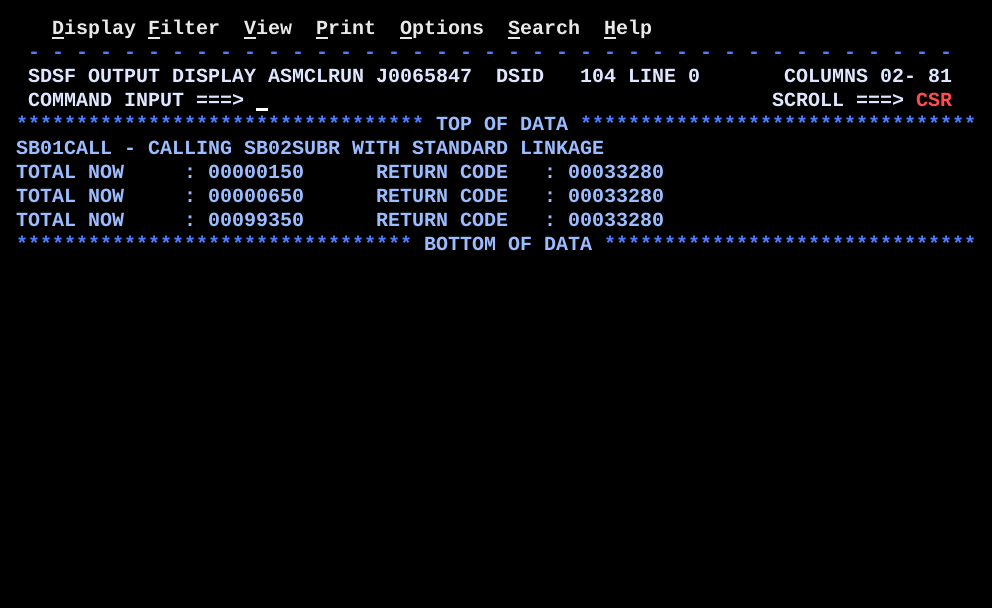

# SB01CALL.asm

## Program Overview

SB01CALL is the main program of a pair. It calls the separate subprogram SB02SUBR three times, each time passing the address of a running total and the address of an amount to add. After every call it prints the total and the value left in R15. The first call is written out by hand (`LA`, `L`, `BALR`), the second and third use the `CALL` macro. A comment block shows the one line that would replace `CALL` to load the subprogram by name with `LINK`.

SB01CALL and SB02SUBR are assembled as two object decks and link-edited into one load module (`SB01CALL`), so the `V`-type constant `=V(SB02SUBR)` and the `CALL` macro are resolved by the linkage editor. Run JCL: `jcl/SB01CALL.jcl`. The companion write-up is `docs/SB02SUBR.md`.

Source lines 1 to 29 (the header and the start of the linkage text) were not in the screenshots. `src/SB01CALL.asm` carries a placeholder block for them so that line numbers stay the same; replace it with the original text.

Program data:

| Field | Value | Used by |
|---|---|---|
| TOTAL | `F`, set to 100 at the start | First parameter of every call; updated by SB02SUBR |
| AMOUNT | `F`, set before each call to 50, 500, -100000 | Second parameter of every call |
| SAVERC | `F` | Holds R15 after each call |
| PARMLST1 | `A(TOTAL)`, then `X'80',AL3(AMOUNT)` | Hand-built parameter list for the first call |
| MSGHDR | `CL50` heading | First output line |

Registers used:

| Register | Role |
|---|---|
| R1 | Address of the parameter list on a call |
| R3 | Work register in `SHOWRC` (total, then return code, for `CVD`) |
| R10 | Return address of `SHOWRC` (`BAL 10,SHOWRC` / `BR 10`) |
| R12 | Base register |
| R13 | Address of `SAVEAREA`; SB02SUBR chains its own save area to it |
| R14 | Return address set by `BALR` or by the `CALL` macro |
| R15 | Entry address of SB02SUBR going in; SB02SUBR's return value coming out |

Output (4 lines):

```
SB01CALL - CALLING SB02SUBR WITH STANDARD LINKAGE
TOTAL NOW     : 00000150      RETURN CODE   : 00033280
TOTAL NOW     : 00000650      RETURN CODE   : 00033280
TOTAL NOW     : 00099350      RETURN CODE   : 00033280
```

The total is at column 17 and the return code at column 47. The return code is 33280 (X'00008200') on all three lines, including the third call, where SB02SUBR sets 4. The cause is in SB02SUBR; see Key Takeaways.



Not assembled or run by Claude: the output above is the output the owner supplied (job J0065847, `DSID 104`).

## How the Program Works

**Linkage and I/O.** Standard entry linkage (`STM`, `LR 12,15`, `USING`, save area chain), `OPEN` of `SYSOUT`, heading line from `MSGHDR`. Exit linkage is `CLOSE`, `L 13,SAVEAREA+4`, `LM 14,12,12(13)`, `SR 15,15`, `BR 14`.

**Call 1 (by hand).**
1. `MVC AMOUNT,=F'50'` sets the amount.
2. `LA 1,PARMLST1` points R1 at the parameter list: word 1 `A(TOTAL)`, word 2 `X'80',AL3(AMOUNT)` (the high-order bit marks the last address).
3. `L 15,=V(SB02SUBR)` loads the entry address of SB02SUBR.
4. `BALR 14,15` puts the return address in R14 and branches to R15.
5. `BAL 10,SHOWRC` prints the line.

**Calls 2 and 3 (`CALL` macro).** `MVC AMOUNT,...` then `CALL SB02SUBR,(TOTAL,AMOUNT)`, then `BAL 10,SHOWRC`. The macro builds the parameter list, loads R1 and R15 and branches with `BALR`.

**SHOWRC.**
1. `ST 15,SAVERC` saves R15 at once, because `PUT` changes it.
2. `MVC OUTMSG,BLANKS` clears the line, then `MVC OUTMSG(16),=C'TOTAL NOW     : '`.
3. `L 3,TOTAL`, `CVD`, `UNPK ZONE,DOUBLE`, `OI ZONE+7,X'F0'`, `MVC OUTMSG+16(8),ZONE`.
4. `MVC OUTMSG+30(16),=C'RETURN CODE   : '`, then the same conversion of `SAVERC` into `OUTMSG+46(8)`.
5. `PUT SYSOUT,OUTMSG` and `BR 10`.

**Execution trace.**

| Call | Method | AMOUNT | TOTAL before | TOTAL after | Sign of result | Return code SB02SUBR sets | RETURN CODE printed |
|---|---|---|---|---|---|---|---|
| 1 | `LA` / `L` / `BALR` | 50 | 100 | 150 | positive | 0 | 33280 |
| 2 | `CALL` | 500 | 150 | 650 | positive | 0 | 33280 |
| 3 | `CALL` | -100000 | 650 | -99350 | negative (`BM` taken) | 4 | 33280 |

## Concepts Demonstrated

- Calling a separate CSECT through the z/OS standard linkage (R1, R13, R14, R15)
- A parameter list of fullword addresses with the high-order bit on the last one
- The same call written by hand and with the `CALL` macro
- `V`-type address constant resolved by the linkage editor
- `LINK` (a supervisor call that loads a program by name) compared with `CALL`, shown only in a comment
- Saving R15 before it is reused
- Two object decks link-edited into one load module

## How the Concepts Are Implemented

| Concept | Implementation |
|---|---|
| Parameter list | `PARMLST1`: `DC A(TOTAL)` and `DC X'80',AL3(AMOUNT)`. `AL3` is a 3-byte address; with the 1-byte `X'80'` it fills one fullword with bit 0 on. |
| Hand-built call | `LA 1,PARMLST1`, `L 15,=V(SB02SUBR)`, `BALR 14,15`. All three are needed: R1 for the parameters, R15 for the entry address, `BALR` to branch and set R14. |
| `CALL` macro | `CALL SB02SUBR,(TOTAL,AMOUNT)` generates the same kind of sequence. `PRINT NOGEN` hides the expansion in the listing. |
| Address resolution | `=V(SB02SUBR)` is an external reference; `SYSLIN` of the link-edit step holds `&&OBJ1` then `&&OBJ2`, which resolves it inside one load module. |
| `LINK` | Only in a comment: `LINK EP=SB02SUBR,PARAM=(TOTAL,AMOUNT)`. It would load the program at run time instead. |
| Return value | `SHOWRC` saves R15 with `ST 15,SAVERC` before `PUT`, then prints it through `CVD`, `UNPK`, `OI`. |
| Save area | `SAVEAREA DS 18F`; SB02SUBR stores this address in word 2 of its own `SUBSAVE` and its own address in word 3 of `SAVEAREA` (two-way chain). |
| Output columns | Total at `OUTMSG+16(8)`, return code label at `OUTMSG+30(16)`, return code at `OUTMSG+46(8)`. |

## Key Takeaways

- The first run abended S0C4 right after the heading line. The hand-built call had `L 15,=V(SB02SUBR)` and `BALR 14,15` but no `LA 1,PARMLST1`. SB02SUBR runs `L 2,0(,1)` on its first instruction, so it used whatever R1 held after `OPEN` and `PUT`, and the address was invalid. The fix is `LA 1,PARMLST1` before the `L 15`. R1 must hold the parameter list address before every call.
- RETURN CODE is 33280 on all three lines. SB02SUBR runs `IC 15,RETCODE` after `LM 14,12,12(13)`. `LM` restores R12 to SB01CALL's base, so the assembled `RETCODE` reference (based on R12) reads a byte from SB01CALL, not from `RETCODE`. `IC` replaces only the low byte of R15, so the upper three bytes are the entry address that `LM` restored. The third call should print 4 and does not. This is inferred from the source and the SYSOUT; the program was not run by Claude. The source is not changed. An untested fix: `SR 15,15` and `IC 15,RETCODE` before the `LM` while R12 is still valid, then `L 13,SUBSAVE+4`, `ST 15,16(,13)`, `LM 14,12,12(13)`.
- The comments say the `CALL` macro sets the high bit of the last address automatically. `CALL` sets it only when `VL` is coded, and `VL` is not coded here. SB02SUBR masks the bit with `N 3,=X'7FFFFFFF'` but never tests it, so the run is the same either way.
- `TOTAL NOW` prints 00099350 for the third call, although the total is -99350. `OI ZONE+7,X'F0'` forces the zone of the last digit to F, so the sign is lost.
- The comment on call 2 ("large enough to push TOTAL over ... NOT triggered") contradicts itself: 500 does not push the total over anything, and the negative check is exercised by call 3.
- `SHOWRC` uses R3 and `PUT`; R10 is the only return register, so `SHOWRC` must not call another routine with `BAL 10`.
