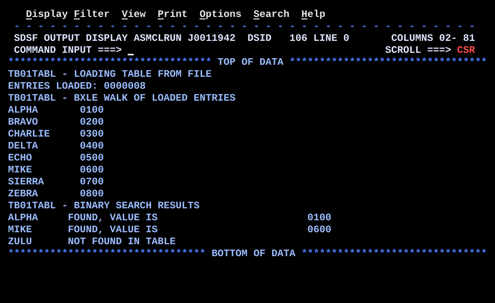

# TB01TABL.asm

## Program Overview

TB01TABL builds a table in storage at run time instead of coding it with `DC`. `TABLE` is empty storage for `MAXENT` (200) entries of 12 bytes (`CL8` key, `CL4` value). `LOADLOOP` reads the sequential file `TABFILE` with `GET` straight into the next free slot and counts the entries in R8; the count is saved in `ENTCNT` at end of file. The program prints the count, then steps through the loaded entries with `BXLE` (the limit is the address of the last entry actually loaded, held in `TABLEND`), then runs a binary search for three keys (`ALPHA`, `MIKE`, `ZULU`). The binary search keeps LOW, HIGH and MID as entry numbers and is correct only because the file is in ascending key order. Output goes to `SYSPRINT`.

Test file: `data/TB01TABL_TABFILE.txt` (8 records x 12 bytes, sorted). Run JCL: `jcl/TB01TABL.jcl` assembles (`ASMA90`), link-edits (`HEWL`), builds `TABFILE` as a temporary dataset from inline data with `IEBGENER`, and runs the program.

Program data:

| Field | Value | Used by |
|---|---|---|
| TABFILE | DCB: `DSORG=PS`, `MACRF=GM`, `DDNAME=TABFILE`, `EODAD=TABEOF`, `RECFM=FB`, `LRECL=12`, `BLKSIZE=0`. 8 records in the test file | `LOADLOOP` |
| TABLE | `DS (MAXENT)CL12`: 200 entries, 2400 bytes; only the first `ENTCNT` are filled | Load, `BXLE` walk, binary search |
| ENTLEN | 12 (EQU, length of one entry) | `LA 7,ENTLEN(,7)`, `LA 2,ENTLEN` |
| MAXENT | 200 (EQU, size of `TABLE`) | `TABLE` definition (the check in `LOADLOOP` uses the literal `=F'200'`) |
| ENTCNT | F, entries actually loaded (8) | Walk setup, binary search |
| TABLEND | F, address of the last loaded entry | `BXLE` limit |
| SRCHLST, NSRCH | 3 keys `CL8`: `ALPHA`, `MIKE`, `ZULU`; count 3 | Binary search outer loop |
| SRCHKEY | CL8, the key being searched | `CLC` against the MID entry |
| MSGHDR1, MSGHDR2, MSGHDR3 | `CL50` headings | `PRTHDR` macro |
| MSGFND, MSGNF | `CL40` `FOUND, VALUE IS` and `NOT FOUND IN TABLE` | Search result lines |
| PRTLINE, BLANKS, ZONE7, DOUBLE | CL80 print line, CL80 blanks, CL7 and D work areas | Output lines, count display |

Test file `TABFILE` (8 records, key `CL8` then value `CL4`, ascending):

| Entry no. | Key | Value |
|---|---|---|
| 0 | ALPHA | 0100 |
| 1 | BRAVO | 0200 |
| 2 | CHARLIE | 0300 |
| 3 | DELTA | 0400 |
| 4 | ECHO | 0500 |
| 5 | MIKE | 0600 |
| 6 | SIERRA | 0700 |
| 7 | ZEBRA | 0800 |

Registers used:

| Register | Role |
|---|---|
| R2 | `BXLE` increment (`ENTLEN`, even register of the R2/R3 pair) |
| R3 | `BXLE` limit (address of the last loaded entry, odd register of the pair); in the search, MID as a byte offset |
| R4 | LOW entry number |
| R5 | HIGH entry number |
| R6 | MID entry number (LOW + HIGH is built here, then halved) |
| R7 | Next free slot while loading; `BXLE` index; address of the MID entry in the search |
| R8 | Entries loaded; later count - 1, then the byte offset of the last entry |
| R9 | Search keys remaining (`BCT`) |
| R10 | Address of the current key in `SRCHLST` |
| R12 | Base register |
| R13 | Save area |

Output (15 lines):

```
TB01TABL - LOADING TABLE FROM FILE
ENTRIES LOADED: 0000008
TB01TABL - BXLE WALK OF LOADED ENTRIES
ALPHA       0100
BRAVO       0200
CHARLIE     0300
DELTA       0400
ECHO        0500
MIKE        0600
SIERRA      0700
ZEBRA       0800
TB01TABL - BINARY SEARCH RESULTS
ALPHA     FOUND, VALUE IS                         0100
MIKE      FOUND, VALUE IS                         0600
ZULU      NOT FOUND IN TABLE
```



## How the Program Works

**Linkage and I/O.** Entry and exit linkage, save area and the `SYSPRINT` DCB follow the earlier programs. `OPEN` opens `SYSPRINT` for output and `TABFILE` for input. The local macro `PRTHDR` (defined before the `CSECT`) clears `PRTLINE`, moves a `CL50` heading into it and writes it; it is called three times.

**Loading.** `LA 7,TABLE` points R7 at the first slot and `SR 8,8` clears the count. Each pass of `LOADLOOP`:
1. `GET TABFILE,0(7)` reads the record directly into the slot R7 points at (move mode, the target is the table).
2. `LA 8,1(,8)` adds 1 to the count.
3. `LA 7,ENTLEN(,7)` moves R7 to the next slot.
4. `C 8,=F'200'` and `BNH LOADLOOP` loop while the count is not above 200. If control falls through, `DC H'0'` stops the program.

At end of file `GET` branches to `TABEOF` (the `EODAD` routine). R8 is intact there, because QSAM keeps R2 to R13. `ST 8,ENTCNT` saves the count. The count is converted (`CVD`, `UNPK ZONE7`, `OI ZONE7+6,X'F0'`) and shown at `PRTLINE+16(7)` after `ENTRIES LOADED: `.

**BXLE walk.** R8 = `ENTCNT`, `BCTR 8,0` gives count - 1, `MH 8,=H'12'` gives the byte offset of the last entry (84), `LA 3,TABLE` and `AR 3,8` give its address, stored in `TABLEND`. R7 = `TABLE`, R2 = `ENTLEN`. Each pass writes the key (`PRTLINE(8)`) and value (`PRTLINE+12(4)`) of the entry R7 points at, reloads R3 from `TABLEND`, and `BXLE 7,2,BXSTEP` adds 12 to R7, compares it with R3 and branches back while R7 is not above R3.

**Binary search.** R10 points at `SRCHLST`, R9 = 3. For each key: R4 = 0 (LOW), R5 = `ENTCNT` - 1 (HIGH). `BSLOOP`:
1. `CR 4,5` and `BH BSNOTFND`: leave when LOW is above HIGH.
2. R6 = LOW + HIGH, `SRA 6,1` halves it: MID entry number.
3. R3 = MID, `MH 3,=H'12'` makes it a byte offset, `LA 7,TABLE(3)` gives the address of the MID entry.
4. `CLC SRCHKEY,0(7)`: `BE BSFOUND`; key low goes to `BSLOWER` (`BCTR 6,0`, `LR 5,6`: HIGH = MID - 1); key high does `LA 4,1(,6)` (LOW = MID + 1). Both go back to `BSLOOP`.

`BSFOUND` builds the line with the key, `MSGFND` at column 11 and the 4-byte value from `8(7)` at column 51. `BSNOTFND` builds the key and `MSGNF` only. `BSPUT` writes the line, `LA 10,8(,10)` moves to the next key and `BCT 9,BSOUTER` repeats for the 3 keys.

**Execution trace, BXLE walk** (`TABLEND` = `TABLE` + 84):

| Pass | R7 before | Entry | R7 after | R7 <= R3 |
|---|---|---|---|---|
| 1 | TABLE | ALPHA | TABLE+12 | branch |
| 2 | TABLE+12 | BRAVO | TABLE+24 | branch |
| 3 | TABLE+24 | CHARLIE | TABLE+36 | branch |
| 4 | TABLE+36 | DELTA | TABLE+48 | branch |
| 5 | TABLE+48 | ECHO | TABLE+60 | branch |
| 6 | TABLE+60 | MIKE | TABLE+72 | branch |
| 7 | TABLE+72 | SIERRA | TABLE+84 | branch (equal) |
| 8 | TABLE+84 | ZEBRA | TABLE+96 | fall through |

**Execution trace, binary search** (8 entries, numbers 0 to 7):

| Key | Pass | LOW | HIGH | MID | MID entry | `CLC` | Next |
|---|---|---|---|---|---|---|---|
| ALPHA | 1 | 0 | 7 | 3 | DELTA | low | HIGH = 2 |
| ALPHA | 2 | 0 | 2 | 1 | BRAVO | low | HIGH = 0 |
| ALPHA | 3 | 0 | 0 | 0 | ALPHA | equal | found, value 0100 |
| MIKE | 1 | 0 | 7 | 3 | DELTA | high | LOW = 4 |
| MIKE | 2 | 4 | 7 | 5 | MIKE | equal | found, value 0600 |
| ZULU | 1 | 0 | 7 | 3 | DELTA | high | LOW = 4 |
| ZULU | 2 | 4 | 7 | 5 | MIKE | high | LOW = 6 |
| ZULU | 3 | 6 | 7 | 6 | SIERRA | high | LOW = 7 |
| ZULU | 4 | 7 | 7 | 7 | ZEBRA | high | LOW = 8 |
| ZULU | 5 | 8 | 7 | | | `CR 4,5` high | not found |

## Concepts Demonstrated

- A table built at run time: empty `DS` storage sized for the worst case, filled from a file
- `GET` in move mode directly into a table slot
- Keeping the real entry count in a register and in storage, separate from the declared size
- `BXLE` with an increment and a limit in an even-odd register pair, bounded by the address of the last loaded entry
- Computing a table address from an entry count (`BCTR`, `MH`, `AR`)
- Binary search on a sorted table with LOW, HIGH and MID entry numbers
- Entry numbers for the bracket arithmetic, byte offsets only when an entry is touched
- A local source macro (`PRTHDR`) defined before the `CSECT`
- A found and a not-found result in the same output loop

## How the Concepts Are Implemented

| Concept | Implementation |
|---|---|
| Table at run time | `TABLE DS (MAXENT)CL12` reserves 2400 bytes with no value. `LOADLOOP` stores one record per slot. |
| Load straight into the table | `GET TABFILE,0(7)` with R7 at the next free slot; `LA 7,ENTLEN(,7)` advances it. No work area and no `MVC`. |
| Real count | `LA 8,1(,8)` per record; `ST 8,ENTCNT` at `TABEOF`. Later code loads `ENTCNT`, never `MAXENT`. |
| End of file | `EODAD=TABEOF` in the DCB. R8 survives the branch because QSAM keeps R2 to R13. |
| `BXLE` limit | `L 8,ENTCNT`, `BCTR 8,0`, `MH 8,=H'12'`, `LA 3,TABLE`, `AR 3,8`, `ST 3,TABLEND`: the address of the last loaded entry. |
| `BXLE` loop | `LA 7,TABLE` (index), `LA 2,ENTLEN` (increment, even register), R3 (limit, odd register); `BXLE 7,2,BXSTEP`. R3 is reloaded from `TABLEND` before every `BXLE`. |
| LOW, HIGH, MID | R4 = 0, R5 = `ENTCNT` - 1, R6 = `LR 6,4`, `AR 6,5`, `SRA 6,1`. |
| MID address | `LR 3,6`, `MH 3,=H'12'`, `LA 7,TABLE(3)`. |
| Three-way decision | `CLC SRCHKEY,0(7)`, `BE BSFOUND`, `BL BSLOWER`, otherwise fall into the LOW = MID + 1 code (`LA 4,1(,6)`). |
| Not found | `CR 4,5` and `BH BSNOTFND` at the top of `BSLOOP`. |
| Search keys | `SRCHLST` holds three `CL8` keys; R10 steps 8 bytes per key (`LA 10,8(,10)`), R9 counts with `BCT 9,BSOUTER`. |
| Heading macro | `MACRO` / `PRTHDR &MSG` / `MEND` before `CSECT`; `PRINT NOGEN` hides the expansions. |
| Count display | `CVD 8,DOUBLE`, `UNPK ZONE7,DOUBLE`, `OI ZONE7+6,X'F0'`, `MVC PRTLINE+16(7),ZONE7`. |
| Result columns | Key at `PRTLINE(8)`, message at `PRTLINE+10(40)`, value at `PRTLINE+50(4)`; walk lines have the value at `PRTLINE+12(4)`. |

## Key Takeaways

- Two sizes: `MAXENT` (how many entries fit) and `ENTCNT` (how many are there). Every routine after the load uses `ENTCNT`. The `BXLE` limit and the HIGH entry number both come from it.
- The binary search is correct only for a file in ascending EBCDIC key order. The program never checks the order. On an unsorted file it would report `NOT FOUND` for keys that are in the table.
- `ZULU` is not found because it is higher than `ZEBRA` (`Z` = `Z`, `U` is higher than `E` in EBCDIC), so LOW passes HIGH.
- The `MAXENT` check is one record late. `C 8,=F'200'` with `BNH` loops back when the count is 200, so the 201st `GET` stores a record in slot 201, which is 12 bytes past `TABLE` (the `TABFILE` DCB follows `TABLE`), before the count 201 reaches `DC H'0'`. Read from the code, not run; the test file has 8 records. The comment says "never overrun".
- The check uses the literal `=F'200'` and `MH` uses `=H'12'` (twice), not `MAXENT` and `ENTLEN`. Changing the `EQU` values does not change these.
- The `BXLE` walk is bottom-tested and runs at least once. With an empty file R8 is 0, `BCTR` makes it -1, R3 becomes `TABLE` - 12 and the first pass prints an unfilled slot before `BXLE` ends the loop. The binary search handles an empty table: HIGH is -1, so `CR 4,5` branches to `BSNOTFND` at once. Not run.
- `BXLE` compares the index with the address of the last entry, not the address after it. Here R7 equals R3 on pass 7 and the loop still branches.
- LOW + HIGH is built in R6 and halved there, so R4 and R5 keep their values. `SRA` keeps the sign; LOW and HIGH only go negative as the empty-table case, where the loop is not entered.
- R3 is used twice with different meanings: `BXLE` limit in the walk, MID byte offset in the search. The search starts after the walk has ended.
- Items after `TABLE` (the two DCBs and the literal pool) must stay within 4096 bytes of the base register. A much larger `MAXENT` would put them out of reach of one base register.
- The comment about "BINSRCH" refers to no label or instruction; the search routine is `BSLOOP`.
- `PRTLINE+10(40)` and `PRTLINE+50(4)` depend on the `CL40` message length, and the heading macro depends on `CL50`.
