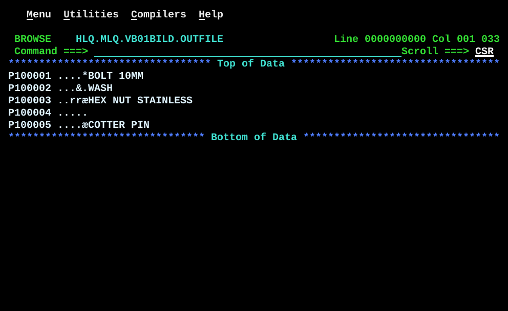

# VB01BILD.asm

## Program Overview

VB01BILD builds a small variable length file, `OUTFILE`, with five records. Each record has a 4-byte RDW (Record Descriptor Word), an 8-byte customer number, a 5-byte packed amount and a name of 12, 5, 20, 0 and 10 bytes. A packed amount and a correct RDW cannot be typed in an ordinary text editor, so the program builds the file for the reader program VB01LOC. It writes in locate mode: `PUT OUTFILE` has no area operand, and the system returns the address of an empty buffer in R1. A DSECT (`VBOUTRECD`) is mapped over that address, and the fields are filled in place.

Run JCL: `jcl/VB01BILD.jcl` assembles (`ASMA90`), link-edits (`HEWL`) and runs the program. The program step defines `OUTFILE` as `HLQ.MLQ.VB01BILD.OUTFILE` with `DISP=(NEW,CATLG,DELETE)`, `SPACE=(TRK,(10,20),RLSE)` and `DCB=(RECFM=VB,LRECL=37,BLKSIZE=0)`. Delete the dataset before a rerun.

Program data:

| Field | Value | Used by |
|---|---|---|
| OUTFILE | DCB: `DSORG=PS`, `MACRF=PL`, `DDNAME=OUTFILE`, `RECFM=VB`, `LRECL=37`, `BLKSIZE=0` | `OPEN`, `PUT`, `CLOSE` |
| VBOUTRECD | DSECT: `OUTRDWLL` H (+0), `OUTRDWFL` H (+2), `OUTCUSTNO` CL8 (+4), `OUTAMOUNT` PL5 (+12), `OUTNAME` 0CL1 (+17) | Every record, through R4 |
| SAVEAREA | 18F | Linkage |

Records built:

| # | OUTCUSTNO | OUTAMOUNT | OUTNAME | Name length | RDW length (`OUTRDWLL`) | Bytes shown in Browse |
|---|---|---|---|---|---|---|
| 1 | `P100001` | 12345 | `BOLT 10MM` (padded to 12) | 12 | 29 | 25 |
| 2 | `P100002` | 500 | `WASH ` | 5 | 22 | 18 |
| 3 | `P100003` | 99999 | `HEX NUT STAINLESS` (padded to 20) | 20 | 37 | 33 |
| 4 | `P100004` | 0 | none | 0 | 17 | 13 |
| 5 | `P100005` | 15099 | `COTTER PIN` | 10 | 27 | 23 |

Registers used:

| Register | Role |
|---|---|
| R1 | Address of the empty buffer, returned by `PUT` in locate mode |
| R4 | Base register for `VBOUTRECD`, copied from R1 for each record |
| R12 | Program base register |
| R13 | Save area address |

Output (5 records, ISPF Browse of `HLQ.MLQ.VB01BILD.OUTFILE`, columns 1 to 33):

```
P100001 ....*BOLT 10MM
P100002 ...&.WASH
P100003 ..rræHEX NUT STAINLESS
P100004 .....
P100005 ....æCOTTER PIN
```

The program writes no SYSOUT. The screen above is the output file in ISPF Browse. Browse does not show the RDW. The 5 packed bytes show as characters: X'5C' is `*`, X'50' is `&`, X'99' is `r`, X'9C' is `æ`, and every other byte is `.`. The dataset name is masked.



## How the Program Works

**Linkage and I/O.** The entry linkage, save area, exit linkage (`BR 14`) and `OPEN`/`CLOSE` follow the same pattern as the earlier programs. The DCB is an output DCB in locate mode (`MACRF=PL`) with `RECFM=VB`. There is no SYSOUT and no `GET`.

**Setup.** `OPEN (OUTFILE,(OUTPUT))` is the only setup. There is no loop: the same statements are coded once for each of the five records.

**Each record.**
1. `PUT OUTFILE` has no area operand. QSAM returns the address of an empty buffer in R1.
2. `LR 4,1` copies the address to R4, because R1 is overwritten by the next system macro.
3. `USING VBOUTRECD,4` maps the DSECT over that address.
4. `MVC OUTRDWLL,=H'n'` sets the RDW length: the name length plus 17.
5. `XC OUTRDWFL,OUTRDWFL` sets the RDW flag halfword to zero.
6. `MVC OUTCUSTNO,=CL8'P10000n'` stores the customer number.
7. `ZAP OUTAMOUNT,=P'n'` stores the amount as `PL5` with a valid sign.
8. `MVC OUTNAME(len),=CLlen'name'` stores the name with an explicit length. Record 4 has no name, so it has no `MVC`.
9. `DROP 4` ends the mapping.

**After the last record.** The fifth record is still in the buffer when the program reaches `CLOSE (OUTFILE)`. `CLOSE` writes it, closes the file, and the exit linkage returns with code 0.

**Execution trace.**

| Record | RDW (hex) | OUTCUSTNO | OUTAMOUNT (hex) | Name (length) | Data bytes (LL - 4) |
|---|---|---|---|---|---|
| 1 | 001D0000 | `P100001 ` | 000012345C | BOLT 10MM (12) | 25 |
| 2 | 00160000 | `P100002 ` | 000000500C | WASH (5) | 18 |
| 3 | 00250000 | `P100003 ` | 000099999C | HEX NUT STAINLESS (20) | 33 |
| 4 | 00110000 | `P100004 ` | 000000000C | none (0) | 13 |
| 5 | 001B0000 | `P100005 ` | 000015099C | COTTER PIN (10) | 23 |

## Concepts Demonstrated

- Variable length records (`RECFM=VB`) and the RDW
- The RDW length field: 4 bytes of RDW plus the data, built by the program
- QSAM locate mode output: `PUT` with no area operand, buffer address in R1
- A DSECT mapped over a buffer the system supplies, with `LR`, `USING` and `DROP`
- Building a test file that contains packed data
- Explicit-length `MVC` for a field whose length differs per record
- A field of length zero
- Literals as the source of constants (`=H'29'`, `=CL8'P100001'`, `=P'12345'`)

## How the Concepts Are Implemented

| Concept | Implementation |
|---|---|
| Variable length file | The DCB has `RECFM=VB,LRECL=37,BLKSIZE=0`. `LRECL=37` is the longest record including its 4-byte RDW: 17 fixed bytes plus a 20-byte name. |
| RDW | `OUTRDWLL DS H` is the length of the whole record, RDW included. `OUTRDWFL DS H` is the flag halfword, set to zero with `XC OUTRDWFL,OUTRDWFL`. |
| Fixed part | 4 bytes RDW, 8 bytes `OUTCUSTNO`, 5 bytes `OUTAMOUNT`: 17 bytes. The comments name the arithmetic: 17 + 12 = 29, 17 + 5 = 22, 17 + 20 = 37, 17 + 0 = 17, 17 + 10 = 27. |
| Locate mode | `MACRF=PL` in the DCB and `PUT OUTFILE` with no area operand. The address of the buffer comes back in R1. |
| Mapping the buffer | `LR 4,1` and `USING VBOUTRECD,4`. The field names then address the buffer as R4 plus the displacement. `DROP 4` ends it before the next `PUT`. |
| DSECT placement | `VBOUTRECD DSECT` follows `LTORG` and is directly before `END`, because a DSECT ends the control section. |
| Packed amount | `ZAP OUTAMOUNT,=P'12345'` moves a 3-byte packed literal into a `PL5` field, clears the leading bytes and stores the sign C. |
| Variable name | `OUTNAME DS 0CL1` marks the start of the name with no storage. Each record uses `MVC OUTNAME(12)`, `OUTNAME(5)`, `OUTNAME(20)` or `OUTNAME(10)` with a literal of the same length. |
| Empty name | Record 4 sets `OUTRDWLL` to 17, fills the three fixed fields and has no `MVC` for the name. |
| Literal lengths | `=CL5'WASH '` and `=CL20'HEX NUT STAINLESS   '` are written with trailing blanks, so the literal length equals the `MVC` length. `CL12'BOLT 10MM'` and `CL10'COTTER PIN'` get their length from the `CL` modifier. |
| Last record | The record set up after the fifth `PUT` is written by `CLOSE (OUTFILE)`. |

## Key Takeaways

- In locate mode the system picks the buffer. Copy R1 to another register at once (`LR 4,1`), because the next macro changes R1.
- The RDW length includes the 4 RDW bytes. Name length plus 17 is correct only because the 4-byte RDW is part of the 17.
- `LRECL=37` is the maximum record length including the RDW. The program does not check the name length: a name longer than 20 bytes would run past the end of the buffer.
- Each record is complete only when the next `PUT` or `CLOSE` runs. The fifth record is written by `CLOSE`, so a missing `CLOSE` loses it.
- `PUT` does not clear the buffer. The program sets every byte inside the record length itself (the 17 fixed bytes and the name bytes), and the RDW length stops the record at the end of the name, so stale buffer bytes are not written.
- A machine `MVC` always moves at least one byte (its length field holds the length minus 1). For an empty name the program does not issue the `MVC`; it just does not move anything.
- Packed data cannot be typed in an editor, so a program builds the file. `ZAP` from a packed literal stores a valid sign, which `AP` and `UNPK` in the reader need. `MVC` of packed data would not do that.
- ISPF Browse does not show the RDW, and it shows packed bytes as characters. The longest line is 33 characters (`LRECL` 37 minus the RDW), which matches `Col 001 033` on the screen. `HEX ON` shows the real bytes.
- `VBOUTRECD` must match the DSECT in VB01LOC byte for byte, and nothing checks it. `VBINRECD` in VB01LOC has the same fields and lengths (H, H, CL8, PL5, 0CL1). Record 4 has an empty name, and VB01LOC does not handle that case (see `docs/VB01LOC.md`).
- The explicit-length `MVC` is correct here because each name length is known at assembly time. A reader that gets the length from the RDW at run time needs `EX`, as the source comments say.
- The source ended with a stray control character (shown as SUB at line 133 in the editor). It is not part of the program and is not in `src/VB01BILD.asm`.
