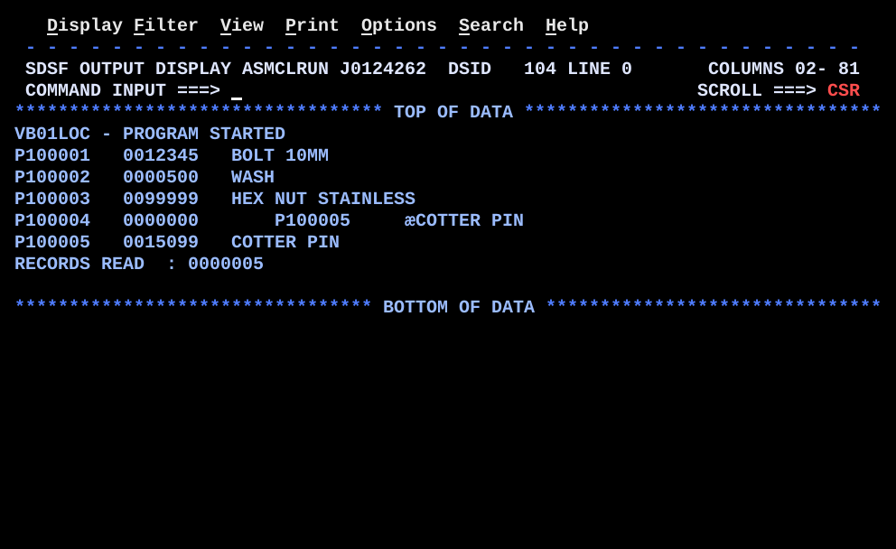

# VB01LOC.asm

## Program Overview

VB01LOC reads the variable length file written by VB01BILD (`INFILE`, `RECFM=VB`, `LRECL=37`) in locate mode: `GET INFILE` has no area operand, and the system returns the address of the next record, RDW included, in R1. A DSECT (`VBINRECD`) is mapped over that address. The name field at the end of each record has a different length every time, so the program works the length out from the RDW and moves the name with `EX`, which takes the length of an `MVC` from a register at run time. The program prints each record on `SYSPRINT` and builds a matching record in `OUTFILE`, also in locate mode (`PUT OUTFILE`, DSECT `VBOUTRECD` over the returned buffer address).

Run JCL: `jcl/VB01LOC.jcl` assembles (`ASMA90`), link-edits (`HEWL`) and runs the program. The program step reads `HLQ.MLQ.VB01BILD.OUTFILE` as `INFILE` and creates `HLQ.MLQ.VB01LOC.OUTFILE` as `OUTFILE` with `DISP=(NEW,CATLG,DELETE)`, `SPACE=(TRK,(10,20),RLSE)` and `DCB=(RECFM=VB,LRECL=37,BLKSIZE=0)`. Delete `OUTFILE` before a rerun. Run VB01BILD first: it creates the input.

Program data:

| Field | Value | Used by |
|---|---|---|
| INFILE | DCB: `DSORG=PS`, `MACRF=GL`, `DDNAME=INFILE`, `EODAD=EOFRTN`, `RECFM=VB`, `LRECL=37`, `BLKSIZE=0` | `OPEN`, `GET`, `CLOSE` |
| OUTFILE | DCB: `DSORG=PS`, `MACRF=PL`, `DDNAME=OUTFILE`, `RECFM=VB`, `LRECL=37`, `BLKSIZE=0` | `OPEN`, `PUT`, `CLOSE` |
| SYSPRINT | DCB: `MACRF=PM`, `RECFM=FB`, `LRECL=80` | Report lines and messages |
| VBINRECD | DSECT: `INRDWLL` H (+0), `INRDWFL` H (+2), `INCUSTNO` CL8 (+4), `INAMOUNT` PL5 (+12), `INNAME` 0CL1 (+17) | Input record, through R3 |
| VBOUTRECD | DSECT: same layout with the `OUT` prefix | Output buffer, through R4 |
| NAMELEN, NAMELENM1 | F, F: name length and name length minus 1 of the current record | `READREC`, `SHOWREC`, `BUILDOUT` |
| EOFSW | CL1, `N` until the `EODAD` routine sets `Y` | `MAINLOOP` |
| RECCNT | PL4, records read | `READREC`, `ALLDONE` |
| PRTLINE, ZONE7 | CL80 print line, CL7 zoned work area | `SHOWREC`, `ALLDONE`, `PRTMSG` |

Registers used:

| Register | Role |
|---|---|
| R1 | Address returned by `GET` or `PUT` in locate mode. Also the message address for `PRTMSG` |
| R2 | DCB address passed to `OPENCHK` |
| R3 | Base register for `VBINRECD`, copied from R1 after `GET` |
| R4 | Base register for `VBOUTRECD`, copied from R1 after `PUT` |
| R5 | Name length, then name length minus 1; the register `EX` takes its length from |
| R6 | Total length of the output record (name length + 17) |
| R10 | Return address of the `BAL` subroutines |
| R12 | Program base register |
| R13 | Save area address |

Output (8 lines, from the SDSF screen of `SYSPRINT`, job name masked):

```
VB01LOC - PROGRAM STARTED
P100001   0012345   BOLT 10MM
P100002   0000500   WASH
P100003   0099999   HEX NUT STAINLESS
P100004   0000000       P100005     æCOTTER PIN
P100005   0015099   COTTER PIN
RECORDS READ  : 0000005

```

The last line is blank. The customer number is at column 1, the amount at column 11 and the name at column 21. Line 5 (`P100004`) is not correct: its name field holds the bytes of the next record, not an empty name. The explanation is in Key Takeaways. The program prints `VB01LOC - PROGRAM ENDED NORMALLY` as its last message, but the screen shows a blank line there.



## How the Program Works

**Linkage and I/O.** The entry linkage, save area and exit linkage follow the same pattern as the earlier programs. Three files are opened: `SYSPRINT` (output), `INFILE` (input) and `OUTFILE` (output). Each `OPEN` is followed by `LA 2,<dcb>` and `BAL 10,OPENCHK`, which tests the open flag in the DCB (`TM DCBOFLGS,DCBOFOPN`) through the `DCBD` dummy section. A failed open goes to `OPNERR1` / `OPNERR2` (message, then `ABEND 999,DUMP`) or directly to `ABENDRTN` for `SYSPRINT`.

**Setup.** `EOFSW` is set to `N`, `RECCNT` to zero, the start message is printed, and `READREC` is called once (priming read).

**Each record (`MAINLOOP`).**
1. `CLI EOFSW,C'Y'` and `BE ALLDONE` leave the loop when the `EODAD` routine has run.
2. `BAL 10,SHOWREC` prints the record.
3. `BAL 10,BUILDOUT` writes a matching record to `OUTFILE`.
4. `BAL 10,READREC` reads the next record, then `B MAINLOOP`.

**READREC.**
1. `GET INFILE` (locate mode): R1 is the address of the next record. At end of file control goes to `EOFRTN`, which sets `EOFSW` to `Y` and returns.
2. `LR 3,1` and `USING VBINRECD,3` map the record.
3. `LH 5,INRDWLL` loads the record length; `S 5,=F'17'` removes the 17 fixed bytes (4 RDW, 8 customer number, 5 amount). R5 is the name length.
4. `ST 5,NAMELEN`, then `BCTR 5,0` and `ST 5,NAMELENM1` store the length and the length minus 1.
5. `DROP 3` and `AP RECCNT,=P'1'`.

**SHOWREC.** Builds `PRTLINE`: customer number (`MVC PRTLINE(8),INCUSTNO`), amount (`UNPK ZONE7,INAMOUNT`, `OI ZONE7+6,X'F0'`, 7 digits at column 11), then `L 5,NAMELENM1` and `EX 5,MVCSHOWN`. The target `MVCSHOWN MVC PRTLINE+20(1),INNAME` has a placeholder length of 1; `EX` replaces its length byte with the low byte of R5.

**BUILDOUT.** `PUT OUTFILE` returns the address of an empty buffer; `LR 4,1` and `USING VBOUTRECD,4` map it. R6 = `NAMELEN` + 17 is stored with `STH 6,OUTRDWLL`; `XC OUTRDWFL,OUTRDWFL` zeros the flag halfword; `MVC OUTCUSTNO,INCUSTNO` and `ZAP OUTAMOUNT,INAMOUNT` copy the fixed fields; `EX 5,MVCBUILD` copies the name with the length from `NAMELENM1`. `DROP 3` and `DROP 4` follow `MVCBUILD`.

**ALLDONE.** Prints `RECORDS READ  : ` and the count, prints the end message, closes `INFILE`, `OUTFILE` and `SYSPRINT`, and returns with code 0. The last output record is written by `CLOSE (OUTFILE)`.

**Execution trace.** The input is the file built by VB01BILD.

| Record | RDW length (LL) | NAMELEN (LL - 17) | NAMELENM1 (R5) | Length byte used by `EX` | Bytes moved by the `MVC` | Output RDW length |
|---|---|---|---|---|---|---|
| 1 | 29 | 12 | 11 | X'0B' | 12 | 29 |
| 2 | 22 | 5 | 4 | X'04' | 5 | 22 |
| 3 | 37 | 20 | 19 | X'13' | 20 | 37 |
| 4 | 17 | 0 | -1 | X'FF' | 256 | 17 |
| 5 | 27 | 10 | 9 | X'09' | 10 | 27 |

## Concepts Demonstrated

- `RECFM=VB` records and the RDW as the only source of each record's length
- QSAM locate mode input: `GET` with no area operand, record address in R1
- QSAM locate mode output: `PUT` with no area operand, empty buffer address in R1
- Two DSECTs active at once on two registers (R3 input, R4 output)
- `EX` to run an `MVC` whose length is decided at run time
- The length minus 1 form that `EX` needs, produced with `BCTR`
- A zero length DSECT field (`DS 0CL1`) that only marks where the variable part starts
- `EODAD=` to handle end of file in a locate mode loop
- Why a length of zero is a special case for `EX`

## How the Concepts Are Implemented

| Concept | Implementation |
|---|---|
| Variable length input | `INFILE DCB ...,MACRF=GL,EODAD=EOFRTN,RECFM=VB,LRECL=37,BLKSIZE=0`. `LRECL=37` is the longest record including the RDW. |
| Record length from the RDW | `LH 5,INRDWLL` loads the 2 byte binary length; `S 5,=F'17'` leaves the name length. |
| Locate mode input | `GET INFILE` has no area operand. `LR 3,1` saves the address before R1 is reused, and `USING VBINRECD,3` maps the record. |
| Locate mode output | `PUT OUTFILE` has no area operand. `LR 4,1` and `USING VBOUTRECD,4` map the empty buffer; the record is written by the next `PUT` or by `CLOSE`. |
| Separate output DSECT | `VBOUTRECD` has the same layout as `VBINRECD` but its own field names, so the two `USING`s in `BUILDOUT` do not share names. |
| `EX` | `L 5,NAMELENM1`, `EX 5,MVCSHOWN` and `EX 5,MVCBUILD`. The targets `MVC PRTLINE+20(1),INNAME` and `MVC OUTNAME(1),INNAME` have length 1, which assembles to a length byte of zero; `EX` ORs the low byte of R5 into it. |
| Length minus 1 | `BCTR 5,0` after `S 5,=F'17'`. |
| Variable field marker | `INNAME DS 0CL1` and `OUTNAME DS 0CL1` use no storage; they give a name to displacement 17. |
| RDW of the output record | `A 6,=F'17'`, `STH 6,OUTRDWLL`; `XC OUTRDWFL,OUTRDWFL`. |
| Packed amount | `ZAP OUTAMOUNT,INAMOUNT`, not `MVC`, so the sign is valid. `UNPK ZONE7,INAMOUNT` shows 7 of the 9 digits. |
| End of file | `EOFRTN` is named in `EODAD=`; it sets `EOFSW` to `Y`; `MAINLOOP` tests it with `CLI`. |
| Open check | `OPENCHK` maps `IHADCB` on R2 (`USING IHADCB,2`) and tests `TM DCBOFLGS,DCBOFOPN`. `DCBD DSORG=PS,DEVD=DA` is directly before `END`. |
| DSECT placement | `VBINRECD`, `VBOUTRECD` and `DCBD` follow `LTORG` and are directly before `END`. |

## Key Takeaways

- A record with an empty name breaks the program. For record 4, `NAMELEN` is 0, `BCTR` gives -1 (X'FFFFFFFF'), and `EX` ORs the low byte X'FF' into the length byte. The `MVC` moves 256 bytes, not 0 or 1.
- On the screen, line 5 shows the effect: the 256 bytes are taken from `INNAME` of record 4, which is the start of record 5 in the same block (RDW, `P100005`, the amount, `COTTER PIN`). They appear at column 25 of the `P100004` line.
- The `MVC PRTLINE+20(256),...` is longer than `PRTLINE` (80 bytes). By the layout in the source (`PRTLINE`, `ZONE7`, `BLANKS`, `MSGSTRT`, `MSGEND`, `MSGOPN1`), it overwrites the 196 bytes after `PRTLINE`, which include `BLANKS`, `MSGSTRT` and all of `MSGEND`. The end message does not appear; a blank line is printed instead. The bytes that came after record 5 in the buffer are not shown on the screen, so what was stored in `MSGEND` is not known.
- `BUILDOUT` uses the same -1 for record 4. The output record still has RDW length 17, because `STH` uses `NAMELEN`, so the 256 byte move writes past the end of the record in the buffer but not into the record. `OUTFILE` was not browsed, so its content is not shown here.
- The source comments say a length of 0 in the register is a harmless one byte move, and that production code checks the length before `EX`. The check is left out. An empty name makes the register -1, not 0, so the empty name case is unsafe. VB01BILD builds record 4 with an empty name for this case; the VB01LOC output shows the reader does not handle it.
- A fix is to test `NAMELEN` before the `EX` (for example `LTR 5,5` / `BZ` after the `S`, and skip the move), or to treat a length of 0 as no move. The source is not changed here; the fix is made in VB02FIX (`docs/VB02FIX.md`).
- In locate mode R1 is overwritten by the next system macro, so `LR 3,1` and `LR 4,1` come first. Two active `USING`s need two DSECTs with different field names.
- The record count and the other 4 name lengths are correct: 12, 5, 20 and 10 bytes moved, and `RECORDS READ  : 0000005`.
- `LRECL=37` on a `VB` DCB is the longest record, RDW included, not the length of each record.
- `UNPK ZONE7,INAMOUNT` shows the 7 lowest digits of the 9 digit field. An amount over 9999999 would lose its high digits.
- The program was run once with the VB01BILD data. Only record 4 exercises the empty name case.
