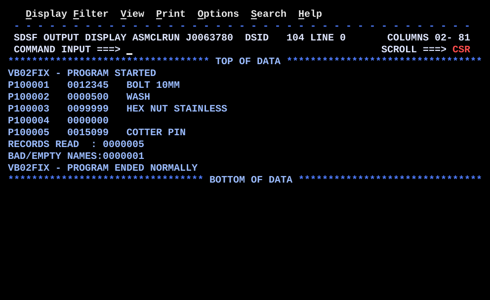
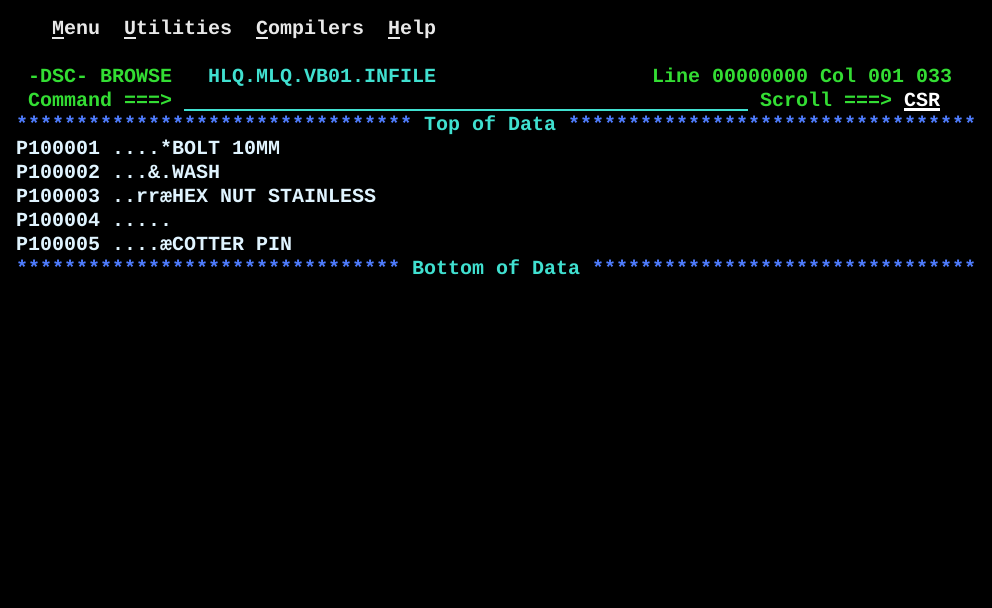

# VB02FIX.asm

## Program Overview

VB02FIX is VB01LOC with the empty-name defect fixed. It reads the variable length file `INFILE` (`RECFM=VB`, `LRECL=37`) in locate mode, prints each record on `SYSPRINT` and builds a matching record in `OUTFILE` (locate mode, DSECT `VBOUTRECD` over the buffer). The name length is still taken from the RDW and the name is still moved with `EX`. The change is in `READREC`: the computed length is tested before it reaches `EX`, and `SHOWREC` and `BUILDOUT` skip the `EX` when the length was rejected.

Run JCL: `jcl/VB02FIX.jcl` assembles (`ASMA90`), link-edits (`HEWL`) and runs the program. The program step reads `HLQ.MLQ.VB01.INFILE` as `INFILE` (`DISP=SHR`) and creates `HLQ.MLQ.VB02.OUTFILE` as `OUTFILE` with `DISP=(NEW,CATLG,DELETE)`, `SPACE=(TRK,(10,20),RLSE)` and `DCB=(RECFM=VB,LRECL=37,BLKSIZE=0)`. Delete `OUTFILE` before a rerun. The input has the same 5 records VB01BILD builds.

Program data (changes from VB01LOC in bold):

| Field | Value | Used by |
|---|---|---|
| INFILE | DCB: `DSORG=PS`, `MACRF=GL`, `DDNAME=INFILE`, `EODAD=EOFRTN`, `RECFM=VB`, `LRECL=37`, `BLKSIZE=0` | `OPEN`, `GET`, `CLOSE` |
| OUTFILE | DCB: `DSORG=PS`, `MACRF=PL`, `DDNAME=OUTFILE`, `RECFM=VB`, `LRECL=37`, `BLKSIZE=0` | `OPEN`, `PUT`, `CLOSE` |
| SYSPRINT | DCB: `MACRF=PM`, `RECFM=FB`, `LRECL=80` | Report lines and messages |
| VBINRECD / VBOUTRECD | DSECTs: `xxRDWLL` H, `xxRDWFL` H, `xxCUSTNO` CL8, `xxAMOUNT` PL5, `xxNAME` 0CL1 | Input record on R3, output buffer on R4 |
| NAMELEN, NAMELENM1 | F, F: name length and name length minus 1 | `READREC`, `SHOWREC`, `BUILDOUT` |
| **NAMEOK** | CL1: `Y` = length is safe for `EX`, `N` = skip the `EX` | `READREC` sets, `SHOWREC` and `BUILDOUT` test |
| EOFSW | CL1, `N` until the `EODAD` routine sets `Y` | `MAINLOOP` |
| RECCNT | PL4, records read | `READREC`, `ALLDONE` |
| **BADCNT** | PL4, records whose name length was zero or rejected | `READREC`, `ALLDONE` |
| PRTLINE, ZONE7 | CL80 print line, CL7 zoned work area | `SHOWREC`, `ALLDONE`, `PRTMSG` |

Registers used: the same as VB01LOC (R1 macro address, R2 DCB for `OPENCHK`, R3 input DSECT, R4 output DSECT, R5 name length then length minus 1, R6 output record length, R10 `BAL` return, R12 base, R13 save area).

Output (10 lines, from the SDSF screen of `SYSPRINT`, job name masked):

```
VB02FIX - PROGRAM STARTED
P100001   0012345   BOLT 10MM
P100002   0000500   WASH
P100003   0099999   HEX NUT STAINLESS
P100004   0000000
P100005   0015099   COTTER PIN
RECORDS READ  : 0000005
BAD/EMPTY NAMES:0000001
VB02FIX - PROGRAM ENDED NORMALLY
```

The customer number is at column 1, the amount at column 11 and the name at column 21. Line 5 (`P100004`) now has an empty name, and the end message is printed. `BAD/EMPTY NAMES:` has no blank before the count because the literal is exactly 16 characters and the count is moved to `PRTLINE+16`.



Input file, `HLQ.MLQ.VB01.INFILE` (ISPF Browse, no RDW shown):



Output file, `HLQ.MLQ.VB02.OUTFILE` (ISPF Browse):


The two Browse screens show the same 5 lines, so `OUTFILE` is a copy of `INFILE`: record 4 is `P100004` with a packed amount of zero and no name bytes.

## How the Program Works

**Linkage and I/O.** As in VB01LOC: three files opened, each followed by `LA 2,<dcb>`, `BAL 10,OPENCHK` and a branch on failure. `RECCNT` and the new `BADCNT` start at zero, the start message is printed and `READREC` is called once (priming read).

**Each record (`MAINLOOP`).** `CLI EOFSW,C'Y'` and `BE ALLDONE`, then `BAL 10,SHOWREC`, `BAL 10,BUILDOUT`, `BAL 10,READREC` and `B MAINLOOP`.

**READREC (changed).**
1. `GET INFILE`, `LR 3,1`, `USING VBINRECD,3`.
2. `LH 5,INRDWLL` and `S 5,=F'17'` give the name length in R5.
3. `LTR 5,5` sets the condition code from R5. `BZ NAMEZERO` handles a length of zero. `BM NAMEBAD` handles a negative length (a damaged RDW). `C 5,=F'256'` and `BH NAMEBAD` reject a length over 256, the most one `MVC` can move.
4. Safe path: `ST 5,NAMELEN`, `BCTR 5,0`, `ST 5,NAMELENM1`, `MVI NAMEOK,C'Y'`, `B RRCOMMON`.
5. `NAMEZERO`: stores `NAMELEN` = 0, `NAMELENM1` = 0 (unused), sets `NAMEOK` to `N` and adds 1 to `BADCNT`.
6. `NAMEBAD`: sets `NAMELEN` and `NAMELENM1` to 0 with `MVC` from `=F'0'`, `NAMEOK` to `N`, and adds 1 to `BADCNT`.
7. `RRCOMMON`: `DROP 3` and `AP RECCNT,=P'1'`.

**SHOWREC.** Builds `PRTLINE` as before. `CLI NAMEOK,C'Y'` and `BNE SHOWPUT` skip the `L 5,NAMELENM1` and `EX 5,MVCSHOWN` when the name is empty or rejected, so the name area stays blank.

**BUILDOUT.** The RDW length is `NAMELEN` + 17 as before (17 for an empty name). `CLI NAMEOK,C'Y'` and `BNE BUILDBR` skip the `EX 5,MVCBUILD`; the output record has a valid RDW and no name bytes.

**ALLDONE.** Prints `RECORDS READ  : ` with `RECCNT`, `BAD/EMPTY NAMES:` with `BADCNT`, the end message, closes the three files and returns with code 0.

**Execution trace.**

| Record | RDW length (LL) | NAMELEN | Test result | NAMEOK | Bytes moved by the `MVC` | Output RDW length |
|---|---|---|---|---|---|---|
| 1 | 29 | 12 | positive, not over 256 | Y | 12 | 29 |
| 2 | 22 | 5 | positive | Y | 5 | 22 |
| 3 | 37 | 20 | positive | Y | 20 | 37 |
| 4 | 17 | 0 | `BZ NAMEZERO` | N | none (`EX` skipped) | 17 |
| 5 | 27 | 10 | positive | Y | 10 | 27 |

## Concepts Demonstrated

- Validating a run-time length before `EX` uses it
- `LTR` to set the condition code from a register without changing it
- `BZ`, `BM`, `BH` after `LTR` and `C`: zero, negative and too-long cases separated
- The 256 byte limit of `MVC` as a range check
- A flag (`NAMEOK`) that carries the result of one check to later routines
- A counter (`BADCNT`) for rejected records, printed at end of job
- Locate mode input and output with two DSECTs, as in VB01LOC

## How the Concepts Are Implemented

| Concept | Implementation |
|---|---|
| Test before use | `LTR 5,5` directly after `S 5,=F'17'` in `READREC` |
| Zero length | `BZ NAMEZERO`: counted, flagged `N`, no `EX` |
| Negative length | `BM NAMEBAD`: treated as an empty name |
| Over the limit | `C 5,=F'256'`, `BH NAMEBAD` |
| Length minus 1 | `BCTR 5,0` only on the safe path |
| One place for the check | Only `READREC` tests the length; `SHOWREC` and `BUILDOUT` test the `NAMEOK` flag |
| Counting rejected records | `AP BADCNT,=P'1'` in both reject paths; `UNPK ZONE7,BADCNT`, `OI ZONE7+6,X'F0'` in `ALLDONE` |
| Safe fallback values | `NAMELEN` and `NAMELENM1` set to 0 so a later routine never reads a stale length |

## Key Takeaways

- The defect in VB01LOC: for an empty name `BCTR` turns 0 into -1, `EX` uses the low byte X'FF', and the `MVC` moves 256 bytes. VB02FIX tests the length first, so `EX` never sees 0 or a negative value.
- The check is made once, where the value is computed. `SHOWREC` and `BUILDOUT` test one byte (`NAMEOK`) and do not repeat the arithmetic.
- The SYSOUT confirms the fix: line 5 is `P100004   0000000` with a blank name, no data from record 5 appears on it, and `VB02FIX - PROGRAM ENDED NORMALLY` is printed. In VB01LOC that line was blank because the overrun had destroyed `MSGEND`.
- `OUTFILE` was browsed this time: record 4 is `P100004` with no name, as in the input.
- `BAD/EMPTY NAMES:0000001` counts record 4. An empty name is a legal record, but the program counts it with the rejected ones; the source comment says this is for demonstration.
- A length over 256 can only occur with a damaged RDW, since `LRECL=37` limits the name to 20 bytes. Only the zero path was exercised by the test data; the negative and over-256 paths were not run.
- `LTR 5,5` is a test only; R5 is unchanged. `C 5,=F'256'` uses a literal that goes into the pool at `LTORG`.
- The program was assembled and run once with the VB01BILD data.
